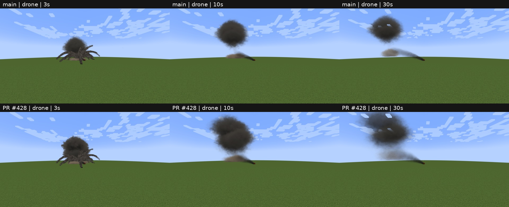
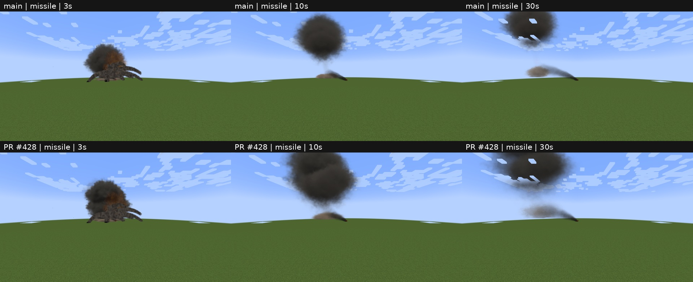
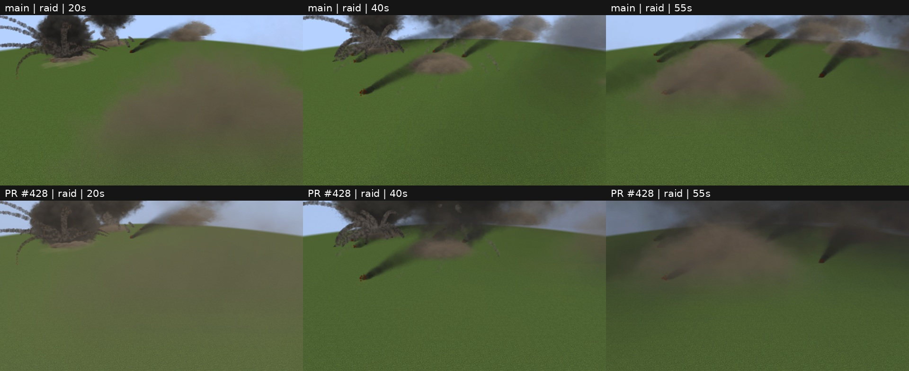
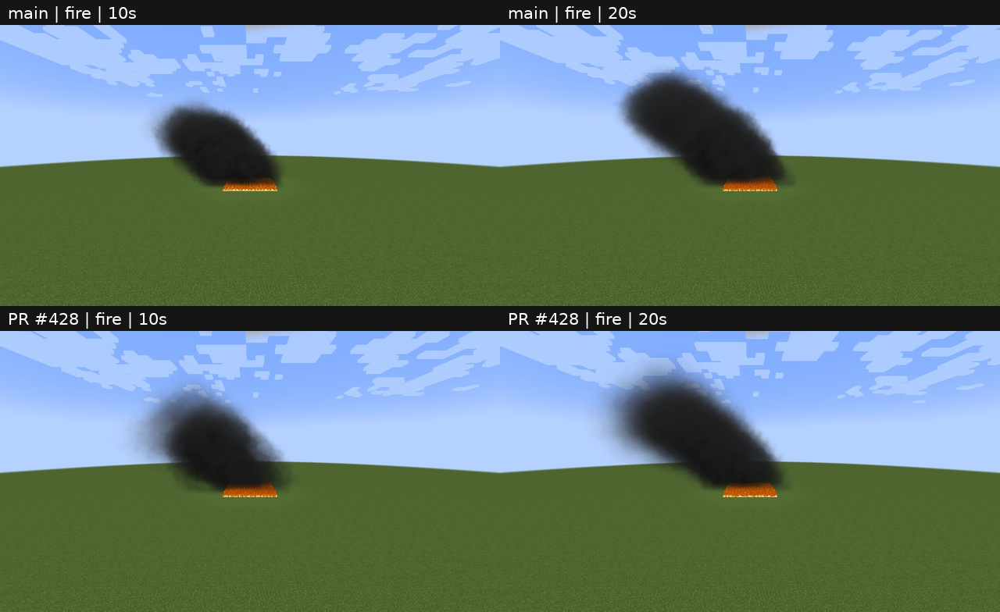

# SM / PR #428 sandbox evidence

Baseline main e592f2ff, candidate 3c7208bb. 1280x720; no shaders; quiet power mode.
Contact sheets: main on top, PR below. Raw PNG files are copied unchanged; capture manifests contain actual ages.

