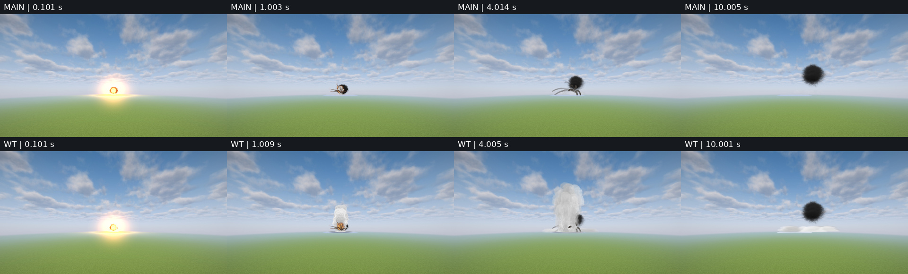
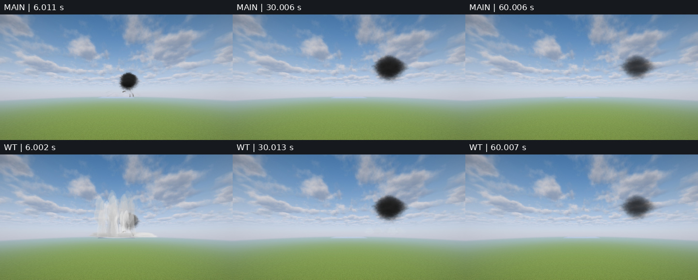
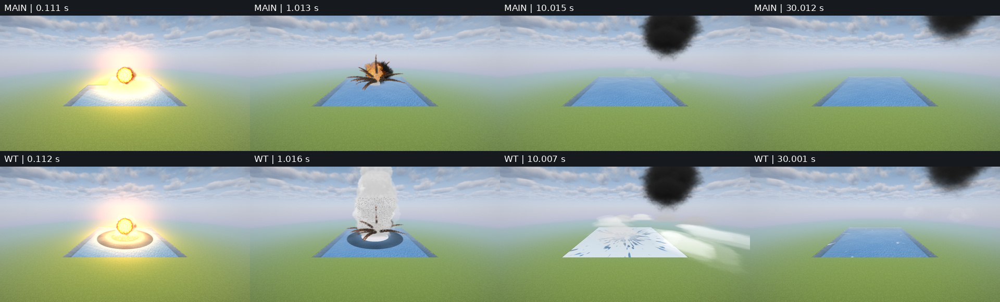
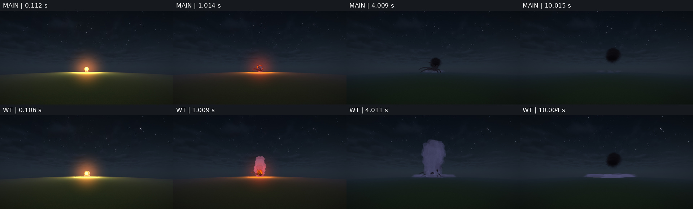
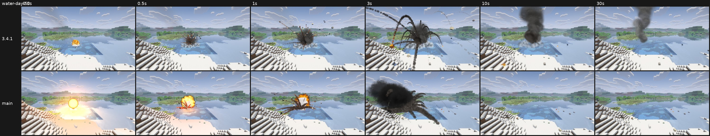
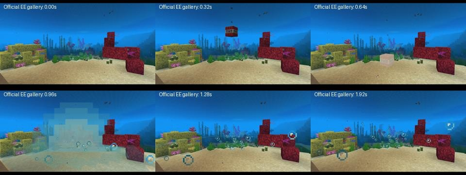

# WT — water strike review evidence

**Latest: [final visual polish, 9ebb5e75](polish.md)**. The original core evidence below is retained as capture and CI history.

## Existing solutions

| Available work | What it provides | Decision |
| --- | --- | --- |
| [Explosive Enhancement / Reforged](https://modrinth.com/mod/explosive-enhancement-forge) | Underwater bubbles, a shockwave and blast particles. [Official underwater gallery animation](https://cdn.modrinth.com/data/OSQ8mw2r/images/80dd67cf47911226d5a5c99bcd1d6d8f6900971a.gif). | Useful visual reference. The published underwater shot is a submerged view, not a surface plume. It does not replace a charge/depth driven plume, falling water and foam on the surface. No dependency added. |
| [Particular](https://github.com/Leclowndu93150/Particular) | Entity-entry water splashes and ambient effects. | Reuses neither the blast model nor its energy/depth input; outside this effect. |
| Incoming `SmokePuffs` / `WaterDecal` | Sorted, six-way lit spray clubs; water-only foam/wave compositing, including Iris. | Reuse the existing renderers. No new renderer or mod dependency. |

## What the patch changes

The old `WaterBlast` used nuclear Baker scaling for ordinary charges: a 50 kg surface charge gave a roughly 14 m plume, mostly inside its fireball and smoke. The model was called, and its clubs reached the existing sorted particle renderer. The old event had no water-surface foam/wave submission at all. The sandbox also always sent a grass blast, so it could not reproduce a water hit directly.

The patch uses Swisdak's conventional-charge table for height/radius, ballistic jets for rise and return, the existing mist model after landing, and the existing water compositor for foam and waves. A submerged charge's spray starts at the surface rather than at the charge. The sandbox adds `blast drone 1 0 water`, a local 65×65-block pond with four water blocks; the nominal POND extent is 64 and both endpoints are included.

## Sources and limits

- [Swisdak, NSWC/WOL TR 76-116, 1978](https://semspub.epa.gov/work/01/550573.pdf), chapter 14, table 14: plume height/radius versus scaled charge depth. The table is a safety envelope. Dividing by chapter 13's margins (1.4 height, 1.3 radius) is an **estimate**, not a measured correction for table 14. Surface contact is the zero-depth row; partially submerged charge geometry is an approximation. The first row gives ~78 m for 50 kg, ~113 m for 150 kg, ~39 m for 6.4 kg. The scan is saved locally in `mod/run/wt-WT-dl/epa.pdf`.
- Rise and return: gravity, `g = 9.80665 m/s²`, ignoring drag for the bulk jets. A Shahed's fastest vertical jet peaks after ~4 s and returns by ~8 s. Jet spread, cone sampling and equal mass shares are marked estimates; sprite extent is a rendering approximation to the plume envelope.
- Mass: the existing Baker water/energy reference, scaled to the conventional plume's height. Same energy fraction across scales is an estimate, as are drop size, the mist fraction and foam lifetime.
- [WEC-Sim wave theory](https://wec-sim.github.io/WEC-Sim/main/theory/theory.html): group velocity `dω/dk` from `ω² = gk tanh(kD)`. Small-amplitude wave model outside the initial cavity; wavelength from plume size is an estimate. Local client water depth is used; unloaded water defaults to a surface hit in deep water. No bottom topography, refraction or nonlinear cavity simulation.
- No nuclear water model or audio code changes.

## Capture provenance

Captured 23 Oct 2026. WT is 7ea5c239, based on main 4498ecfc. The matched sandbox pair uses Iris + Complementary Unbound r5.9.3, the same seed, pond, camera and effect ages. `main` is commit 4498ecfc with only the two devtest sandbox command files copied from WT to make the same pond and blast packet. Production effect code remains main.

The RV2 reference pair is an existing production-pack recording of 3.4.1 and the earlier main at the same pond/camera and ages. It is a separate environment from the sandbox and is labelled as such. Its audio is the whole strike, not an isolated water-splash stem.

## Local checks

- Final `./gradlew --daemon build`: 1220 JUnit tests, zero failures/errors/skips; 7 `WaterBlastTest` tests. The wave test checks the analytical group velocity against a numerical derivative of dispersion at five water depths.
- Final `./gradlew runGameTestServer -PgametestOnly=blast_ground_under`: 1/1 passed, including the water surface rather than the bottom.
- The earlier, broader `surface_drone` run failed 7/7 with `работа ударов идёт`: the shared impact queue was still running at the 400-tick timeout. WT changes only client effects and sandbox devtest code, not that server destruction path. It is recorded here, not counted as a passing check. The affected water-surface GameTest above is green.
- Logs on the laptop: `mod/run/wt-WT-dl/final-check.log` (green), `validation.log` (initial broad run).

## CI diagnostic retained for the reviewer

The first full CI on b093cb56 failed `surface_missile_nearby` (oak planks). An isolated diagnostic on that head passed 4/6 new-world runs; a separate main diagnostic passed 6/6. The failed isolated cases left a nominal 0.60-radius plank standing, at different random world coordinates. **The cause has not been established.** These runs are not a passing validation and are not replaced by the later green runs. WT has no production server changes, and the only devtest changes are in the client sandbox; the destruction code and these server tests are unchanged. This is relevant test debt for the reviewer, outside the water-effect patch.

- [Initial full CI](https://github.com/zentixua/incoming/actions/runs/40030887973)
- [WT diagnostic: 4/6](https://github.com/zentixua/incoming/actions/runs/40031769352)
- [main diagnostic: 6/6](https://github.com/zentixua/incoming/actions/runs/40031806708)

After rebase onto main's AGENTS.md-only commit, production code is unchanged from the locally tested patch. Final full CI is reported separately below; no assertions or test thresholds were weakened.

## Observed frames and author verdict

| Age | Observed in WT | Compared with main |
| --- | --- | --- |
| 0.1 s | The flash dominates the first frame. | Comparable opening flash. |
| 1 s | A white column rises above the burning impact; the close view shows a dark leading wave ring around a white foam patch. | Main has small spray at the foot, mostly inside fire and debris. |
| 4 s | A substantial, textured water column remains above the smoke, with individual spray clods. At night it is lit by the moon after the fire has cooled. | Main's low column has already fallen; its fire/smoke/debris dominate. |
| 6–10 s | The column falls away; low mist spreads and drifts, foam covers much of the small pond. | The water aftermath is much more legible. |
| 30–60 s | Foam fades; the late shots show the residual mist and smoke dispersing. | The water addition fades rather than becoming a permanent marker. |

Author visual verdict: the water sequence is more legible and more substantial than current main and the existing 3.4.1 water reference. The flash is comparable; the rise, falling curtain and surface aftermath provide the improvement. This is the author's comparison, awaiting independent Claude review.

**Scale qualification for review:** the ~78 m value and ~4 s apex describe the model's fastest jet centre. The Gaussian spray clubs have a soft outline above and beside their centres; their visible boundary is broader than the centre trajectory. The tests assert centre height and optical depth, not a pixel-exact outer silhouette. The report's empirical uncertainty and the Gaussian representation should be assessed together when judging the apparent plume size.

The close camera deliberately crops the top of the column to show the water surface. The pond is only 65 blocks wide: the wave leaves it by the later frames and the foam is clipped to actual water. The world-time-dependent wind was not frozen between takes, so smoke drift is uncontrolled. Shaderpack/sky/water, payload seed, camera and requested ages match. Captures were made in quiet power mode; this is not a performance benchmark.

Warm-up takes are excluded from the comparison: the first WT warm-up requested 0.1 s but reached 0.507 s during initial rendering. All published series use the warmed renderer; exact ages are in the capture JSON and contact-sheet labels. JPEG review copies are quality 96, without colour/contrast changes; capture JSON retains the original PNG filenames. Original PNGs remain in each sandbox's `fx/out` directory on the laptop.

### Matched sandbox frames

Full frames and capture JSON: [WT day](wt_day), [main day](main_day), [WT close](wt_near), [main close](main_near), [WT night](wt_night), [main night](main_night).

### Existing 3.4.1 / earlier-main reference

This production-pack pair has its own matching camera and ages. It is not a matched-camera three-version comparison with the flat sandbox. See the original water plume/foam at 1–10 s and the newer sandbox column/aftermath separately.

### Community reference

The official animation shows a brief underwater blast, a wave and bubbles below the surface. It is useful for bubble/detail presentation; this published view does not demonstrate a rising surface column. Source attribution and the original animation are in the existing-solutions table above. No claim of a controlled head-to-head test with that mod is made.

### Audio

- [WT WAV](wt_day/wt_day.wav): stereo, 48 kHz, 12.0 s, peak 11248/32768, zero clipped samples.
- [main WAV](main_day/main_day.wav): stereo, 48 kHz, 12.0 s, peak 11565/32768, zero clipped samples.
- [Existing 3.4.1 reference audio](rv2-341.ogg), [earlier main reference audio](rv2-main.ogg).

The new WAVs start at effect age zero and include propagation delay to the same 170 m camera. They are complete strike mixes, not isolated splash recordings. No audio code/assets changed. Signal checks are not a listening review; WAVs are provided for the independent reviewer.

## Final CI and environment

After rebase onto #429, local `build` passed 1220 tests. The water-surface GameTest was already green; #429 changes flight lanes, not water surface sampling. [Current full CI](https://github.com/zentixua/incoming/actions/runs/40036795174) is green after a failed-shard rerun. Attempt 1 failed `heavyzonelodsgowiththefront`: a nuclear LOD copy was sent seven ticks after its deadline. That nuclear/server code is unchanged by WT; the cause was not fixed in this water patch. The rerun and the earlier diagnostics above are retained for review. No test assertions were weakened.

Both sandbox runs retained the same shaderpack compatibility warnings (`BIOME_PALE_GARDEN`, `BIOME_SULFUR_CAVES`, `endFlashIntensity`) and missing narrator/flite warning. Iris and Complementary were active in both captures. There were no water-effect exceptions in either run.

Both owned clients were stopped and the GPU lease released. No personal instance, worlds, settings, game servers, modpack dependencies or release were changed.
