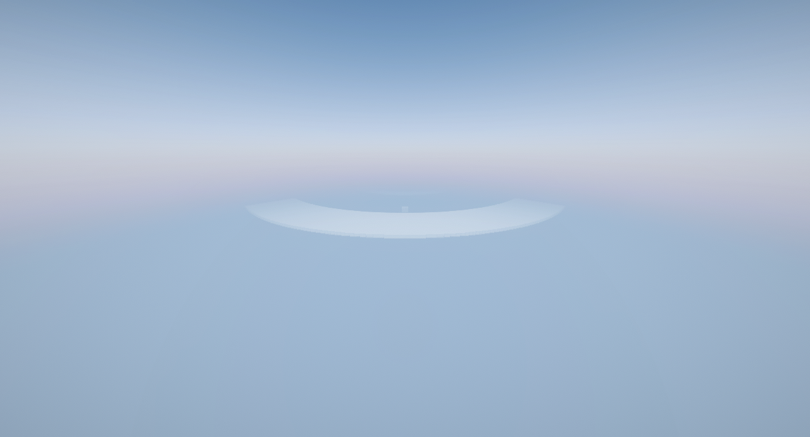
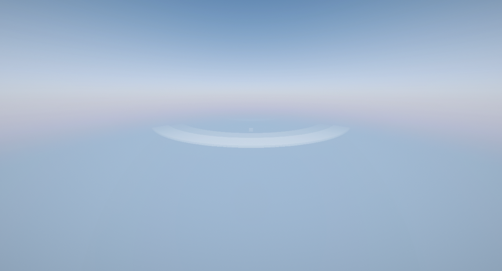
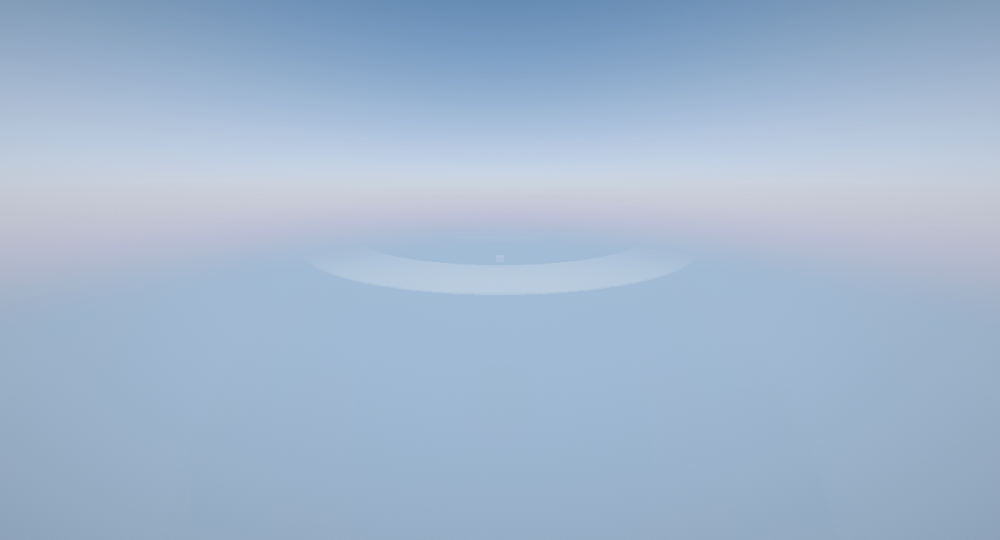
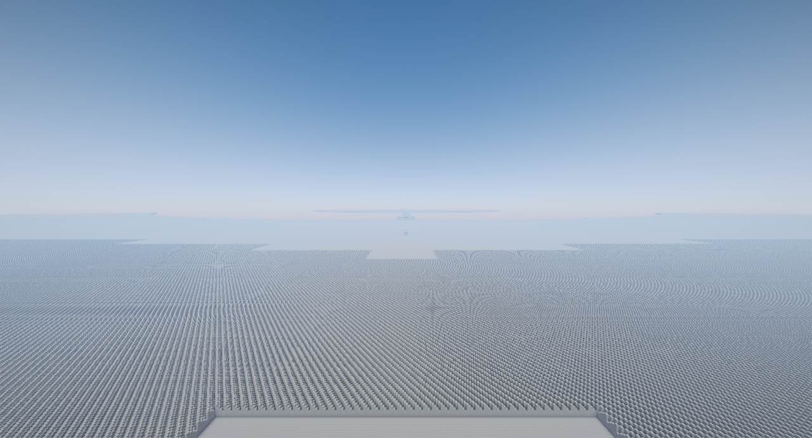

# MT-B1 client LOD buffer experiment

Companion evidence for [PR #561](https://github.com/zentixua/incoming/pull/561), following #557 at `638c18597`. The measurement script, raw logs and frames live only on this orphan evidence branch. The opt-in development scenario and its CPU ownership regressions are excluded from release jars. No yield ceiling, normal player flow, Voxy/LSS implementation, or renderer is changed by the probe.

## Method and limits

- Installed Voxy 0.2.16 through Roxy 0.4.1, LSS 0.20.0, RTX 4060, 1280×692 actual frame (1280×720 requested window); exact installed-jar hashes are in `gate-jars.json`. The run copies the shader and Voxy configuration into its own directory, uses a fresh timestamped flat world, disables LSS generation there, and never opens a player world. The GPU lease and nested compositor isolate it from Artem's game and desktop/audio.
- The input envelope is the near-side 90° sector between 0.8 and 1.0 times the model's optimal-airburst 5 psi ground radius, for 15/100/1000 kt. This is approximately 9% of the heavy disk, not the entire zone or a real city. Every fixture is a 64 m concrete/glass tower changing into low rubble. The full-column runs transmit all 24 sections, including air; four structural sections change. The final run uses the same existing wire format to send only the four changed sections, after a verified full baseline; newly empty sections are included. This isolates transport/ingestion, not ruin planning, physical collapse, lighting calculation, or disk settlement.
- The integrated server uses real development S2C packets and explicitly round-trips their existing column codec (integrated connections may otherwise bypass byte encoding). This measures local delivery, not WAN bandwidth/loss. Preparation emits at most 16 analytic row headers per tick; a distance heap merges them without scanning the zone. The window holds at most 1024 columns / 48 MiB of encoded data. Decoded sections, Voxy's internal storage, Minecraft heap and rendering are separate allocations, not covered by that reservation.
- An intact baseline is ingested first. The next phase fixes a burst time ten seconds ahead, and every column's due time is `Detonation.arrivalTicks` at effects scale 1 / wave speed 0.25. Neither delivery nor client frame rate can move it. The client holds early columns and uses the existing `VoxyIngest.accept` only when due, at most 32 columns (768 transmitted sections) per pass, waiting for Voxy's reported queue to drain between passes.
- Submission timings include column decode and calls to `rawIngest`; acceptance and a zero queue are not renderer completion. Approximately 33 database witnesses per phase read existing public Voxy methods on a worker. A separate three-pixel depth witness attempts to observe the outermost central tower disappearing in the real Voxy render target; its readback overhead is logged. Screenshots have game-clock timestamps. Frame timing includes instrumentation and screenshot captures and is not a production FX benchmark.
- Stale replay uses LSS's real public `dispatchColumn` with intact data and timestamp 1. Its consumer returns void: Incoming cannot veto delivery to Voxy. Two overwrite/reapply cycles retain one authoritative ruin column locally. The first deliberately holds stale data for 42 ticks to photograph it; the second repairs promptly and captures successive frames. Database repair alone does not prove an invisible renderer transition or protection against later replays/eviction/reconnect.
- Six CPU tests cover immutable deadlines, late/out-of-order delivery, stop/refire, taken-work ownership and never-returning reads (10,000 refires / 64 reservations), plus bounded panorama enumeration. They prove the prototype ledger's invariants, not every production asynchronous reader.

## Reproduction

`prepare-client.sh` records the isolated launch setup. Run preparation through `tools/laptop_job.sh`, take the GPU with `INCOMING_GPU_OWNER=<session> tools/gpu_lease.sh take --wait`, and launch the generated script only through `tools/laptop_job.sh --gpu` and `tools/nested_kwin.sh` as in `run-client.sh`. Set `INCOMING_SCENARIO=lod-buffer`, `INCOMING_VOXY=1`, `INCOMING_LSS=1`, `INCOMING_SHADERS=1`. Paths/owner in the archived scripts name the measured worktree and must be changed for another checkout. Compile development classes before starting the client; do not hot-reload code during a measurement.

`analyse.py <client-run-directory>` parses `lod-probe/events.tsv`. `analysis.json` records all three runs; `analysis-first.json`, `analysis-clear.json`, and `analysis-sections.json` separate the diagnostic, clear full-column and changed-section runs. The final run adds JVM argument `-Dincoming.lodProbe.changedOnly=true` to the generated launch argument file before starting the client. Clear runs use shader option `CLOUD_STYLE_DEFINE=0`; all changes are in disposable run directories. Full local build and touched GameTest logs, final CI checks, and the shared gate report are archived here. `SHA256.json` verifies each archived input.

## Result

See `MT-B1-gate.md` for the verdict and measured table. Do not infer a passed atomic-activation or 1 Mt whole-zone gate from the existence of this prototype.

## Selected frames

Final four-section run: [15 kt baseline](runs/client-20261104-004322/screenshots/panorama_15_0_complete.png), [15 kt ruined](runs/client-20261104-004322/screenshots/panorama_15_1_complete.png); [100 kt baseline](runs/client-20261104-004322/screenshots/panorama_100_0_complete.png), [100 kt ruined](runs/client-20261104-004322/screenshots/panorama_100_1_complete.png).

| 1 Mt before front | 1 Mt mid-front |
|---|---|
|  |  |

| 1 Mt after | Deliberately stale LSS column |
|---|---|
|  |  |

The two clear runs’ 90-frame prompt-repair sequences are archived as lossless RGB videos (the first diagnostic video remains local); `pack_replay.py` verifies every decoded frame against the original PNG's RGB frame hash. Playback is a fixed 90 FPS for inspection, not a timing measurement: exact capture ticks are in each run's event log. `replay_pixels.py` measures a fixed strip through the reinstated tower; its contrast is a local visibility check, not a universal screen-difference metric. Original PNGs remain in the disposable local runs; selected PNGs and all replay frame pixels are archived here.

Archived PNGs are losslessly recompressed by `archive.py`; decoded mode, size and every pixel byte are asserted identical before writing the Git object. The manifest hashes the archived bytes.
