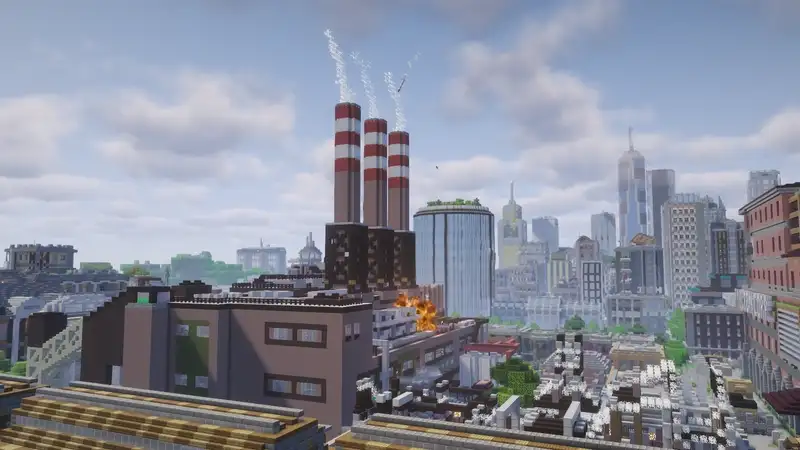
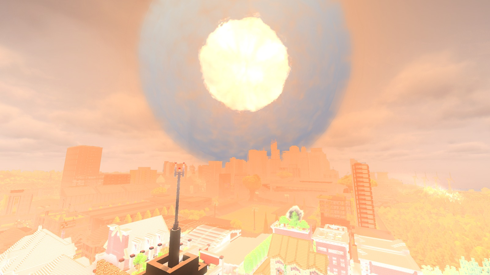

# Incoming

Air strikes that look and feel real, from the flash to the aftermath.

[Русский](README.ru.md)

Incoming brings cinematic air strikes to Minecraft 1.21.1, with one block representing one meter at the target by default.
Light arrives before sound; blast damage follows the charge, fires start from heat and fuel, and smoke rises and drifts with the wind.
A nuclear strike unfolds from flash and rising fireball through blast wave and mushroom cloud to ruins.

## Features

- **The impact:** the fireball lights nearby ground and walls, glass shatters, fragments strike and the blast breaks blocks according to their material and cover. Dust and smoke grow from the impact and drift with the wind; fuel left in the crater keeps burning.
- **Blackout:** strike a transformer substation to cut electric lights in its district.

- **Nuclear strikes:** flash, rising fireball, mushroom cloud, blast wave, fires and ruins. Ground bursts leave a crater and fallout downwind. Nuclear warheads fit the ICBM, cruise missile and B-2 bomb; operator-only by default.

- **Air defense and sirens:** sirens warn players near a target. A SAM shoots down hostile drones, cruise missiles and B-2s; it cannot intercept Grad rockets or ICBMs.
- **Shahed-136:** a drone for single strikes or salvos.
- **Lancet:** circles above the target, with a camera for choosing where to dive.
- **Cruise missile:** flies low over the terrain, then climbs and dives into the target.
- **Grad:** fires unguided rockets across an area.
- **B-2:** drops a bunker buster that penetrates the ground before exploding.
- **ICBM:** carries a nuclear warhead to the target after a warning period.
- **Fixed launchers:** load ammunition, assign a target and fire with redstone.
- **Strike Designator:** choose targets through binoculars or on the console map, set salvos and routes, or watch through a projectile's camera.

## Requirements and dependencies

**Minecraft 1.21.1 · NeoForge 21.1.264+ · Java 21.** Incoming is required on the server and every client.
No other mods are required.

Create, Create Aeronautics with Sable, Distant Horizons, Voxy through Roxy and Iris are optional.
See [compatibility and supported versions](docs/guide/compatibility.md).

## Installation

Install NeoForge for Minecraft 1.21.1, then put the [Incoming jar](https://github.com/zentixua/incoming/releases/latest)
in `mods`. For multiplayer, install the same version on the server and every client.
Start with the [player guide](docs/guide/README.md).

## FAQ

**Fabric or Forge?** This version is for NeoForge only.

**Other Minecraft versions?** Incoming currently supports 1.21.1.

**Can I use it in a modpack?** Yes, under the GPL-3.0 license.

**Client or server?** Both. It works in single-player, LAN worlds and dedicated servers. Use the same Incoming version on both sides.

**How demanding is it?** Large salvos, nuclear strikes and shaders can be demanding. See [performance help](docs/guide/faq.md#troubleshooting).

**Can I protect builds?** The owner can restrict launches and disable destruction and fires in [world settings](docs/guide/settings.md#world-settings). Destruction is on by default.

## Links

[Player guide](docs/guide/README.md) · [Issues](https://github.com/zentixua/incoming/issues) · [Source](https://github.com/zentixua/incoming)

## License and credits

Made by ZentixUA. [GPL-3.0-only](LICENSE). [Sound credits](SOUND-CREDITS.md) · [Asset credits](tools/bake_fx/SOURCES.md).
Includes sable-companion and FastNoiseLite by Jordan Peck (MIT); fireball and smoke textures use JangaFX CC0 simulations.
