# FLASHCAM comparison frames

Review evidence for PR #646. Main: fa0ece44b. Branch: cb41a2c00.
Identical client-only sandbox fixture, Complementary Unbound, 1280×720 output. No image processing.
1 Mt night: 4550 m ground range, HOB 2400 m, time 16000, wave scale 0.35.
15 kt day: 1400 m ground range, HOB 240·cube-root(15) m. Sky/block light: sealed 0/0, window 8/0, torch 0/9.
Open main frames include chat; branch chat was cleared. Chamber construction waits for loaded chunks in both.

| Scene | Main | Branch |
|---|---|---|
| 1mt, 1 s | 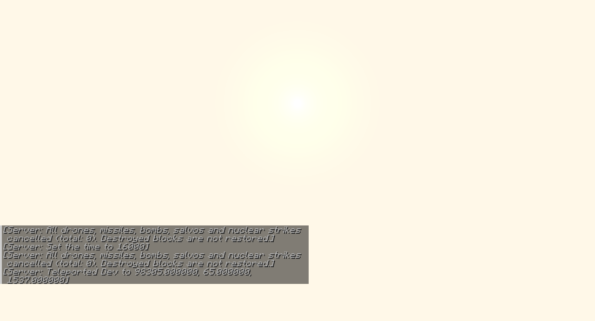 |  |
| 1mt, 3 s | 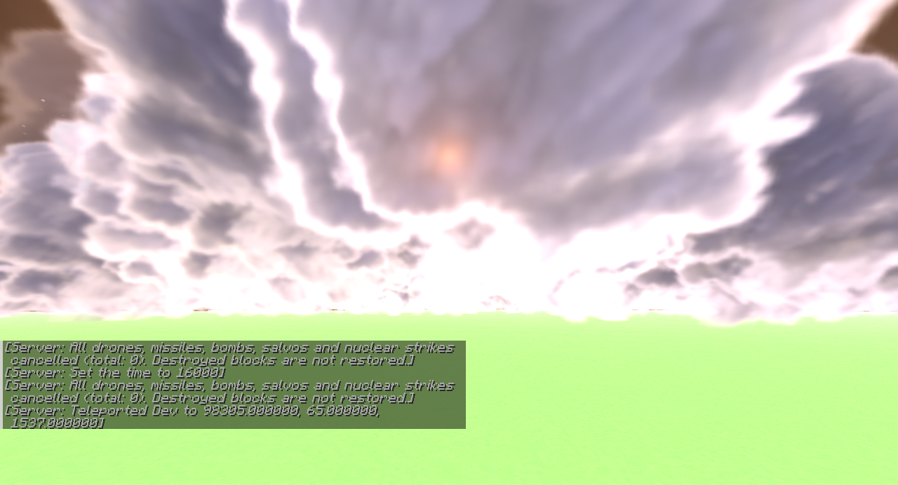 | 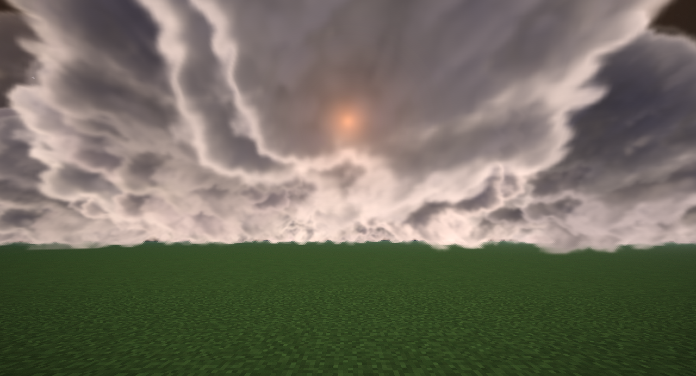 |
| 1mt, 10 s | 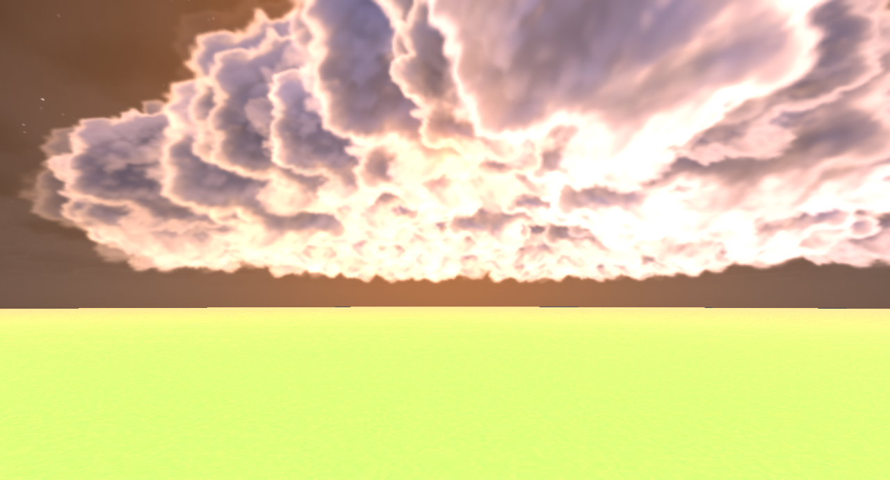 | 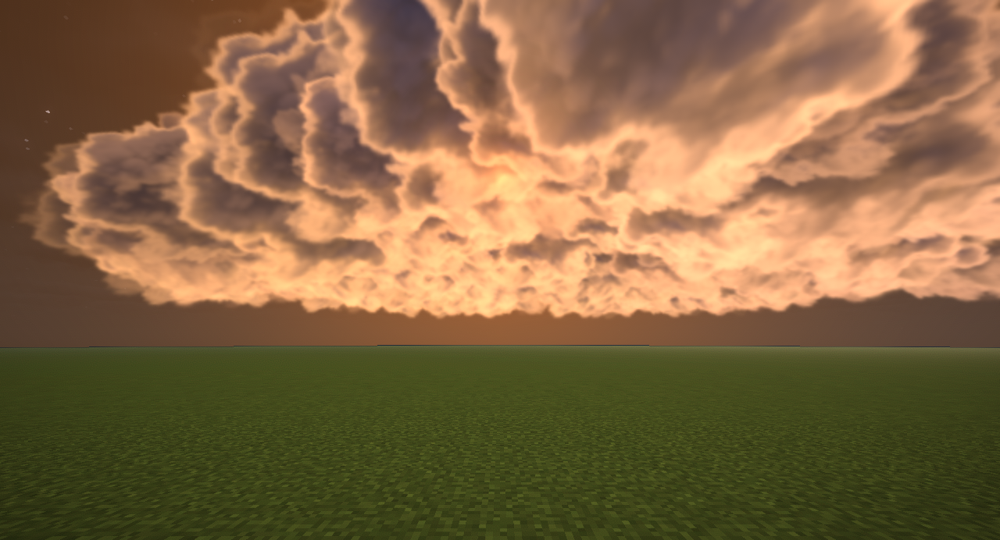 |
| 1mt, 20 s | 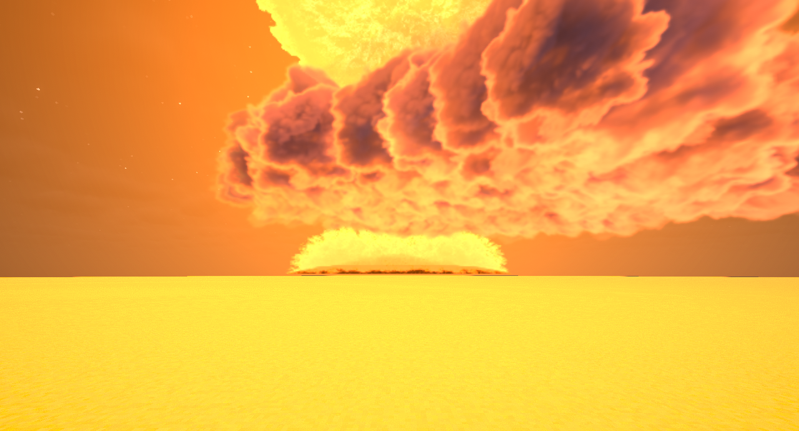 | 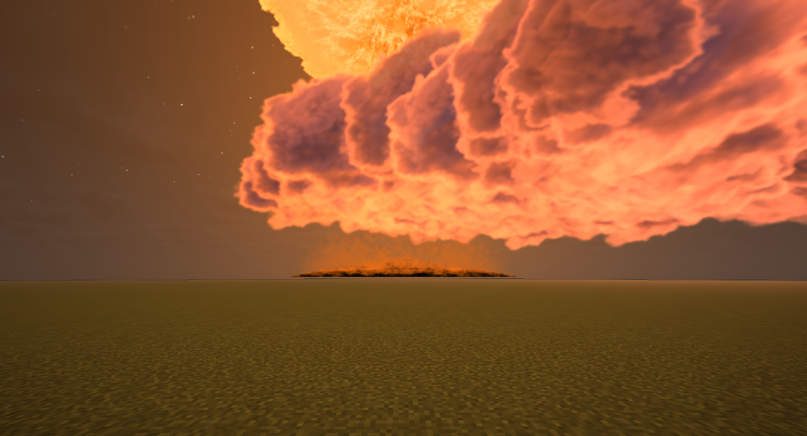 |
| 1mt, 33 s | 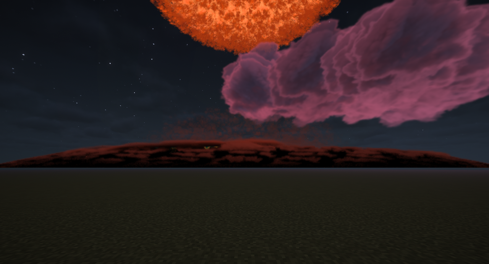 | 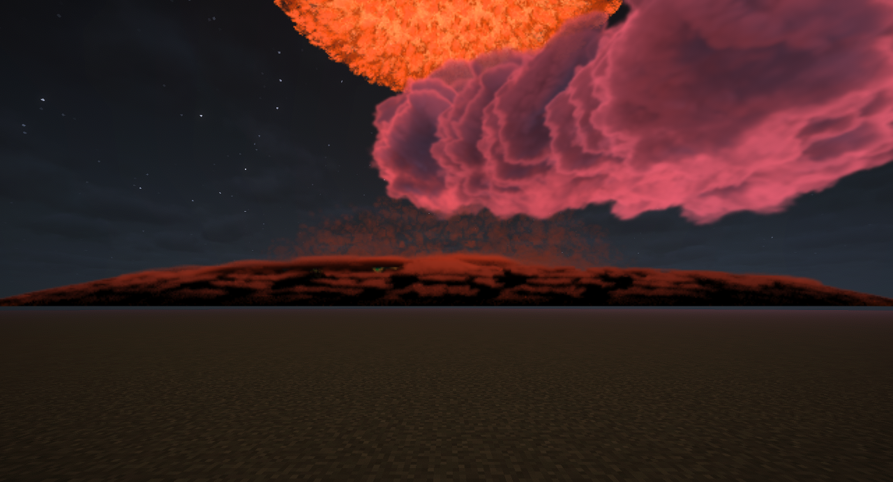 |
| 15kt, 1 s | 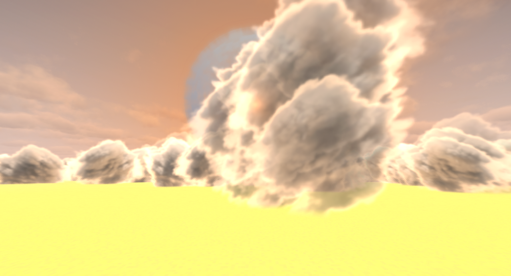 | 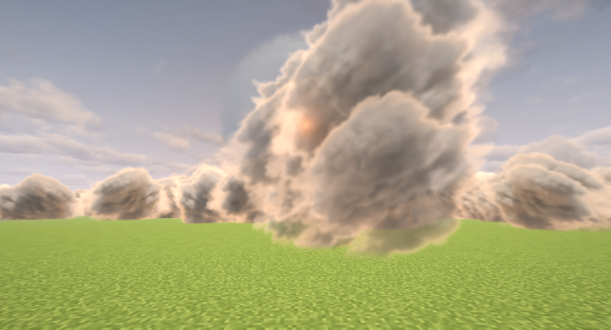 |
| 15kt, 3 s | 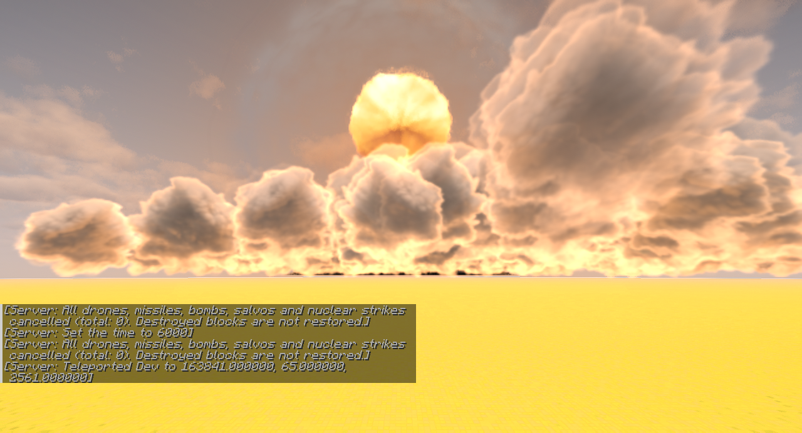 | 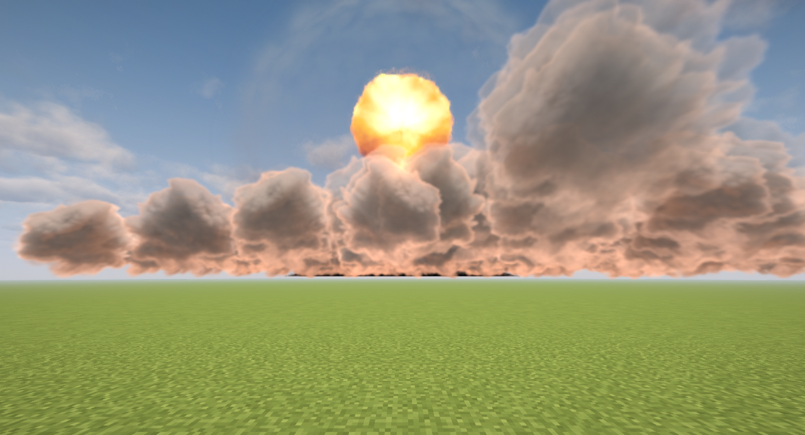 |
| 15kt, 6 s | 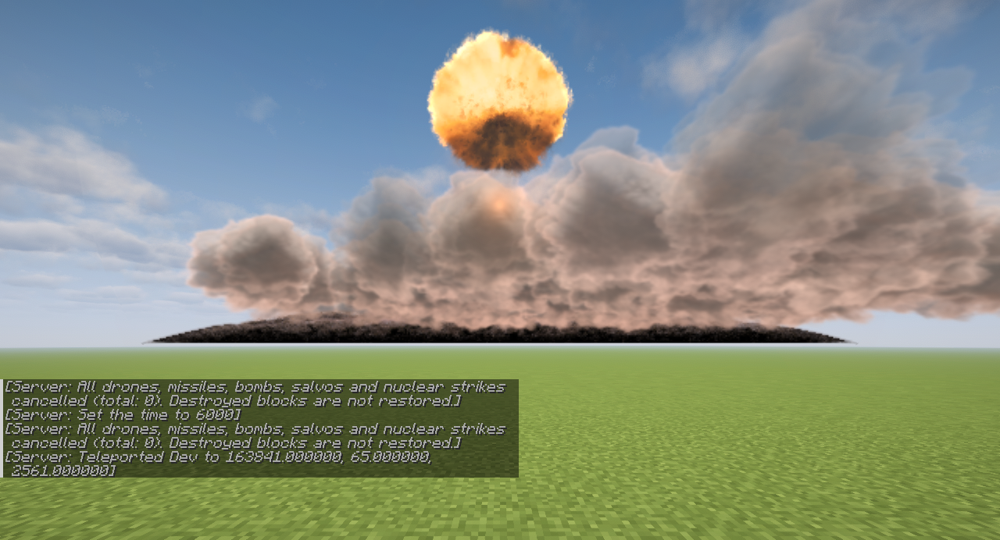 | 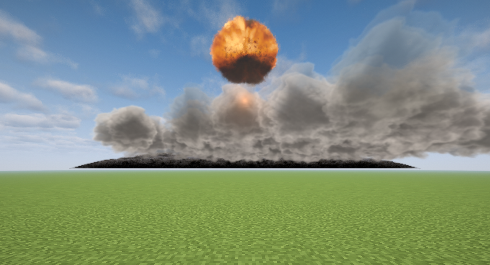 |
| sealed_room, 1 s |  | 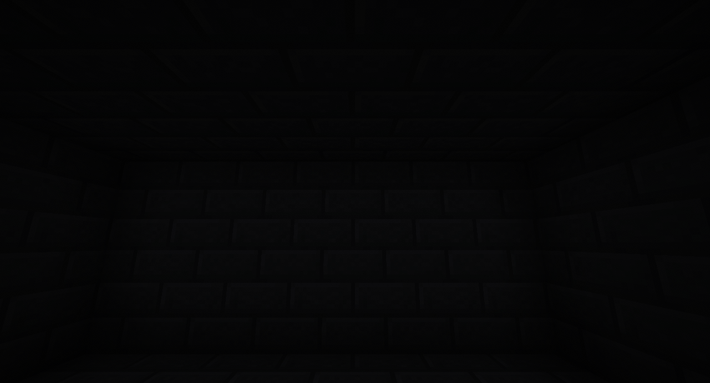 |
| window_room, 1 s |  |  |
| torch_room, 1 s |  | 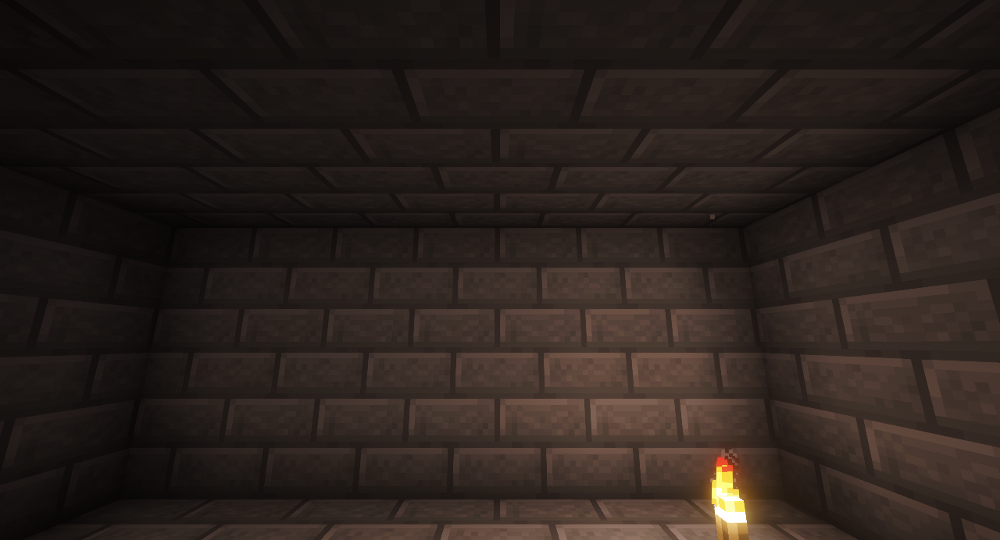 |
