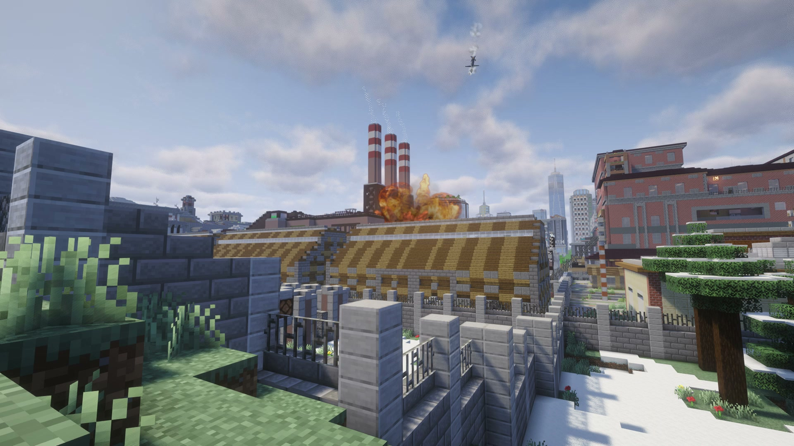
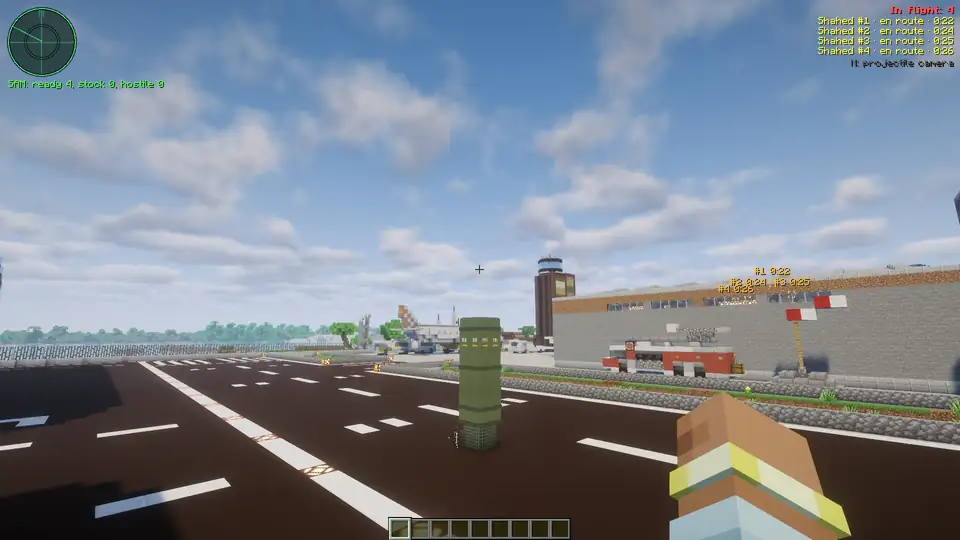

# Incoming

Incoming adds air strikes and air defense to Minecraft 1.21.1 on NeoForge.

<!-- MEDIA-RR2-HERO: replace with the gameplay GIF/video from PR #518; existing animation until then. -->

[Download](https://github.com/zentixua/incoming/releases/latest) · [Player guide](docs/guide/README.md) · [Русский](README.ru.md)

Pick a target from the ground or plan a route on the map. Watch from the projectile's camera, or stay behind and
listen for it. At a distance, you see the explosion before you hear it.

## Choose your strike

### Shahed-136

Send a drone toward a building or send several in a salvo. To follow a moving target, keep it in view through the
drone's camera.

### Lancet

Circle above the target, look through the camera, then pick where to dive.

### Cruise missile

Plot a route around a hill or an air defense site. The missile flies low, climbs near the target and dives into it.

### Grad

Choose an area and fire a rocket salvo. The unguided rockets spread across it; they won't chase a moving target.

### B-2 and bunker buster

Call in a bomber to drop a bomb that digs into the ground before exploding.

### Nuclear ICBM

Launch an ICBM and wait for the warning countdown. The flash comes first, then the blast wave rolls through the
landscape beneath a rising mushroom cloud. A ground burst leaves a crater and radioactive fallout downwind.
Cruise missiles and B-2 bombs can carry nuclear warheads too. Nuclear launches are operator-only by default.

Weapons are built at one block per meter. Flight speeds are reduced by default so you can see the approach.
The [guide](docs/guide/not-physical.md) explains the game rules and limits.

## Defend your base

Place a SAM under open sky and keep it supplied with interceptors. It can shoot down hostile drones, cruise
missiles and B-2s. It cannot intercept Grad rockets or ICBMs. Stay nearby to keep it working; sirens warn players near a target.

For a base of your own, link a fixed launcher to the designator, load it and fire with redstone.
Destroying a transformer substation cuts the electric lights in its district.

## Your first strike

1. Install **Minecraft 1.21.1, NeoForge 21.1.264+ and Java 21**. Put the [Incoming jar](https://github.com/zentixua/incoming/releases/latest) in `mods`. No other mods are required.
2. Craft a [Strike Designator](docs/guide/designator.md#crafting): a spyglass, two iron ingots, redstone dust and a compass. Craft a [Shahed munition](docs/guide/munitions.md) and keep it in your inventory. In Creative, take the designator from the Incoming tab; ammunition is free.
3. Find an open test area away from builds. Hold right-click, select Shahed with the mouse wheel, aim at the ground in the distance and left-click to launch.
4. Press `N` for the projectile camera; Shift brings you back. Shift + right-click opens the console for salvos; `,` opens the targeting map.

## Compatibility

| Mod / platform | What you need to know |
|---|---|
| **NeoForge, Minecraft 1.21.1** | Required. Install the same Incoming version on the server and every client. |
| Create | Optional. Adds Create-based munition recipes; without it, use vanilla ingredients. |
| Create Aeronautics + Sable | Optional. Target flying craft; explosions can break and push them. |
| Distant Horizons | Optional. Distant terrain on the targeting map and updates to damaged terrain. |
| Voxy through Roxy | Optional, client only. Distant terrain for the map and for watching strikes. |
| Iris | Optional. Nuclear effects work with shaders. |

See [compatible versions and setup](docs/guide/compatibility.md) before adding the optional mods.

## FAQ

**Single-player or server?** Both, including a world opened to friends. Everyone needs the same version of Incoming.

**Will it slow the game down?** Large salvos, nuclear strikes and shaders can be demanding. Start small, lower effect
quality if needed, and see [performance help](docs/guide/faq.md#troubleshooting).

**Can I protect builds?** The owner can restrict launches and disable destruction and fires; conventional and nuclear
strikes have separate controls in [world settings](docs/guide/settings.md#world-settings). Destruction is on by default.

## Credits

Made by ZentixUA. [GPL-3.0-only](LICENSE); modpacks are welcome under that license.
[Sound credits](SOUND-CREDITS.md) · [Asset credits](tools/bake_fx/SOURCES.md) · [Report a bug](https://github.com/zentixua/incoming/issues)

The jar includes sable-companion and FastNoiseLite by Jordan Peck (MIT). Fireball and smoke textures use JangaFX CC0 simulations.
