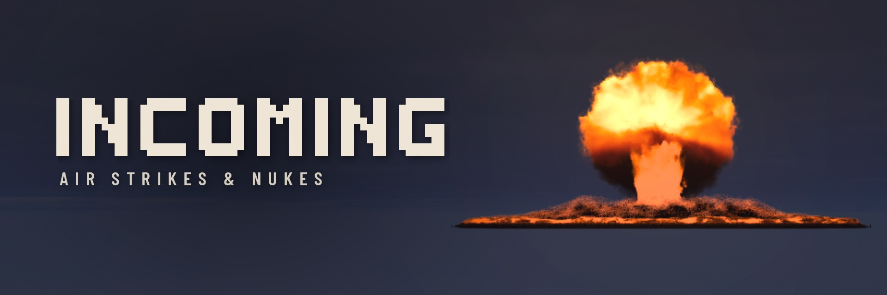
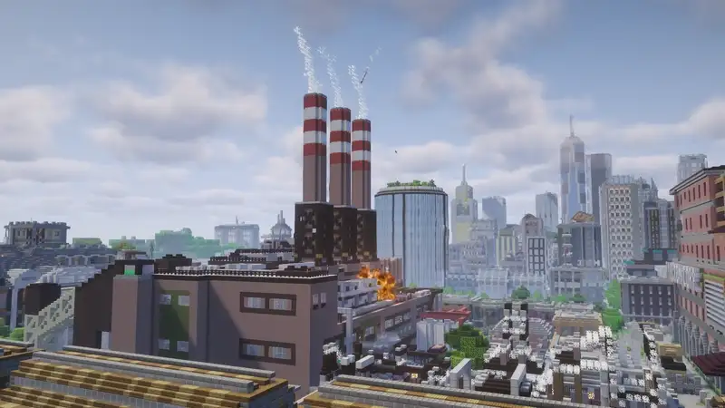

# Incoming: Air Strikes & Nukes

Удары с воздуха и ПВО для Minecraft 1.21.1.

[English](README.md)

Incoming добавляет удары с воздуха со взрывами, дымом, пожарами и разрушениями — от атак дронов до ядерных ударов.
В моде шесть видов оружия, ПВО и сирены, а выбирать цели и задавать залпы можно пультом наведения.

## Возможности

- **Взрывы и последствия:** огненные шары освещают землю вокруг, взрывы разрушают блоки и выбивают стёкла, а пыль и дым поднимаются и уносятся ветром. Удары могут вызывать пожары; остатки топлива горят в воронке.
- **Блэкаут:** удар по трансформаторной подстанции гасит электрический свет в её районе.

### Ядерные удары

Вспышка, ударная волна, гриб, пожары и руины. Наземный взрыв оставляет воронку и радиоактивный след по ветру.
Запускай МБР или ставь ядерную боеголовку на крылатую ракету либо бомбу B-2. По умолчанию доступны операторам и хозяину одиночного или открытого по сети мира.

### Оружие

- **Шахед-136:** отправляй дроны к цели по одному или залпом.
- **«Ланцет»:** выйди на круг над целью, осмотрись через камеру и выбери, куда пикировать.
- **Крылатая ракета:** идёт низко над землёй, перед целью набирает высоту и пикирует.
- **«Град»:** накрывает участок залпом неуправляемых ракет.
- **B-2:** сбрасывает противобункерную бомбу, которая пробивает грунт и взрывается под землёй.
- **МБР:** несёт ядерную боеголовку к цели после периода предупреждения.

### ПВО и сирены

- **ЗРК:** сбивает вражеские дроны, крылатые ракеты и B-2, но не ракеты «Града» и не МБР.
- **Сирены:** предупреждают игроков возле цели.

### Пуск

- **Пульт наведения:** наводись через бинокль или нажми Shift+ПКМ с пультом в руке, чтобы открыть экран пульта: оружие, залп, разброс, цель и карта. Задавай маршруты, наблюдай через камеру снаряда.
- **Стационарные пусковые:** загружай боеприпасы, назначай цель пультом и запускай сигналом редстоуна, в том числе с летательного аппарата Create Aeronautics в полёте.

### Для серверов и сборок

- **События и команды:** скрипты и другие моды (в том числе KubeJS) видят каждый приказ, снаряд, ядерный взрыв и отключение света и могут отклонить приказ, так что сборка может задать свою цену, перезарядку или счёт очков. Ударам можно давать метки, `/incoming status` их показывает, а `/incoming rule` меняет правила мира на ходу.
- **Правила:** мод прав вроде LuckPerms решает, кто может запускать; приваты Open Parties and Claims, FTB Chunks и других модов сохраняют блоки при любом ударе; группы FTB Teams и Open Parties and Claims считаются сторонами, и ЗРК не сбивает их снаряды.
- **Сигналы:** достижения и статистика; сигнал редстоуна от ЗРК во время воздушной тревоги и от работающей подстанции; табло Create, Jade и компьютеры CC:Tweaked читают ЗРК и стационарную пусковую.
- **Данные:** рецепты принимают обычные ингредиенты из других модов, а сборки могут дать защиту от радиации любому надеваемому предмету (защитный костюм Mekanism работает сразу). См. [Для владельцев серверов и авторов сборок](docs/guide/ru/packs.md).

## Требования и зависимости

**Minecraft 1.21.1 · NeoForge 21.1.264+ · Java 21.** Incoming нужен на сервере и у каждого игрока.
Другие моды не обязательны.

Дополнительно поддерживаются Create, Create Aeronautics с Sable, Distant Horizons, Voxy через Roxy, Iris, Vista, Jade, CC:Tweaked, Mekanism, FTB Teams и Open Parties and Claims.
Версии и подробности — в [руководстве по совместимости](docs/guide/ru/compatibility.md).

## Установка

Установи NeoForge для Minecraft 1.21.1 и положи [jar Incoming](https://github.com/zentixua/incoming/releases/latest)
в `mods`. Для игры по сети поставь одну версию на сервер и всем игрокам.
Первый пуск описан в [руководстве](docs/guide/ru/README.md).

## Частые вопросы

**Работает на Fabric или Forge?** Эта версия — только для NeoForge.

**А на других версиях Minecraft?** Сейчас Incoming поддерживает 1.21.1.

**Можно добавить в сборку?** Да, с соблюдением GPL-3.0.

**Нужен на сервере или у игроков?** И там, и там. Можно играть одному, открыть мир для сети или поставить мод на выделенный сервер. Версия Incoming у всех должна совпадать.

**Сильно нагружает игру?** Большие залпы, ядерные удары и шейдеры могут быть требовательны. Смотри [помощь с производительностью](docs/guide/ru/faq.md#неполадки).

**Почему взрывы так мало ломают?** У каждого оружия заряд настоящего, а блок — это метр. «Шахед» (50 кг в тротиловом эквиваленте) оставляет воронку в грунте около 2,4 м в поперечнике и ломает кирпичные стены в пределах около 3 м; крылатая ракета (около 150 кг) — около 7 м; ракета «Града» (6,4 кг) — около 1 м, так что деревья рядом могут устоять. Что взрыв оставил без опоры, затем падает: ракета в квартире первого этажа может обрушить этажи над ней. Дым и пыль расходятся намного дальше разрушений, как на настоящих съёмках. Ядерный заряд по умолчанию, 15 кт, валит кирпичные дома до 700 м, деревянные — до 1,3 км. Подробнее: [что делает взрыв](docs/guide/ru/weapons.md#что-делает-взрыв).

**Ядерка слишком большая или слишком маленькая для моего мира?** Мощность выбирают на пульте: от 1 кт до предела мира (по умолчанию 100 кт). Владелец мира может поднять предел до 1 Мт настройкой `nuclear.max_yield` или уменьшить все ядерные расстояния: переключить `scale.scale_preset` на `CUSTOM` и снизить `nuclear.effects_scale` (1.0 — как в жизни; при 0,1 взрыв в 15 кт валит кирпич до 70 м). Настройки открываются кнопкой «Настройки» на экране пульта (Shift+ПКМ с пультом в руке) или в «Моды → Incoming → Настройки»; настройки мира там меняются в одиночном мире, не открытом для сети, иначе — в `incoming-server.toml`. Подробнее: [настройки мира](docs/guide/ru/settings.md#настройки-мира).

**Как уберечь постройки?** Владелец может ограничить пуски, отключить разрушения и пожары в [настройках мира](docs/guide/ru/settings.md#настройки-мира). По умолчанию разрушения включены.

## Ссылки

[Руководство игрока](docs/guide/ru/README.md) · [Сообщить об ошибке](https://github.com/zentixua/incoming/issues) · [Исходный код](https://github.com/zentixua/incoming)

## Лицензия и авторы

Автор — ZentixUA. [GPL-3.0-only](LICENSE). [Авторы звуков](SOUND-CREDITS.md) · [Источники текстур](tools/bake_fx/SOURCES.md).
В jar входят sable-companion и FastNoiseLite Джордана Пека (MIT); текстуры огня и дыма сделаны из симуляций JangaFX под CC0.
