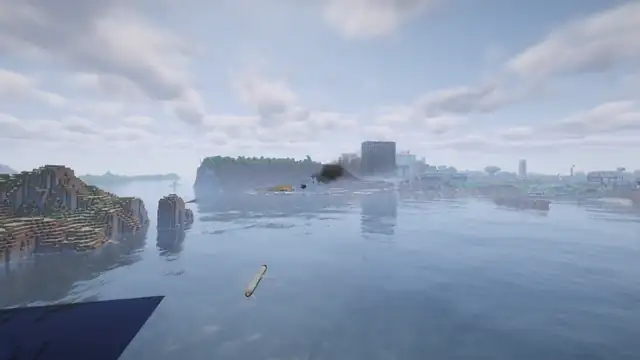
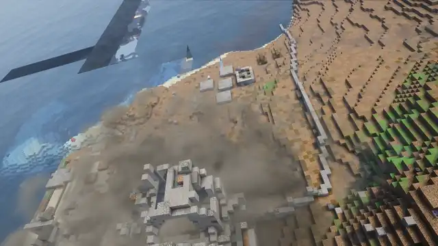

# Projectile camera

English · [Русский](ru/camera.md)

Press `N` while your projectile is in flight and watch the strike through its camera: the flight from on board and the
impact. Press `N` again for the next projectile; Shift exits. While you are in the camera, your character stays where
it is. You hear what the camera hears, but a blast wave hurts your ears and pushes you only when it reaches your
character.

The camera and radar captions follow your game language: `REC` marks the camera display, `N` marks north, and
`T-` is the countdown to impact. The camera indicator does not save a video file.

- When the projectile is beyond your render distance, you see a map with its path instead of video. The video starts
  by itself once it comes closer.
- **LMB**: new target, whatever is under the crosshair.
- **F5**: switch to an outside view using the normal perspective key.
- The Shahed and the Lancet follow a moving target while you keep it in frame. Other weapons hit where the target was
  at launch.
- To have the camera start by itself at every launch, turn on "Projectile camera on launch" in the
  [settings](settings.md).

## Lancet

The Lancet flies to the target and circles over it. Put the crosshair on a target below and press LMB: it dives at
once. If you pick nothing, it dives by itself after about 25 seconds.

