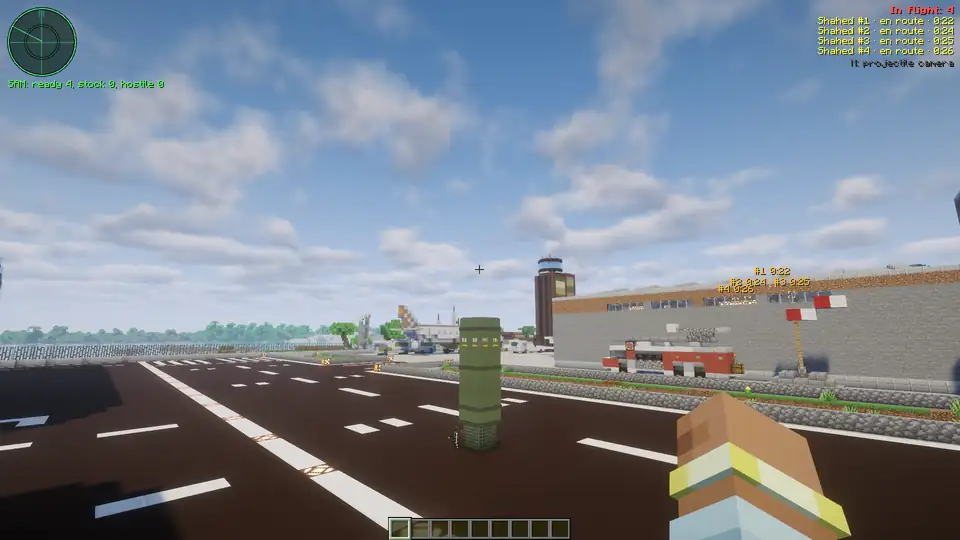

# Defense

English · [Русский](ru/defense.md)

## Sirens

Everyone within 350 blocks of the target hears a siren and sees a warning on screen before the strike. A nuclear strike
is announced to everyone within 20 km.

| Warning | Weapon | Before impact |
|---|---|---|
| ⚠ AIR RAID ALERT ⚠ | Shahed, Lancet, B-2 | 20–25 s |
| ⚠ MISSILE THREAT ⚠ | cruise missile, Grad | 15 and 8 s |
| ☢ MISSILE ATTACK ☢ | ICBM | 90 s, with a countdown |

These warnings require `world.early_warning = true` (the default). With it off, no automatic siren, target banner or nuclear launch notice is sent. The launching player keeps their own flight HUD and countdown. SAM radar and everything visible or audible still work. `nuclear.warning_radius` only applies while the network exists.

Projectiles can be seen from up to 8 km away. How far you hear one depends on its engine and on the weather. On a quiet
night a Shahed is heard about 12 km away (its two-stroke has no muffler), a Lancet only a few hundred blocks away, and a cruise missile's turbine or a
burning rocket motor many kilometres away. By day the warm ground bends sound upwards, and in rain the noise hides it,
so you hear everything from closer. Damp air takes less of the high notes: in rain a distant engine sounds brighter,
even though you lose it sooner. An air defence missile's motor is heard by the same law, far away too. Sound travels at the speed of sound: a distant flash shows up before you hear the
explosion, and you hear a fast projectile only shortly before it arrives. A projectile faster than sound is not heard
until its shock wave reaches you: first comes the crack, then its own sound. At GAME speeds, a Grad rocket fired from a fixed launcher at a target more than about 7 km away can already be
supersonic: its exit speed is solved for the distance (about 480 m/s at 10 km). With REAL, or CUSTOM toward real
speed, Grad rockets, SAM interceptors and B-2 bombs can be supersonic too, so their sound can arrive after they pass.

An explosion is heard as far as its charge carries: on a quiet night even a Lancet or a Grad rocket rumbles tens of
kilometres away, up to 32 km, the farthest the mod sends anything; by day, behind hills and in rain much less. A small
charge sounds short and sharp, a big one low and long; its echo comes back from the hills after the blast itself.

## Cover

A blast hits everyone within its radius, you included, and debris flies far.

The blast wave reaches further than the damage. When it passes you, the view shakes for a moment, then the wave shoves
you, your head rocks on your neck and you come back upright over two or three seconds. A Shahed within about 20 blocks
knocks you off balance, at 100 blocks the view swings by a few degrees, a few hundred blocks away you barely feel it.
The shake is stronger the higher the pressure and lasts longer the bigger the charge (0.3–1.7 s). A wave strong enough to hurt the
ears muffles your hearing for game hours, like after a nuclear blast: a Shahed within about 75 blocks, a Lancet within
about 35, a cruise missile within about 150. While the strike's cloud still rises and the fuel in its crater burns,
hearing comes back in real time; then by the hours of the world's day. Closer in, your ears also ring faintly; you hear the ringing only when it is quiet. A wall, a house or a hill between you and the blast
softens both. Hearing damage can be turned off in the [settings](settings.md).

- **Get underground.** Earth and thick walls stop a blast; underground and under water even glass stays intact.
- **The bunker buster** goes through about 4 blocks of stone or concrete, or tens of blocks of dirt, and explodes there;
  it crushes rock about 10 blocks around and brings down tunnel roofs about 27 blocks away
  ([details](weapons.md#bomb-b-2)). Depth in rock protects against it, or a SAM that shoots down the B-2.
- **Nuclear strike**: see [how to survive](nuke.md#how-to-survive).

## Surface-to-Air Missile System (SAM)

The SAM is a block that shoots down other players' Shaheds, Lancets, cruise missiles and B-2s by itself. It leaves the
projectiles of the player who placed it, and of that player's team, alone ([who is on a team](rules.md#spotting)). If a
target's owner joins the team while a missile chases it, the missile blows itself up in the air.

The block itself is the radar cabin. Four missile canisters stand upright on top of it, so the whole SAM is about five
and a half blocks tall. An interceptor leaves its canister straight up, then turns in a short arc toward the point where it will meet the
target.

- Its radar reaches 3 km and it fires from 1.5 km, one interceptor per target. These are game ranges, much shorter
  than a real system's, so that the fight happens within sight (not physical). Harder-to-detect targets are seen closer:
  a cruise missile from 2.1 km, a Lancet from 1.5 km, the B-2 only from 450 blocks.
- The radar sees only what is in line of sight. A hill or a building between the SAM and the target hides it: a cruise
  missile flying low behind a hill is not seen until it comes out. Ground in chunks the server has not loaded hides
  nothing.
- An interceptor explodes where it passes closest to its target. If that point is within its fuze radius (6 blocks
  plus half the target's length), the target is shot down. There is no dice roll. If it passes farther away, the target
  flies on and the interceptor turns back after it until its fuel runs out (15 s).
- It does not shoot down ICBMs or Grad rockets. It does not see players, mobs or aircraft.
- It needs open sky above it and a player nearby: it does not work in an unloaded chunk.
- Its own side gets "Air raid alert!" with the direction to the target. Near the SAM, a radar screen appears in the
  corner of the screen.
- RMB on it with an empty hand shows how many missiles are ready and how many are in stock.

How often it shoots targets down follows from the game model; nothing is tuned. In a batch of 400 simulated raids per
target over flat ground, with the target point up to 600 blocks from the SAM, every interceptor it fired hit:
all Shaheds, cruise missiles and Lancets were shot down, and 78 % of B-2s. The other B-2s never came within the 450
blocks at which the radar sees them. With real flight speeds (`REAL`) the same raids bring down all Shaheds and Lancets
and 99.5 % of cruise missiles; the B-2 then flies at 12 km, out of the radar's sight. In a real game targets get
through behind hills, in salvos larger than its four rails while it reloads, and when it runs out of missiles.

A cruise missile flies 12 blocks above the treetops (40 with `REAL`). From a SAM among trees or in hills the radar
sees it only 100–300 blocks out, or not at all, and a missile aimed at something a few hundred blocks from
the SAM can get there before an interceptor reaches it. Put the SAM on open, high ground.

Against a SAM: a salvo (it has only four rails), a route around it or behind hills, the hard-to-detect B-2, or the Grad.

### Crafting and loading

SAM ingredients: 2 iron bars, 1 compass, 4 iron ingots, 1 precision mechanism and 1 iron block; makes 1 SAM.
Interceptor ingredients: 1 precision mechanism, 4 iron ingots and 2 gunpowder; makes **2 interceptors**.
Without Create, use a clock in the SAM and a comparator in the interceptor instead of the precision mechanism.

1. Place the SAM under open sky and keep its chunk ticking by staying nearby.
2. Load interceptors with RMB or a hopper. Stock has two slots of 16 missiles each, separate from the four ready rails.
3. Wait for loading: by default one missile moves from stock to a free rail every 8 seconds, including the first one.
   Filling four empty rails takes 32 seconds if nothing fires (`air_defense.reload_seconds` and `air_defense.rails` change this).
4. RMB with an empty hand checks ready missiles and stock. If the SAM is covered, it shows only "blocked from above";
   clear the space above it to see the counts. Stock alone cannot fire until a missile reaches a rail.

Missiles cannot be taken back out, but a broken SAM drops its stock and ready missiles.

### Redstone

The SAM gives a redstone signal while its radar sees a hostile target: strength 15 from every side, like a daylight
detector. It powers dust, lamps, pistons, doors and the redstone inputs of Create and ComputerCraft blocks next to it,
not through the block it touches. Through a redstone torch the signal inverts: iron doors fed by the torch stand open
while the sky is clear and shut on alarm (more examples in [For server owners and pack makers](packs.md#redstone)).

- It comes on within half a second of a hostile target appearing on the radar and goes off within half a second of the
  last one leaving it, being shot down or exploding.
- Every hostile target the radar sees counts, also the ones it does not fire at: an ICBM, Grad rockets, targets beyond
  its 1.5 km firing range. Projectiles of its owner and the owner's team never turn it on. A SAM placed by command,
  without an owner, counts every projectile it sees.
- It works without missiles. Under a solid roof the radar sees nothing, so there is no signal; leaves do not hide the
  sky from the radar.
- A comparator next to the SAM still shows how full its stock is.
- Keep what you build beside it no taller than the SAM block: its radar looks out half a block above it, so a door or
  an extended piston next to it hides targets lower than about 45° above the horizon straight out from that side, and
  the alarm can drop as the door closes.
- In an unloaded chunk the SAM keeps the signal it had and looks again within half a second once its chunk works.
  Within 32 blocks of ground that is not loaded (the edge of the loaded world), what it powers learns of a change
  only once that ground loads: a circuit reaching there would otherwise load it.
- A CC:Tweaked computer attached to the SAM reads its missiles and radar, and receives the event `incoming_alert` on
  every sweep while the radar tracks a hostile target ([For server owners and pack makers](packs.md#computers-cctweaked)).
  With Jade, looking at the SAM shows its missiles and what its radar tracks.
- With Create, a Display Link attached to the SAM offers the source **Air-raid alert**: a sign or nixie tube reads
  `ALERT` while the signal is on and `Clear` while it is off (a display board writes both in capitals), at most half a
  second behind the signal. An attached label goes before the text, as with Create's own sources.
