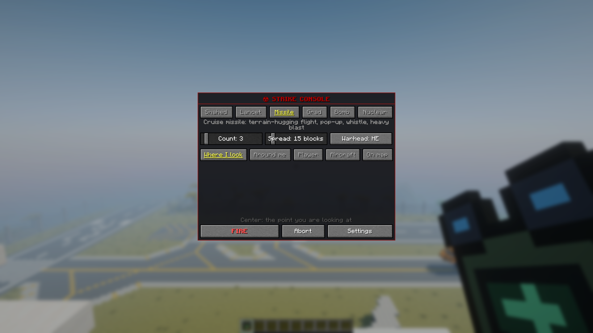
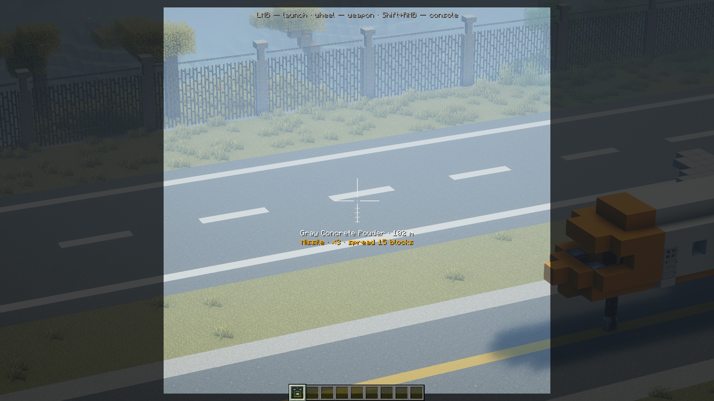
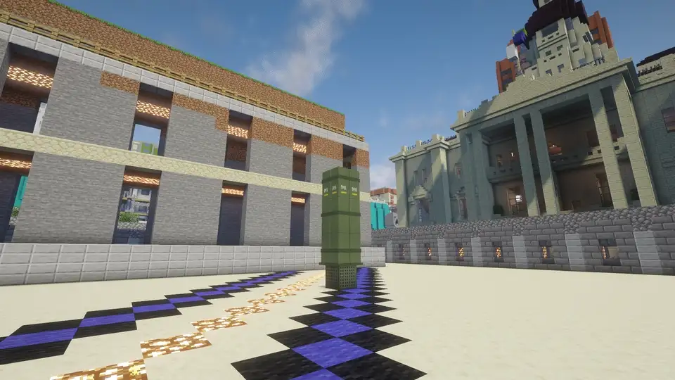

# Strike Designator

English · [Русский](ru/designator.md)

The designator aims and launches every strike: from its binoculars, from its console or from the [map](map.md).
Shift+RMB with the designator in hand opens the console; the first time you hold a designator, a hint in the corner
of the screen says so.

## Crafting

Recipe: redstone dust on top; iron ingot, spyglass and iron ingot in the middle row; compass at the bottom.

Ingredients: 1 redstone dust, 2 iron ingots, 1 spyglass and 1 compass. Makes 1 designator. The recipe appears in the
recipe book once you carry any of its ingredients.

In Creative mode the designator is in the Incoming tab. If the world owner has limited the designator to operators, it
does not fire for other players.

## Binoculars

- **RMB (hold)**: binoculars. The reticle shows what is under it and how far away it is. When it locks onto a mob, a
  player or an aircraft, the designator beeps.
- **Mouse wheel**: weapon (Shahed, Lancet, Missile, Grad, Bomb, Nuclear). The Grad fires a burst; wheeling on to another
  weapon returns to a single round.
- **LMB**: launch. With nothing under the reticle it says so above the hotbar.

When you stand where the warhead's fragments are hazardous, the reticle warns "Danger close" and shows that distance:
the hazard distance of one warhead (about 124 m for the Shahed, 114 m for the Grad, 206 m for the Missile, 54 m for the
Lancet) plus the salvo spread. Single fragments fly farther. The warning does not stop the launch, and it also applies to
missions for linked launchers.

The binoculars lock onto mobs, players, aircraft and blocks up to 400 blocks away. Farther out they mark the ground you
see, as far as the air lets you make it out: 20 km in clear weather, 5 km in rain, 1 km in a thunderstorm, and no farther
than the map reaches. Past your render distance this needs distant terrain from Voxy, Distant Horizons or LOD Server
Support; without one, use [the map](map.md). For a nuclear launch, review the target and
hold the final launch control for three seconds. Releasing cancels the hold. [Nuclear strike](nuke.md#how-to-launch).

## Console

Shift+RMB with the designator in hand. Here you choose how many rounds to launch, how widely to spread them and where.
The binoculars then fire with the same settings.

- **Weapon**: six buttons, each with a tooltip. The Missile and the Bomb also get a warhead button.
- **Count and Spread**: up to 30 rounds over up to 150 blocks from the center.
- **Target**: Where I look, Around me (where you stand, so step away first), Player (only [spotted](rules.md#spotting)
  players), Aircraft (Create aircraft nearby), On map.
- **FIRE**, **Abort** and **Settings**. FIRE is greyed out until the order is complete; its tooltip says what is missing
  (a yield, a player, an aircraft). In Survival a red line above it shows the munitions the order still lacks.

## Projectiles on screen

While your projectiles are in flight, a list in the top right corner shows each one's flight phase and time to impact,
and in the world both every projectile and its target sit in corner frames the size of the body on screen, joined by a
dotted line. A frame stays on a moving player or mob and grows with it when you zoom in; a far one never gets smaller
than a few pixels. The projectile's number and time to impact are above its frame, the target's label below its frame,
so text never covers what it marks, and it stays the same size at any zoom.

## Abort

The Abort button on the console calls off **your** strikes: projectiles self-destruct in the air without exploding, the
B-2 turns away, and unfired rounds of a salvo return to your inventory. A nuclear strike, Grad rockets in flight and a
dropped bomb still hit.
