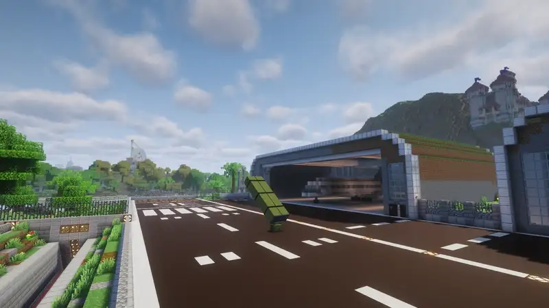

# Fixed launcher

English · [Русский](ru/launcher.md)

A block that launches Shaheds, Lancets, cruise missiles and Grad rockets by itself on a redstone signal. The designator
sets the target; a button, a lever or any circuit gives the order to fire. Several launchers make a battery on one
button.

## Loading

Place it in the open: buildings in front of the rack block the launch. Munitions go in with a right click or through a
hopper (and so from Create machines too); the stock has 9 slots. They come back out only when the block is broken. It
does not launch B-2s or ICBMs, and does not accept a nuclear warhead on a cruise missile.

## Mission

1. RMB on the launcher with the designator links it to the designator (again to unlink).
2. Set the target, weapon and salvo on the designator and fire: while launchers are linked, the designator does not
   fire by itself but gives them a mission. The fire button on the console then reads MISSION.
3. The launcher turns toward the target and waits for a signal.

A mission target is a place no more than 10,000 blocks from the launcher; a player or an aircraft becomes the place
where it was at that moment. You can link only your own launcher or one belonging to your team ([who is on a team](rules.md#spotting)). One designator can link up to 16 launchers. A mission can only be assigned in the same dimension, while the
launcher's chunk is ready; a far target can be outside loaded chunks, but the launcher itself must be loaded.
If assignment fails, go near the launcher, wait for its chunk to load and check the message: it may be busy, belong
to another side, or be too far from the target. To make the designator fire by itself again, unlink all launchers.

## Firing

Each new redstone signal is one order: a single round or the mission's whole salvo. The rounds fly in the name of the
launcher's owner, even when the owner is offline, and Abort on the owner's designator calls them off. The launcher
fires only while its chunk is loaded.

If the launcher clicks but does not fire, RMB on it with an empty hand shows the owner's side and operators why: no
mission, not enough stock, the previous order still running, or buildings blocking the launch sector. Other players see
the weapon, the stock and only the reasons about the launcher itself (no mission, busy, buildings in the way), never
the mission's count, target and spread.

With Jade, looking at the launcher shows its stock and whether a signal now would fire it, by the same rule, and its
owner to the owner's side and operators. A CC:Tweaked computer next to it reads what any player may and fires its
mission like a signal, but cannot change the mission ([For server owners and pack makers](packs.md#computers-cctweaked)).

## On an aircraft

A launcher built into a Create Aeronautics aircraft fires from it, in flight too. Its rack turns on the deck, and the
rounds wait on the rails moving and turning with the aircraft, then leave from where the rack is at that moment, along
its rails. A Shahed, Lancet or cruise missile also keeps the aircraft's speed along its rails; a Grad rocket aims
itself at the target as it leaves the tube. The aircraft's own hull and masts in front of the rack block the launch as
buildings do. The launch sector is checked when the order is given: a turn of the aircraft while the rounds wait can
point them at a slope or a building. Link and fire it as on the ground; a salvo waits while the aircraft is out of
loaded chunks.

On other moving Create contraptions (bearings, pistons, carts) the launcher does not fire while it moves.

## Crafting

Ingredients: 4 iron ingots, 1 dispenser, 2 pistons, 1 precision mechanism and 1 iron block. Makes 1 launcher.
Without Create, use a clock instead of the precision mechanism.
