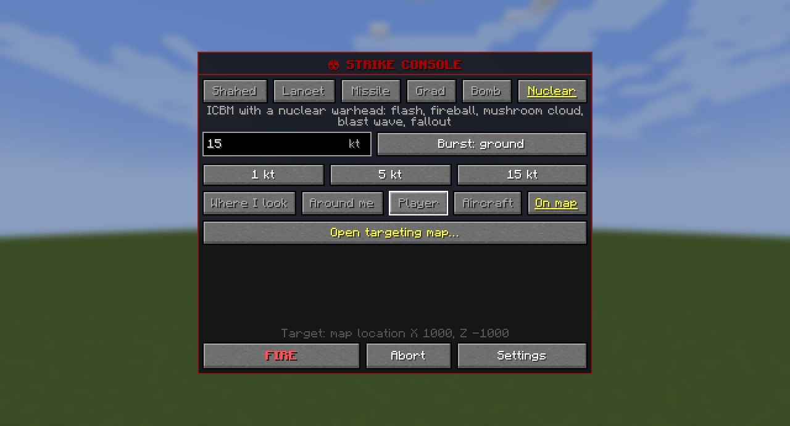
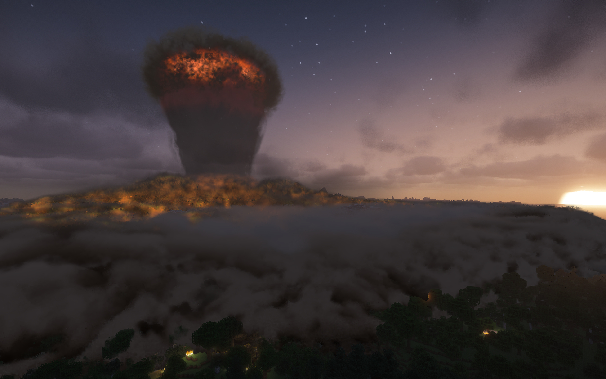

# Nuclear strike

English · [Русский](ru/nuke.md)

A nuclear warhead of 1 kt to 1 Mt on an ICBM, a cruise missile or a B-2 bomb: flash, mushroom cloud, blast wave, fires, and
with a ground burst a crater and a fallout trail. By default, one block represents one meter and the distant wave is slowed so you can see it coming.
Distances below assume full radii.
See [Not physical](not-physical.md) and [world settings](settings.md#world-settings).

In an alarm, get under thick ground, avoid windows and do not look at the fireball. After a ground burst, leave the
fallout trail or stay under cover; water washes contamination off you. [Survival and radiation](#how-to-survive)
come first; [what happens](#what-happens) describes the strike.

## How to launch

By default operators and the host of a single-player or LAN world can, cheats on or off.

1. You need an ICBM item, or a missile or bomb plus a Nuclear Warhead ([recipes](munitions.md#recipes)).
2. On the console: the Nuclear weapon, or the nuclear warhead option of the Missile and the Bomb; the yield
   numeric field in whole kt and suggested values, up to the world’s configured maximum (`nuclear.max_yield`, 100 kt by default, at most 1 Mt); for the ICBM and the missile a ground burst
   (the default, with a crater and fallout trail) or an air burst (wider destruction). The bomb explodes underground.
3. LMB in the binoculars or FIRE opens a review of the server-resolved target and yield. Hold the launch button
   for three seconds, or focus it with Tab and hold Space or Enter. Releasing, moving the pointer off the button,
   losing window focus or closing the review cancels the hold. On small screens, scroll or use Page Up/Down to read the details.

The targeting map shows flat-ground reference contours for the fireball reference silhouette, 5 psi and 1 psi.
The fireball reference is its radius at the second light maximum; it can expand farther later.
“Fit effects” fits them in the viewport; “Thermal / glass” also shows the 0.5 psi glazing reference and the median
first-degree burn radius for exposed skin at the shown weather visibility. These are estimates, not uniform damage
boundaries: terrain, shelter, clothing and materials matter. A dashed elevated fireball silhouette is not a ground-contact disk.
The review shows your distance and a north-up downwind arrow. Unknown ground height remains an estimate.
Viewing a wider footprint does not increase targeting range or reveal hidden players.
After a detonation, a ring on the map follows the shock wave along the ground in real time, until the wave weakens below
what still does damage. It runs from thick red at high overpressure to thin and pale near the end, labelled with its distance
from ground zero and pressure; the band behind it is where the blast wind is blowing now. Below your marker, the seconds
until the wave reaches you.

Reviewing a strike reserves no ammunition and starts no preparation or alarm. Payment and the existing second-key
window begin only after confirmation. A changed target, weather, server limit or flight configuration requires a new
review. An unpaid review expires after one minute and is discarded on disconnect, death or restart. The existing
flight duration and operator immediate-detonation commands are unchanged; this review does not guarantee prepared
terrain or LOD readiness for a cold observer arriving during flight.

Existing worlds need no config edit: burst mode is not stored in `incoming-server.toml`. Older versions normally
omitted AIR from saved designator settings because it was the default, so those designators switch to GROUND after
updating, even if you selected AIR with the button. A saved `air_burst=true` field still keeps AIR. You can select
air burst again on the console before launching. ICBMs already scheduled keep their burst mode.

The ICBM lifts off at the launch site selected on the [map](map.md#launch-site), or behind you if none is selected. Its first stage burns for a minute: the flame and white trail climb into the sky,
leaning toward the target, until the stage burns out about 20 km up. By default, the strike follows 90 seconds after
launch; a shorter flight time shortens both the climb and the fall.
Only the warhead comes back down. For the last 30 seconds it falls steeply out of the sky in the direction of the
launch, as bright as a large meteor: the air in front of it turns to glowing plasma. At night it lights the ground
and leaves a long orange-white trail; by day it is a bright point with a short tail. Clouds, haze and terrain can
hide it. It is faster than sound, so you hear nothing before the burst. The flight-speed scale also controls the
approach.

If the world owner has allowed nuclear weapons for everyone, a player without operator rights needs a second key
whenever someone else is online: another player within 16 blocks presses `.` within 30 seconds. With `world.early_warning = true`, every player is told
about such a launch. With it off, the second-key request still goes to nearby players who can authorize it; there is no automatic launch notice or target alarm. Once ordered, the ordinary launching player cannot recall the nuclear strike, even while it waits for a second key; an operator or the host can
abort it with `/incoming clear`. The non-operator ICBM still flies for at least 90 seconds, and a missile or B-2
with a nuclear warhead still waits 90 seconds before launch, even with early warning off. The owner keeps their countdown and launch confirmations.

## How to survive

- **Get underground.** A thick mass of natural ground shelters a closed bunker or cave from the wave, and earth
  stops light and attenuates radiation. An exposed natural ridge, overhang or wall up to three blocks thick can break
  when air reaches both sides; narrow natural pillars can topple. A thin natural roof is not the same as deep cover.
  A block of stone cuts the radiation of the burst about a hundredfold, a block of earth about thirtyfold. A trench
  or a wall stops what comes straight from the fireball, but not the part
  the air scatters down from the sky.
- **Keep away from walls and windows.** The wave hurts mostly by throwing you against something hard and with glass
  from windows between you and the burst. A wall right behind you reflects the wave and at least doubles the pressure
  on your lungs. A house that collapses buries those inside: dig yourself out before you suffocate.
- **The wave deafens.** At 15 kt it dulls sound out to about 4 km, and closer in everything sounds as if your ears
  were stuffed with cotton. Hearing comes back over game hours: up to 16 beyond 1.5 km, two game days at 1 km. A faint ringing comes with it,
  heard only when it is quiet: beyond 1.5 km for less than a game hour, loud and long only within about 1 km. From 5 psi
  (about 1.1 km) eardrums can tear, and everything stays dull for 4–8 game weeks. Death restores your hearing; logging
  out and back in does not.
- **Do not look at the fireball.** Its light reaches only those who can see it, under open sky or through a window, and
  burns the side of the body that faces it.
- **Burns** depend on the yield: the pulse of a bigger burst is longer, and skin takes more of it. At 15 kt bare skin
  reddens out to about 3.4 km, blisters out to 2.6 km and burns through out to 2.1 km; a cotton shirt catches fire out
  to 1.6 km. Clothes shield you only until they catch fire: burning clothes burn the skin beneath
  them, so where a shirt catches fire a dressed player is burned over the whole side facing the fireball, like an animal.
  Farther out, only the face and arms burn. Iron armour stops the light; leather catches fire later than a shirt.
  Burns take a share of your health and keep it until they heal: two game weeks for blisters, five for deep burns.
  Deep burns over a quarter of the body, or blisters over 30 % of it, bring shock: you die within 12 game hours. Where
  your clothes catch fire, that is shock; beyond, the flash burns a dressed player far less. Milk and potions do not
  heal burns.
- **If you see a flash in the distance**, you have seconds before the wave arrives: get behind a slope, into a
  basement, into a pit.
- **The flash blinds.** It dazzles everyone who sees the fireball, and more weakly everyone under the open sky it lights
  up. The view goes white. As it clears, an afterimage of the fireball stays where you saw it: bright at first, then
  orange, then violet, moving with your gaze. By day the view stays a little pale and washed out; it recovers over
  seconds or minutes. You can always see through it. The closer you are, the longer it lasts, and at night, when
  your eyes have got used to the dark, far longer: at 15 kt about 50 seconds at 3 km by day, several minutes at 10 km at
  night. If you were looking towards the fireball, its image burns a blind spot into your eyes for good, at 15 kt out to
  about 30 km by day and 50 km at night. The spot moves with your gaze and is fainter off to the side; it goes away only
  when you die. Creative mode is dazzled the same way but gets no blind spots; spectator mode only sees the white flash
  and the afterimage. The "Flash brightness" setting weakens or turns all of it off.
  A sealed shelter blocks the new flash; windows and cave mouths admit scattered light according to the opening.
  Torches do not let the flash through rock. A fireball partly hidden by hills or trees lights you only by its visible
  part. Entering cover does not erase an acquired afterimage.
- **Leave the fallout trail, or wait it out indoors.** Fallout lies on everything open to the sky and shines through
  roofs and walls: a block of stone or earth stops nearly all of it, a block of wood about 95%, glass almost nothing,
  and an open doorway lets it in. Water washes the dust off you (rain does not); otherwise it fades only as slowly
  as the fallout itself. Fallout lands where the wind carries the cloud, when the cloud gets there: tens of kilometres
  downwind an hour or more after the burst, even after the cloud is too thin to see. On the ground it weakens as the
  world's day runs, by the same law everywhere: seven times older, ten times weaker. It does not vanish on a set day:
  near ground zero of a ground burst it stays measurable for years of game time (15 kt: about a year and a half of play
  in a vanilla world), ever weaker, until `/incoming clear`.
- **Radiation sickness** starts hours later and keeps game time: nausea and vomiting, then days or weeks of feeling
  well, then weeks of weakness, from 2 Gy without natural healing. Whether it kills depends on the dose: below 2 Gy
  almost nobody dies, at 4.5 Gy half, from 10 Gy everyone, and the higher the dose, the sooner (from 50 Gy within a
  game day or two). From 50 Gy it strikes the brain: within minutes you stagger at a quarter of your speed until you
  die. Milk does not cure it. Animals and villagers get the same dose and sickness; the undead do not.

A Geiger Counter in hand clicks and shows the dose rate and your dose. Craft it from copper and iron ingots, redstone
dust, a note block and an electron tube ([recipe](munitions.md#recipes)). In creative mode the dose does not build up.

A protective suit from another mod shields you if it declares radiation shielding: Mekanism's hazmat suit does,
and a datapack can give any armor a share ([for pack makers](packs.md#radiation-shielding-incomingradiation_shielding)).
Each piece you wear stops its share of the burst's radiation, of fallout and of black-rain dust; a full Mekanism hazmat
suit stops all of it. It does not lower a dose you already took or remove dust already on you: water washes that off.
The Geiger Counter still shows the dose rate around you; with the suit your dose grows more slowly. Incoming adds no
suit of its own.

## What happens

The siren warns players near the target. The flash comes first. By day, for a second or two, the fireball outshines the
sun: everything facing it is lit white, the ordinary daylight steps back behind it, and the air around it glows. A large
burst shines for many seconds: your eyes adjust to it, so the land and dust it lights keep their colour and detail
while the daylight sky behind them dims. Then the day returns, and the fireball rises into a mushroom cloud. At night the fireball lights the land orange.
Then the wave reaches the ground around it, breaking buildings and throwing up dust. The sound reaches you with the wave.
Fires and thick dust can make the area hard to see through long after the strike. The air shimmers above the parts of
the town that burn; over ground that does not burn it stays still. Torches, lanterns and other light
sources light the dust around them and keep lighting the ground under the dust's shadow; with LambDynamicLights, so does
a torch in your hand.

The flash scorches open ground across the zone: grass burns to dirt and charred litter, plants burn, biomes darken.
The light comes from the whole fireball, which is over a kilometre tall at 1 Mt even for a ground burst, so ground
behind a low rise still burns. A wall, house or hill close by (up to about 40 blocks, toward the burst) shades the
ground behind it; terrain farther away does not, so the trace behind distant hills is stronger than in reality.

Green grass, leaves and flowers char, steam and smoke in the flash but do not keep burning, as in real tests. Fire stays
only on dry fuel the light reaches: hay bales, dried kelp blocks, dead bushes, scaffolding,
bookshelves and lecterns, wool, carpets, beds and banners, in the open or indoors
behind glass. Wood does not catch from the flash. Where the climate is dry (desert, savanna, badlands), the grass is
dry and burns as a field. The blast wave blows out some of these fires: none below 2 psi, half above 5 psi. A city
burns from the fires lit through its windows; open green country around it does not.
The wave sweeps away any remaining wisps of smoke from flash-heated surfaces as it reaches them.

With the default ground burst, the dust column joins the mushroom cap. With an explicitly selected air burst
at the standard burst height, the column starts rising later, with a billowing upper edge, and stays below the
faster-rising cap. The gap is expected; in the first seconds, dust near the ground can hide the short column entirely.

The cap stands kilometres above the haze, so it keeps the sun longer than the ground. As the sun sets, its light on the
cloud turns golden, then red, and the edge of the earth's shadow climbs the stem and the cap; a large cap stays lit for a
while after sunset on the ground.

A ground burst leaves a crater and radioactive fallout downwind. Over water the same wave tears up white spray instead of
dust: lower, and gone within a few minutes. A burst on water also throws out a base surge, a ring of droplet fog rolling out
from the falling water column.
The wave tears the dust up from the ground exactly where it touches it: every spot raises its own dust, a little more or
less, a little earlier or later than its neighbours, and that dust shoots up and stays where it was torn up while the
wave runs on. Each spot's dust rises to about one and a half times the height of the layer and settles back to it within
about a second, so a small, uneven crest runs just behind the wave. Bare earth, fields and forests
throw up thick dust; rock, roads, roofs and snow give only the dust of broken buildings, so there the wall is lower and
thinner and the dust left behind is lighter. The dust lies on the ground itself: it runs up over hills and down into
valleys, and reaches all the way to the ground you see.
For the first seconds a thin white condensation shell stands over the wave: the air behind it expands and cools below its dew
point (Minecraft air is humid enough for it in clear weather and in rain).
The dust has the colour of the ground it comes from: grey-brown over grass, fields and forest, pale tan over sand, grey
over roads, roofs and rock. Its coarse soil stays low and looks darker and earthier, the fine dust on the tops of the billows
is paler, and patches of ground torn up side by side differ a little in tint. Right
behind the wave it is clean dust; smoke darkens it only as the fires under it grow, over minutes, and only burning
fires light it orange from below. The dust billows in lumps and eddies: the wave's wind throws it outward, the
reverse wind stalls it and brings part of it back, then the air drawn in under the rising fireball lets the low dust creep
toward ground zero. For tens of seconds the layer stays restless: swells rise and sag, tongues of dust lift, gusts shove
patches aside; then it calms to the slow roll of a dust storm, swirling a little and drifting with the wind. The same dust
thins over the following hours into a haze that drifts with the wind; where the dust of several nukes meets, it adds up.
With **Mushroom cloud and dust wave** set to OFF, the dust wave is not drawn: none of this dust, mist or base surge. Spray drops near you and dust from breaking buildings remain.
Burns, radiation and falling debris can still hurt you after the flash, so stay under cover and watch your dose.

Distant Horizons and Voxy can show ruins without you visiting them. ICBM strikes prepare the hardest-hit area during
flight; other nuclear carriers can take longer to update the distant view. Broken windows and fallen trees farther
out appear when you approach. In Voxy, players who missed the strike also need to approach to see its distant ruins.
Incoming keeps a bounded list of recent distant updates and asks the server to refresh terrain overwritten by LOD Server Support. This recovery is best effort; saved world changes remain the durable source of ruins.

The detailed timings, visual behavior and model limits are in the [nuclear effects reference](../dev/nuclear-effects-reference.md).

### Time after the strike

Everything you watch move runs in real time: the flight, the flash, the wave, the mushroom cloud, the smoke and the
first 20 minutes of the fires. The slow consequences then follow your world's day: the town burns and smoulders for about
12 hours, fallout decays, and burns, radiation sickness, hearing and the power grid heal or are repaired. A game hour is
an hour of the world's day:

- in a vanilla world a day lasts 20 minutes, so a game hour passes in 50 seconds and the fires burn out about
  10 minutes after those first 20;
- with a mod that lengthens the day, the same hours take longer, up to real hours;
- with the day cycle stopped (`doDaylightCycle false`, or a mod holding the time) the sun stops, the aftermath does not:
  it keeps the pace the day last ran at, a vanilla day's if it never ran;
- a night everyone in the Overworld sleeps through (in single player, your own sleep) ends the 20 minutes at once and moves
  the strike on by the hours slept: you wake to the town at its age, the fires burning down and the fallout weaker. What
  the strike put into the air is as old as the night makes it: after an ordinary night the dust and the mushroom cloud
  have gone with the wind, and so have the clouds, dust and trails of every other strike, whose crater fires have burnt
  out;
- a night slept through in the first minute after a nuke, while its blast wave is still crossing the land, counts as a
  night you were awake for: you wake to the strike as you left it;
- a night skipped while someone stays awake (an idle or spectating player too) changes nothing in front of them: the
  fires and the rain keep their time, and only what nobody watches change moves on: the fallout on the ground,
  injuries, radiation sickness, hearing and power repairs;
- burns, radiation sickness, hearing and the power in a district heal or are repaired in real time while any strike
  that caused them is in its first minutes: a nuclear blast's 20, a conventional strike's until its cloud has stopped
  rising and any fuel in its crater has burnt out (about 2 to 16 minutes). A body hurt by two blasts close together
  heals in real time until both are over;
- your injuries and hearing change only while you are in the world: logged out, radiation sickness does not progress,
  burns do not heal and hearing does not come back, and you return to them as you left them;
- `/time add` counts like a sleep; `/time set day` at night counts as the night passing while the day runs, and on a
  stopped day only sets the light. Setting an earlier time never turns anything back;
- `/tick freeze` holds the strike's moment like the rest of the world: the flash, wave and clouds stand still while you
  look around, and `/tick step` moves them on.

The town's smoke leaves with the wind in real time: at every moment it carries away as much smoke as the fires make at
that moment, and the smoke drifts downwind and widens for hours, also after the fires are out. Black rain falls from this
smoke where it has drifted to: a place downwind gets about an hour and a half of it with a 24-hour day, and at most about
10 minutes in a vanilla world, where the fires burn down sooner.

An effect never comes before its cause: fallout lands as the cloud passes over, and black rain starts only once the
firestorm has formed, at least 20 real minutes after the burst, and falls only under the drifting smoke, never ahead of
it.

### Ending the aftermath

The host or an operator can end everything nuclear at once with `/incoming clear`. Besides aborting strikes in flight,
it makes the world forget past nuclear blasts: for every player the mushroom cloud, the dust wave and the smoke, the
firestorm and black rain disappear, and fallout stops irradiating. What the blast already did stays: ruins and
scorched ground, blocks that are burning (ordinary fire, burning out as usual) and the dose players have taken
(`/incoming radiation clear` removes it). The ruin zone stops growing, so chunks it had not reached yet stay as they
were. An ordinary player's `/incoming clear` only recalls their own conventional strikes.

### Saved ruins beyond view distance

After the wave has crossed the ruin zone, the server gradually applies ruins and ground traces to existing chunks
throughout that zone, even without nearby players or a distant-terrain mod. Maps that read the saved world receive
these changes through their normal updates. The pass expands outward from the burst; a large zone takes time to finish.
Concurrency follows spare server time and available memory. Simultaneous strikes share preparation memory across
dimensions; busy preparation can leave distant updates for this background pass. Player-visible ruins take priority.
The pass resumes after a server restart and also catches up retained nuclear strikes from older versions.
