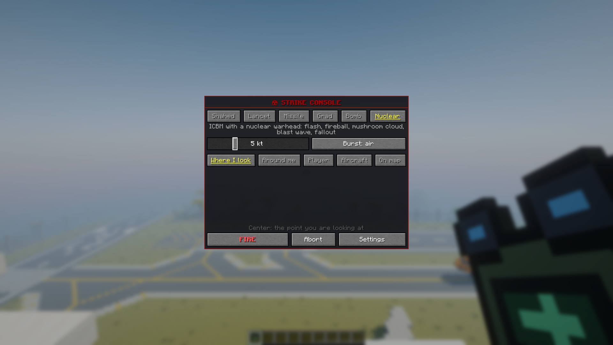
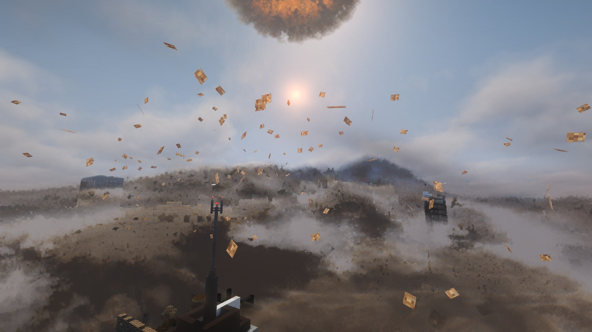
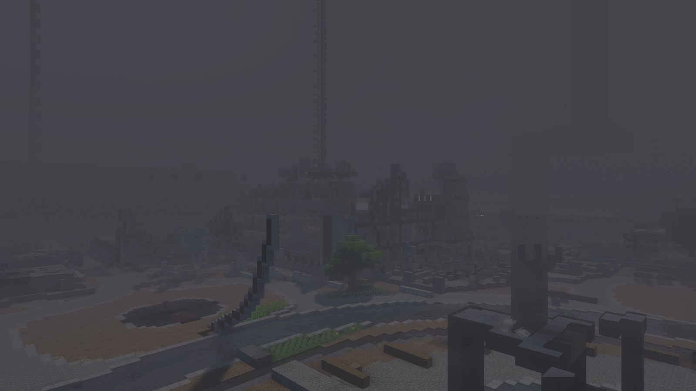

# Nuclear strike

English · [Русский](ru/nuke.md)

A nuclear warhead of 1 to 15 kt on an ICBM, a cruise missile or a B-2 bomb: flash, mushroom cloud, blast wave, fires, and
with a ground burst a crater and a fallout trail. The radii match a real explosion, with one block equal to one meter.

## How to launch

By default only operators can.

1. You need an ICBM item, or a missile or bomb plus a Nuclear Warhead ([recipes](munitions.md#recipes)).
2. On the console: the Nuclear weapon, or the "Warhead: ☢ nuclear" button of the Missile and the Bomb; the yield
   slider, any whole number from 1 kt ("tactical") to 15 kt ("Hiroshima"); for the ICBM and the missile an air burst
   (wider destruction) or a ground burst (crater and fallout trail). The bomb explodes underground.
3. LMB in the binoculars or FIRE. A 3-second countdown follows, and LMB again cancels it.

The ICBM lifts off behind you and flies for 90 seconds.

If the world owner has allowed nuclear weapons for everyone, a player without operator rights needs a second key
whenever someone else is online: another player within 16 blocks presses `.` within 30 seconds. Every player is told
about such a launch, and it cannot be called off. The alarm at the target lasts at least 90 seconds: a missile or B-2
with a nuclear warhead takes off 90 seconds after the alarm starts.

## What happens

Everyone within 20 km of the target hears a siren in advance. Then come the flash, the fireball and the mushroom cloud.
The flash lights up the sky and the land like lightning, in clear weather up to about 100 km away, in rain up to
about 30 km. The blast wave itself is clear air, but the air behind its front is compressed and bends light: once the
front leaves the fireball, its edge shows against the sky and the ground as a thin ring where whatever lies behind is
shifted by a few pixels on a 1080p screen (for a 15 kt ground burst about 4–8 from 1.5 km, 2–5 from 3 km, 1–2 from
10 km; above the ground the front of an air burst is about a third weaker). The ring weakens with the
pressure and is gone where the dust wall ends (not physics: a weak front still bends light a little, but the mod
draws nothing of the wave beyond the wall); once the front has passed you, nothing of it is seen. Hot gas over the
fireball, the mushroom cap and a burning town shimmers too, but by less than a pixel. The wind right behind the front tears up what lies on the ground (dust and earth, smoke over a
burning town, spray over water) as a churning wall. The dust doesn't fly out with the wave: the wind carries it only a
few tens of metres, and after the wave the air flows back towards the burst more weakly and for longer, so the dust
drifts back almost to where it was torn up, while the wave runs on and tears up more ahead, so the wall rolls
over the land like a dust storm. The wall is the youngest dust of the pall: right at the front it hugs the ground, and
behind it the dust grows thicker and taller. At 15 kt it is
30–40 m tall 1 km from the burst and about 60 m tall 4 km out. After an air burst it stays dense out to about 4.5 km,
thins out beyond and fades at about 8 km, where the wind is too weak to lift dust; after a ground burst it is dense out
to about 3.5 km and fades at about 7 km. Inside the wall it is dark. Far away, and more so in rain, the wall fades into the haze, like the mushroom cloud.
In its first seconds the fireball lights the top of the wall orange, even by day.
The wave breaks buildings as it reaches them: their pieces fly with the dust. The ground doesn't shake before the
wave. When it reaches you, the front hits you at once: your view jerks away from the burst in the same instant. Then
the wind behind it keeps pushing you while you stand, and your view leans further and comes back over a few seconds. At 1 psi that is a few degrees, more from a bigger
burst, whose wind blows longer. From about 0.8–1.4 psi the blow and the wind are stronger than anyone can stand against, sooner
when you face the burst and the bigger it is, and your view stops at the edge of balance until the wind weakens. After the wave
passes, the air flows back toward the burst for a few seconds. Behind a strong wave, from about 4 psi, this weaker wind
leans you toward the burst by several degrees. In a jump the wind doesn't lean you.
Where only the sound reaches, the wave moves your view by about a degree or less. A wall or a house between you and the burst shelters
you from the wind.

The fireball shines white with brighter and darker patches boiling over it, and turns yellow and orange as it cools. It
rises and rolls into a ring of hot gas: the cap of the mushroom cloud, the same body from the first moment. As it rolls
up, its outside mixes with cold air, turns dark red and then into brown smoke. Dust in front of the fireball hides it,
and its light falls on the dust and smoke around it. By day it outshines the sky only for its first few seconds; at
night its red glow lasts a few seconds longer. It also lights the land for kilometres around: white at first,
then yellow and orange, dark again within about ten seconds at 15 kt. 4 km from a 15 kt burst, at its brightest, a tenth
of a second after the flash, a slope facing it gets about 250 times the light of the noon sun and flat ground about 70
times, and everything there turns white. Slopes facing it stay brighter than noon for about three seconds, flat ground
for about two. Slopes turned away from it are lit by its light scattered in the air and by the lit ground. Hills and houses don't shade its light yet. The cap is a dense cloud of round billows. When it rolls up, the nitrogen dioxide in it makes it
ochre, a yellowish brown, and the light that comes through it reddish brown. Then water condenses in it, and as the cap
grows the dioxide in it thins out: from outside it turns beige and is almost white within one to two minutes at 15 kt,
like an ordinary cloud. Seen from below, where light comes through it, it stays brown. A 1 kt cap is darker at first,
thinner, and lets more light through: at night its hot core glows through it. When the fireball touches dry
land, the cap carries soil and stays grey with dust. At 15 kt the cloud climbs to about 10 km in six to seven minutes.
At 1 kt it climbs to about 6 km, more slowly: after eight minutes it is still rising, and it stops after about eleven. Then the turbulence of the air mixes it away, and a bigger cloud takes longer: a 15 kt cloud is gone after about 27 minutes, a 1 kt cloud after about 22. While the cloud climbs, the cap keeps rolling: gas goes up through its middle, out over
the top and down the outside, and billows swell out of it and sink back. The faster the
cloud climbs, the faster it rolls; when the cloud stops rising, the cap stops too. The sun lights one side of it, and
the folds between the billows stay darker. By day the cloud casts its shadow on the land: under the thick cap only the
sky lights the ground. A column of dust rises from the ground under the cloud, and a skirt of dust spreads around its
foot. Its dust is what the inflow sucks in from the dust layer near ground zero. After a ground burst the column joins
the cap from the start: the fireball touched the ground. After an air burst the inflow starts some seconds later and the
dust climbs more slowly than the cloud, so the dusty column stays below the cap: at 15 kt and 592 m it reaches about
2.5 km while the cap is above 6 km.
A burning town lights the foot of the column orange from below, and the cap high above only faintly. Far away, and more
so in rain, the cloud fades into the haze. Most haze lies in the lowest kilometre or two of air, so the cap high above
stays clearer than the foot of the column at the same distance.

Behind the wave the dust keeps rising as a pall: within seconds to 50–100 m, and over the next minute the ground
heated by the flash lifts it higher. For a 15 kt air burst it tops out at about 230 m 1 km from the burst, 150 m at 1.4 km and lower
toward the edge. From a rooftop near the blast you first see the wave cross the town, then the dust swallows you. At
night the fireball first lights it as bright as day for several seconds, then the fires light it orange. The top of
the dust wall is lit the same way, and the side of the wall away from the fireball stays dark. The young pall is
torn into clumps, lighter on the side facing the light and darker in their folds; within a minute or two the rising
air mixes it, and from above, from a hill or a plane, the old pall is one even blanket, like fog seen from a plane,
with only gentle humps on its top. Inside it you see only a few metres, it is dark even at noon, and sounds are
muffled. At 15 kt it stays dark about 20 minutes 1.4 km from the burst, as in Hiroshima; within half a kilometre of the
burst it clears in minutes, drawn up into the column of the mushroom cloud. The dust also fills the valleys around the
town. It does not get into the mine, cave or cellar you are in: the air there stays clear and sounds are
not muffled by the dust; only near a shaft or an opening to the sky does some dust drift in, thinning over about 15
blocks. Coarse grains fall out in minutes; the fine dust drifts downwind and hangs as a thinning haze for about an hour and a half, a little longer after an air burst. Where the
light of the fireball set the town on fire, a firestorm builds up over a few minutes. Columns of smoke rise over the
burning blocks, lean downwind and merge higher up into a ceiling of smoke over the town. At night the fires light it
orange-red from below, and the glow flickers; from a couple of kilometres away the town glows under its smoke, and the
dust around it catches the glow. A few times in the first ten minutes a fire whirl rises over the hottest fires for a
minute or so and wanders across them. From about the sixth minute the fires die down to smouldering, and by morning they
are out, together with the smoke. A server with nuclear fires turned off (`nuclear.fires`) has no firestorm and no smoke
haze over the town. Ash and scraps of burnt paper fall around you.

In a 15 kt air burst the wave kills half of those it throws against a wall out to about 0.85 km, and a few out to
1.45 km; in an open field it rarely kills and mostly knocks you down and rolls you over the ground. A 15 kt ground
burst kills half of those in the open out to about 0.4 km. The light of the fireball burns bare skin out to about
3.4 km, and windows break out to 8–9.5 km. At 1 kt all of this is several times closer. A ground burst leaves a fallout trail downwind. Fallout keeps
game time, like radiation sickness (a game hour is 50 seconds): after a 15 kt ground burst it starts to come down about
7 game minutes later, and later farther downwind. Its radiation drops tenfold by the seventh game hour and a
hundredfold by the third game day.

About 80 seconds after the burst, black rain starts to fall from the smoke of the fires: over the burning
town and in a wide strip downwind, for about six minutes in each place, in step with the firestorm. After an air burst
it is only weakly radioactive. In the fallout trail of a ground burst it brings the fallout down onto you.

The land around the burst is scorched. The light does its part within the flash itself, about a second at 15 kt, before
the blast wave comes: it burns grass, flowers and crops in patches, leaves black char where it was strongest, melts
snow, turns the grass, leaves and water around yellow-brown and grey, and starts fires. The wave then strips the turf
near the centre down to bare dirt and blows out about half of the fires where it is strong. The edge is ragged, not a
ring. Away from players the scorch shows together with the ruins. The scorched colours stay for good, also in the
distant terrain of Distant Horizons or Voxy.

After an ICBM strike, the distant terrain of Distant Horizons or Voxy shows the ruins of the hardest-hit area as the
wave reaches them: the server prepares them while the missile flies. At 15 kt the far edge of that area may show later.
After a cruise missile, a bomb or `/incoming nuke now` the distant ruins show some time after the wave. Broken windows
and fallen trees farther out show in the distant terrain once you come close. With Voxy, a player who was not in the
world during the strike sees the distant ruins once they come close.

The flash also marks what it lights. Wood, wool and hay that face the fireball char black in patches, and brick,
concrete, stone bricks and sandstone darken with soot. A player, a mob, an armor stand or a boat standing in the light
leaves a pale shadow of its shape on the wood or masonry behind it. These marks stay until the block is broken or
replaced. In the same instant lit lamps and substations of the [power grid](blackout.md) short out with sparks, and
grass, leaves and wood in the light give off pale grey smoke (they char without burning) until the wave comes and
sweeps it away.

Over water the wave raises no dust. It runs across the water as a dark ring of ripples, with a wall of spray behind it
where the wind is strong, and white foam near the centre. Behind the wave the air over the water fills with white spray
instead of a dust pall. It stays low, at the height the wind tears it off the crests, sinks as the big drops fall, thins
within a minute and is gone in about three. Dust that the wind carries from the shore
out over the water stays brown, and spray carried ashore stays white. A burst on the water or just above it throws up
a hollow column of water, about a kilometre high at 15 kt within a few seconds. Its top opens into a crown of spray,
and the rising mushroom cloud covers it after about ten seconds. Right behind the wave a thin white cloud of
condensation hangs over the water for a second or two. The column then narrows and falls back into the water over
about twenty seconds, and the falling water rolls out as a white base surge for minutes. It is a bright mist: in its
thick part you see only some 50 m, and it thins out over a quarter of an hour.

The blast is as loud as the pressure where you stand: with distance it fades the way ordinary explosions do, and a
hill between you, rain, or a sunny day (the warm ground bends sound up, so far away it is quieter than at night) make
it quieter still. At any distance the wave itself is one sharp crack, duller the farther you are, with a deep boom
behind it; close in it is a deafening slam. The gust of wind after the wave dies down within a second or two. Then you
hear what the wave actually broke around you: windows shattering and debris falling, each from where it fell and a moment
after the wave got there. An open field with nothing to break stays quiet after the crack. Closer in, where the wave hurts your ears
(from about 0.75 psi, a few kilometres from a 15 kt burst), everything goes muffled and your ears ring. Most of your
hearing comes back within a few game hours and all of it within a game day; if you were close, it takes game days,
and weeks if you survived right next to the burst. The ringing fades with it, and sleep counts. From 5 psi the wave can tear your eardrums: then you hear muffled
for game weeks. Dying or leaving the world brings your hearing back. Then the blast echoes back from the hills,
forests and towns around you: every slope that faces both the burst and you sends it back, later the farther it is. Animals around
the burst go quiet for a few minutes. Indoors the echoes are as muffled as the blast itself. Mobs run away from the
flash and the blast wave, then calm down; tamed, named and leashed mobs stay put, and mobs under cover don't run from
the wave. The town keeps burning until morning: the fires roar from where they burn, as loud as the heat of what is
burning, so the roar grows over the first minutes as the firestorm builds and dies down with it; you also hear wind pulled
into the fire near them, ruins collapsing nearby, and now and then an explosion in the burning blocks.

## How to survive

- **Get underground.** The wave leaves natural ground alone and does not get into a closed bunker or cave, and earth
  stops both the light and the radiation. A block of stone cuts the radiation of the burst about a hundredfold, a
  block of earth about thirtyfold. A trench or a wall stops what comes straight from the fireball, but not the part
  the air scatters down from the sky.
- **Keep away from walls and windows.** The wave hurts mostly by throwing you against something hard and with glass
  from windows between you and the burst. A wall right behind you reflects the wave and at least doubles the pressure
  on your lungs. A house that collapses buries those inside: dig yourself out before you suffocate.
- **Do not look at the fireball.** Its light reaches only those who can see it, under open sky or through a window, and
  burns the side of the body that faces it.
- **Burns** depend on the yield: the pulse of a bigger burst is longer, and skin takes more of it. At 15 kt bare skin
  reddens out to about 3.4 km, blisters out to 2.6 km and burns through out to 2.1 km; a cotton shirt catches fire out
  to 1.6 km (water puts it out). Clothes shield you until they catch fire, so a dressed player is burned on the face
  and arms, and an animal over its whole side. Iron armour stops the light; leather catches fire later than a shirt.
  Burns take a share of your health and keep it until they heal: two game weeks for blisters, five for deep burns.
  Deep burns over a quarter of the body, or blisters over 30 % of it, bring shock: you die within 12 game hours. The
  flash alone burns a dressed player far less than that, but burning clothes keep burning like any fire: get into
  water. Milk and potions do not heal burns.
- **If you see a flash in the distance**, you have seconds before the wave arrives: get behind a slope, into a
  basement, into a pit.
- **The flash blinds.** It dazzles everyone who sees the fireball, and more weakly everyone under the open sky it lights
  up: the whole view goes bright, then grey by day or black at night, and clears over seconds or minutes. The closer
  you are, the longer it lasts, and at night, when your eyes have got used to the dark, far longer: at 15 kt about
  50 seconds at 3 km by day, several minutes at 10 km at night. If you were looking towards the fireball, its image
  burns a blind spot into your eyes for good, at 15 kt out to about 30 km by day and 50 km at night. The spot moves
  with your gaze and is fainter off to the side; it goes away only when you die. In creative and spectator mode you
  still see the white flash and its afterimage, but your sight is not dimmed and the spots are hidden.
- **Leave the fallout trail, or wait it out indoors.** Fallout lies on everything open to the sky and shines through
  roofs and walls: a block of stone or earth stops nearly all of it, a block of wood about 95%, glass almost nothing,
  and an open doorway lets it in. Water washes the dust off you (rain does not).
- **Radiation sickness** starts hours later and keeps game time: nausea and vomiting, then days or weeks of feeling
  well, then weeks of weakness, from 2 Gy without natural healing. Whether it kills depends on the dose: below 2 Gy
  almost nobody dies, at 4.5 Gy half, from 10 Gy everyone, and the higher the dose, the sooner (from 50 Gy within a
  game day or two). Milk does not cure it.

A Geiger Counter in hand clicks and shows your dose. Operators give it out.
