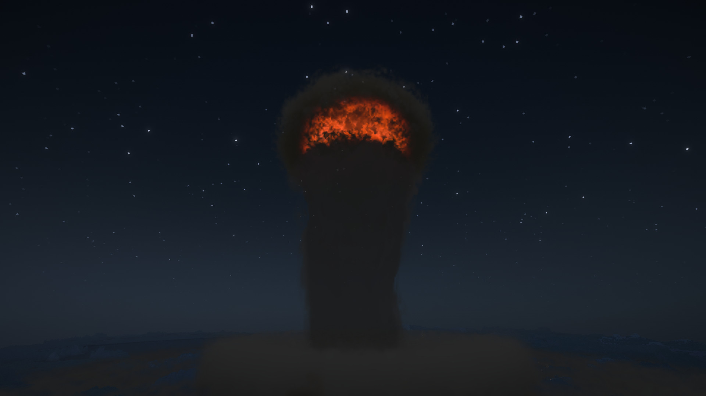

# Nuclear strike

English · [Русский](ru/nuke.md)

A nuclear warhead of 1 to 15 kt on an ICBM, a cruise missile or a B-2 bomb: flash, mushroom cloud, blast wave, fires, and
with a ground burst a crater and a fallout trail. By default, one block represents one meter and the distant wave is slowed so you can see it coming.
Distances below assume full radii.
See [Not physical](not-physical.md) and [world settings](settings.md#world-settings).

In an alarm, get under thick ground, avoid windows and do not look at the fireball. After a ground burst, leave the
fallout trail or stay under cover; water washes contamination off you. [Survival and radiation](#how-to-survive)
come first; [what happens](#what-happens) describes the strike.

## How to launch

By default only operators can.

1. You need an ICBM item, or a missile or bomb plus a Nuclear Warhead ([recipes](munitions.md#recipes)).
2. On the console: the Nuclear weapon, or the nuclear warhead option of the Missile and the Bomb; the yield
   slider, any whole number from 1 kt ("tactical") to 15 kt ("Hiroshima"); for the ICBM and the missile an air burst
   (wider destruction) or a ground burst (crater and fallout trail). The bomb explodes underground.
3. LMB in the binoculars or FIRE. A 3-second countdown follows, and LMB again cancels it.

The ICBM lifts off behind you. By default, the strike follows 90 seconds later.

If the world owner has allowed nuclear weapons for everyone, a player without operator rights needs a second key
whenever someone else is online: another player within 16 blocks presses `.` within 30 seconds. Every player is told
about such a launch. Once ordered, the ordinary launching player cannot recall the nuclear strike, even while it waits for a second key; an operator or the host can
abort it with `/incoming clear`. The alarm at the target lasts at least 90 seconds: a missile or B-2
with a nuclear warhead takes off 90 seconds after the alarm starts.

## How to survive

- **Get underground.** A thick mass of natural ground shelters a closed bunker or cave from the wave, and earth
  stops light and attenuates radiation. An exposed natural ridge, overhang or wall up to three blocks thick can break
  when air reaches both sides; narrow natural pillars can topple. A thin natural roof is not the same as deep cover.
  A block of stone cuts the radiation of the burst about a hundredfold, a block of earth about thirtyfold. A trench
  or a wall stops what comes straight from the fireball, but not the part
  the air scatters down from the sky.
- **Keep away from walls and windows.** The wave hurts mostly by throwing you against something hard and with glass
  from windows between you and the burst. A wall right behind you reflects the wave and at least doubles the pressure
  on your lungs. A house that collapses buries those inside: dig yourself out before you suffocate.
- **Do not look at the fireball.** Its light reaches only those who can see it, under open sky or through a window, and
  burns the side of the body that faces it.
- **Burns** depend on the yield: the pulse of a bigger burst is longer, and skin takes more of it. At 15 kt bare skin
  reddens out to about 3.4 km, blisters out to 2.6 km and burns through out to 2.1 km; a cotton shirt catches fire out
  to 1.6 km (water puts it out). Clothes shield you until they catch fire, so a dressed player is burned on the face
  and arms, and an animal over its whole side. Iron armour stops the light; leather catches fire later than a shirt.
  Burns take a share of your health and keep it until they heal: two game weeks for blisters, five for deep burns.
  Deep burns over a quarter of the body, or blisters over 30 % of it, bring shock: you die within 12 game hours. The
  flash alone burns a dressed player far less than that, but burning clothes keep burning like any fire: get into
  water. Milk and potions do not heal burns.
- **If you see a flash in the distance**, you have seconds before the wave arrives: get behind a slope, into a
  basement, into a pit.
- **The flash blinds.** It dazzles everyone who sees the fireball, and more weakly everyone under the open sky it lights
  up: the whole view goes bright, then grey by day or black at night, and clears over seconds or minutes. The closer
  you are, the longer it lasts, and at night, when your eyes have got used to the dark, far longer: at 15 kt about
  50 seconds at 3 km by day, several minutes at 10 km at night. If you were looking towards the fireball, its image
  burns a blind spot into your eyes for good, at 15 kt out to about 30 km by day and 50 km at night. The spot moves
  with your gaze and is fainter off to the side; it goes away only when you die. In creative and spectator mode you
  still see the white flash and its afterimage, but your sight is not dimmed and the spots are hidden.
- **Leave the fallout trail, or wait it out indoors.** Fallout lies on everything open to the sky and shines through
  roofs and walls: a block of stone or earth stops nearly all of it, a block of wood about 95%, glass almost nothing,
  and an open doorway lets it in. Water washes the dust off you (rain does not).
- **Radiation sickness** starts hours later and keeps game time: nausea and vomiting, then days or weeks of feeling
  well, then weeks of weakness, from 2 Gy without natural healing. Whether it kills depends on the dose: below 2 Gy
  almost nobody dies, at 4.5 Gy half, from 10 Gy everyone, and the higher the dose, the sooner (from 50 Gy within a
  game day or two). Milk does not cure it.

A Geiger Counter in hand clicks and shows your dose. Operators give it out.

## What happens

The siren warns players near the target. The flash comes first; the fireball rises into a mushroom cloud.
Then the wave reaches the ground around it, breaking buildings and throwing up dust. The sound reaches you with the wave.
Fires and thick dust can make the area hard to see through long after the strike.

A ground burst leaves a crater and radioactive fallout downwind. Over water, spray takes the place of the dust wall.
Burns, radiation and falling debris can still hurt you after the flash, so stay under cover and watch your dose.

Distant Horizons and Voxy can show ruins without you visiting them. ICBM strikes prepare the hardest-hit area during
flight; other nuclear carriers can take longer to update the distant view. Broken windows and fallen trees farther
out appear when you approach. In Voxy, players who missed the strike also need to approach to see its distant ruins.

The detailed timings, visual behavior and model limits are in the [nuclear effects reference](../dev/nuclear-effects-reference.md).
