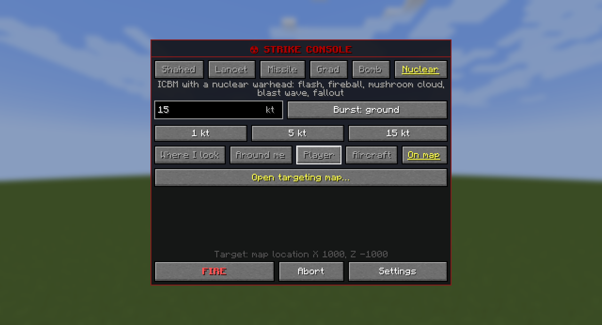
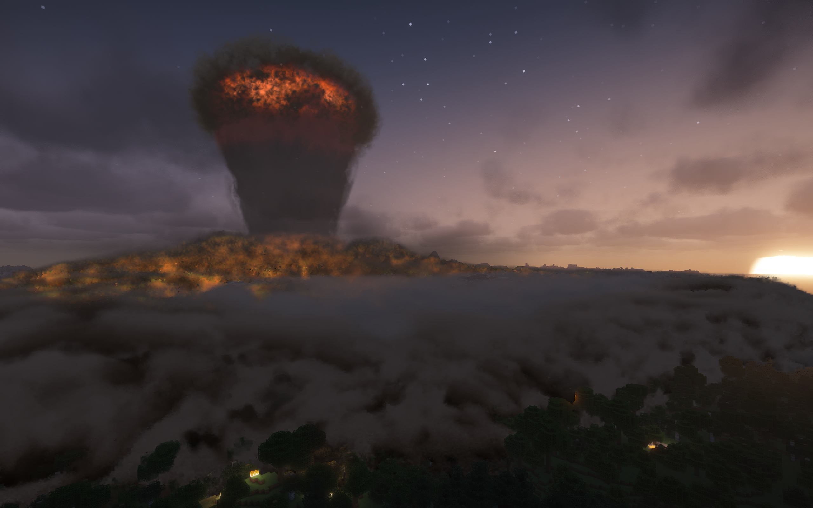

# Nuclear strike

English · [Русский](ru/nuke.md)

A nuclear warhead of 1 to 15 kt on an ICBM, a cruise missile or a B-2 bomb: flash, mushroom cloud, blast wave, fires, and
with a ground burst a crater and a fallout trail. By default, one block represents one meter and the distant wave is slowed so you can see it coming.
Distances below assume full radii.
See [Not physical](not-physical.md) and [world settings](settings.md#world-settings).

In an alarm, get under thick ground, avoid windows and do not look at the fireball. After a ground burst, leave the
fallout trail or stay under cover; water washes contamination off you. [Survival and radiation](#how-to-survive)
come first; [what happens](#what-happens) describes the strike.

## How to launch

By default only operators can.

1. You need an ICBM item, or a missile or bomb plus a Nuclear Warhead ([recipes](munitions.md#recipes)).
2. On the console: the Nuclear weapon, or the nuclear warhead option of the Missile and the Bomb; the yield
   numeric field in whole kt and suggested values, up to the world’s configured maximum (at most 15 kt); for the ICBM and the missile a ground burst
   (the default, with a crater and fallout trail) or an air burst (wider destruction). The nuclear bomb detonates on impact; the conventional bunker-buster penetrates before exploding.
3. LMB in the binoculars or FIRE opens the exact target, yield and effect estimates. Select **Prepare target**;
   the server resolves the surface and prepares destruction for this order, showing actual progress. Cancel or close freely.
4. When **Ready** appears, release the button, then hold the launch button for three seconds, or focus it with Tab
   and hold Space or Enter. Releasing, moving off the button or losing focus cancels the hold. Holding during preparation
   never launches automatically. On small screens, scroll or use Page Up/Down to read the details.

The targeting map shows flat-ground reference contours for the fireball reference silhouette, 5 psi and 1 psi.
The fireball reference is its radius at the second light maximum; it can expand farther later.
“Fit effects” fits them in the viewport; “Thermal / glass” also shows the 0.5 psi glazing reference and the median
first-degree burn radius for exposed skin at the shown weather visibility. These are estimates, not uniform damage
boundaries: terrain, shelter, clothing and materials matter. A dashed elevated fireball silhouette is not a ground-contact disk.
The review shows your distance and a north-up downwind arrow. Unknown ground height remains an estimate.
Viewing a wider footprint does not increase targeting range or reveal hidden players.

Inspection and preparation reserve no ammunition and start no alarm. Payment and the existing second-key window begin
only after confirmation. A changed target, weather, limit or configuration requires a new review. Preparation stays
alive while the review is open; closing, death, disconnect, dimension change, abort or one minute without contact cancels
unlaunched preparation. A confirmed order waiting for a second key or carrier warning keeps its preparation itself.
The configured ICBM flight duration (90 seconds by default) starts at launch, after preparation. A required second key
or carrier warning can add waiting before launch. Ordinary nuclear commands
prepare unpaid and then launch once ready, because the command itself is the instruction to fire. Operator `nuke now`
remains immediate diagnostic behavior. Carrier preparation includes its usual randomly selected aim offset; launch keeps that same offset.
Plans cover the normal arrival for a fixed point or map-ground order. Entity/craft targeting, an earlier collision,
terrain edit or server restart may require fresh destruction work at the actual impact site. It does not guarantee that every distant-terrain client already has the latest view.

Existing worlds need no config edit: burst mode is not stored in `incoming-server.toml`. Older versions normally
omitted AIR from saved designator settings because it was the default, so those designators switch to GROUND after
updating, even if you selected AIR with the button. A saved `air_burst=true` field still keeps AIR. You can select
air burst again on the console before launching. ICBMs already scheduled keep their burst mode.

The ICBM lifts off behind you. By default, the strike follows 90 seconds later.
Near the target, its final approach is a compact glowing head with a short fading wake, ending at the burst
height. It is easier to see at night; haze and terrain can hide it. There is no incoming whistle. The nuclear
bang still arrives with the blast front. The existing flight-speed scale also controls the visible approach.

If the world owner has allowed nuclear weapons for everyone, a player without operator rights needs a second key
whenever someone else is online: another player within 16 blocks presses `.` within 30 seconds. Every player is told
about such a launch. Once ordered, the ordinary launching player cannot recall the nuclear strike, even while it waits for a second key; an operator or the host can
abort it with `/incoming clear`. The alarm at the target lasts at least 90 seconds: a missile or B-2
with a nuclear warhead takes off 90 seconds after the alarm starts.

## How to survive

- **Get underground.** A thick mass of natural ground shelters a closed bunker or cave from the wave, and earth
  stops light and attenuates radiation. An exposed natural ridge, overhang or wall up to three blocks thick can break
  when air reaches both sides; narrow natural pillars can topple. A thin natural roof is not the same as deep cover.
  A block of stone cuts the radiation of the burst about a hundredfold, a block of earth about thirtyfold. A trench
  or a wall stops what comes straight from the fireball, but not the part
  the air scatters down from the sky.
- **Keep away from walls and windows.** The wave hurts mostly by throwing you against something hard and with glass
  from windows between you and the burst. A wall right behind you reflects the wave and at least doubles the pressure
  on your lungs. A house that collapses buries those inside: dig yourself out before you suffocate.
- **Do not look at the fireball.** Its light reaches only those who can see it, under open sky or through a window, and
  burns the side of the body that faces it.
- **Burns** depend on the yield: the pulse of a bigger burst is longer, and skin takes more of it. At 15 kt bare skin
  reddens out to about 3.4 km, blisters out to 2.6 km and burns through out to 2.1 km; a cotton shirt catches fire out
  to 1.6 km (water puts it out). Clothes shield you until they catch fire, so a dressed player is burned on the face
  and arms, and an animal over its whole side. Iron armour stops the light; leather catches fire later than a shirt.
  Burns take a share of your health and keep it until they heal: two game weeks for blisters, five for deep burns.
  Deep burns over a quarter of the body, or blisters over 30 % of it, bring shock: you die within 12 game hours. The
  flash alone burns a dressed player far less than that, but burning clothes keep burning like any fire: get into
  water. Milk and potions do not heal burns.
- **If you see a flash in the distance**, you have seconds before the wave arrives: get behind a slope, into a
  basement, into a pit.
- **The flash blinds.** It dazzles everyone who sees the fireball, and more weakly everyone under the open sky it lights
  up: the whole view goes bright, then grey by day or black at night, and clears over seconds or minutes. The closer
  you are, the longer it lasts, and at night, when your eyes have got used to the dark, far longer: at 15 kt about
  50 seconds at 3 km by day, several minutes at 10 km at night. If you were looking towards the fireball, its image
  burns a blind spot into your eyes for good, at 15 kt out to about 30 km by day and 50 km at night. The spot moves
  with your gaze and is fainter off to the side; it goes away only when you die. In creative and spectator mode you
  still see the white flash and its afterimage, but your sight is not dimmed and the spots are hidden.
- **Leave the fallout trail, or wait it out indoors.** Fallout lies on everything open to the sky and shines through
  roofs and walls: a block of stone or earth stops nearly all of it, a block of wood about 95%, glass almost nothing,
  and an open doorway lets it in. Water washes the dust off you (rain does not).
- **Radiation sickness** starts hours later and keeps game time: nausea and vomiting, then days or weeks of feeling
  well, then weeks of weakness, from 2 Gy without natural healing. Whether it kills depends on the dose: below 2 Gy
  almost nobody dies, at 4.5 Gy half, from 10 Gy everyone, and the higher the dose, the sooner (from 50 Gy within a
  game day or two). Milk does not cure it.

A Geiger Counter in hand clicks and shows your dose. Operators give it out.

## What happens

The siren warns players near the target. The flash comes first; the fireball rises into a mushroom cloud.
Then the wave reaches the ground around it, breaking buildings and throwing up dust. The sound reaches you with the wave.
Fires and thick dust can make the area hard to see through long after the strike.

Walls, floors, columns and timber respond to their shape, material, pressure and the duration of the blast.
Tall and branched trees can topple too. When the strike cuts a structure's last support, the support check
continues across chunk borders. Untouched floating builds stay as they were.

Broken structural blocks fall and drift before settling on actual support. Coarse rubble keeps its block type;
containers retain their contents. Charred faces travel with the block and rotate with fallen logs. Loose piles spread into lower neighbouring spaces. Material still travelling
is saved with the world, so leaving and returning does not erase it. Leaves and shattered glazing enter the dispersed debris reservoir.
A surface-burst crater supplies its rim from the ground actually excavated; remaining ejecta and thermally transformed material stay accounted for.

If the shared nuclear working-memory reservation is full, further material removal waits while already moving
material can settle. Pending material and support checks survive a normal world save and reload. Completed movement and crater
checkpoints are compacted into material totals; container contents are retained. Saving can pause material
movement until its file is written. An old active journal too large for the shared memory limit stays preserved
on disk and paused; it is never replaced with an empty aftermath.

These are reduced block-scale rules: joint properties, drag and the pile's repose angle are estimates.

With the default ground burst, the dust column joins the mushroom cap. With an explicitly selected air burst
at the standard burst height, the column starts rising later, with a billowing upper edge, and stays below the
faster-rising cap. The gap is expected; in the first seconds, dust near the ground can hide the short column entirely.

A ground burst leaves a crater and radioactive fallout downwind. Over water, spray takes the place of the dust wall.
Burns, radiation and falling debris can still hurt you after the flash, so stay under cover and watch your dose.

Nearby terrain changes as the pressure wave passes. Distant Horizons can show distant damage through its supported
integration. Voxy receives remote terrain through LOD Server Support after the changed world chunks are saved;
these updates can arrive later than the wave. Without a server terrain provider, Voxy only knows terrain the
client has loaded. Saved world changes remain the source of ruins, including for players who join later.

The detailed timings, visual behavior and model limits are in the [nuclear effects reference](../dev/nuclear-effects-reference.md).

### Saved ruins beyond view distance

After the wave has crossed the ruin zone, the server gradually applies ruins and ground traces to existing chunks
throughout that zone, even without nearby players or a distant-terrain mod. Maps that read the saved world receive
these changes through their normal updates. The pass expands outward from the burst; a large zone takes time to finish.
Concurrency follows spare server time and available memory. Simultaneous strikes share preparation memory across
dimensions; busy preparation can leave distant updates for this background pass. Player-visible ruins take priority.
The pass resumes after a server restart and also catches up retained nuclear strikes from older versions.
