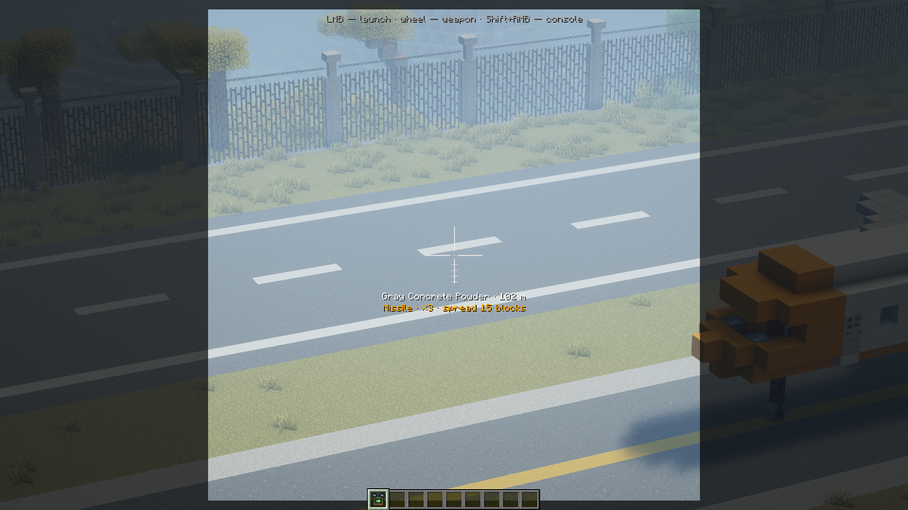

# Incoming: руководство игрока

[English](../README.md) · Русский

В Incoming можно вызывать удары с воздуха и защищаться от них. Для начала хватит одного шахеда и открытого участка земли.

## Первый пуск

1. Установи Incoming для **Minecraft 1.21.1 и NeoForge 21.1.264+**, с Java 21. Положи [jar](https://github.com/zentixua/incoming/releases/latest) в `mods`; на сервере всем нужна одна версия.
2. Скрафти [пульт наведения](designator.md#как-получить) и [боеприпас «Шахед»](munitions.md). Держи оба в инвентаре. В творческом режиме нужен только пульт.
3. Отойди от построек. Зажми ПКМ, выбери шахед колесом, наведи прицел на землю вдалеке и нажми ЛКМ.
4. Нажми `N`, чтобы смотреть через камеру снаряда; Shift — выход. Твой персонаж остаётся на месте, поэтому заранее найди укрытие.

По умолчанию удары ломают блоки и вызывают пожары. Владелец может изменить это в [настройках мира](settings.md#настройки-мира).

## Что дальше?

| Хочу… | Куда смотреть |
|---|---|
| Выбрать другое оружие или сделать боеприпасы | [Оружие](weapons.md) · [Рецепты](munitions.md) |
| Дать залп или отменить удар | [Пульт наведения](designator.md) |
| Проложить маршрут или навести «Ланцет» | [Карта](map.md) · [Камера снаряда](camera.md) |
| Играть с друзьями и защищать базу | [Правила наведения](rules.md) · [ПВО](defense.md) |
| Собрать пусковую с редстоуном | [Стационарная пусковая](launcher.md) |
| Запустить ядерную ракету или пережить удар | [Ядерный удар](nuke.md) |
| Погасить свет в районе | [Блэкаут](blackout.md) |
| Настроить мир или разобраться с неполадкой | [Настройки](settings.md) · [Команды](commands.md) · [Вопросы](faq.md) |
| Добавить другие моды | [Совместимость](compatibility.md) |

## Клавиши

| Где | Клавиша | Что делает |
|---|---|---|
| с пультом в руке | ПКМ (держать) | бинокль |
| в бинокле | ЛКМ / колесо мыши | пуск / выбор оружия |
| с пультом в руке | Shift+ПКМ | экран пульта |
| в игре | `,` | карта наведения |
| в игре | `N` | камера снаряда; ещё раз — следующий снаряд |
| в камере снаряда | ЛКМ / Shift | новая цель / выход |
| в камере снаряда | F5 | вид со стороны (обычная клавиша смены перспективы) |
| на карте | ЛКМ / Enter | выбрать цель / огонь |
| на карте | Shift+ЛКМ / ПКМ | поставить / убрать точку маршрута |
| на карте | Ctrl+ЛКМ | выбрать точку пуска (оператор и хост) |
| рядом с чужим ядерным пуском | `.` | второй ключ |

Клавиши меняются в «Настройки → Управление → Incoming».
