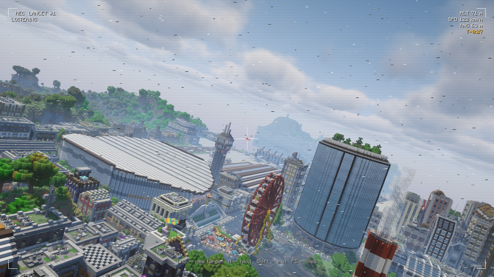

# Камера снаряда

[English](../camera.md) · Русский

Нажми `N`, когда твой снаряд в полёте, и смотри удар его глазами: полёт с борта и попадание. Ещё раз `N` —
следующий снаряд, Shift — выход. Пока ты в камере, твой персонаж стоит на месте. Слышишь ты то, что слышит камера,
а ударная волна бьёт по ушам и толкает тебя, только когда дойдёт до твоего персонажа.

Подписи камеры и радара зависят от языка игры: «ЗАП» — индикатор камеры, «С» — север, «Т-» — время до попадания.
Индикатор камеры не сохраняет видео в файл.

- Если снаряд дальше твоей прорисовки, вместо видео карта с его путём. Подлетит ближе — видео включится само.
- **ЛКМ** — новая цель: то, что в перекрестии.
- **F5** — вид со стороны, обычной клавишей смены перспективы.
- Шахед и «Ланцет» идут за движущейся целью, пока ты держишь её в кадре. Остальное оружие бьёт туда, где цель была
  при пуске.
- Чтобы камера включалась сама при каждом пуске, включи это в [настройках](settings.md).

## «Ланцет»

«Ланцет» прилетает к цели и кружит над ней. Наведи перекрестие на цель внизу и нажми ЛКМ: он сразу пикирует.
Не выбрал — пикирует сам примерно через 25 секунд.

