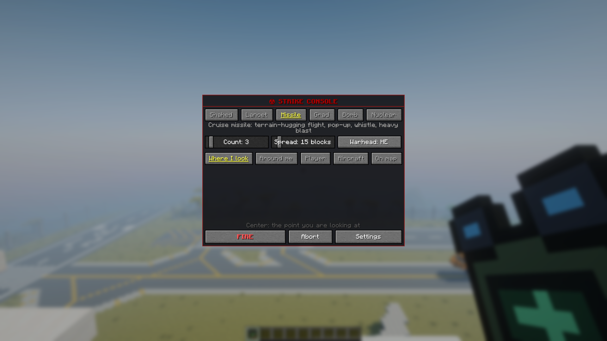
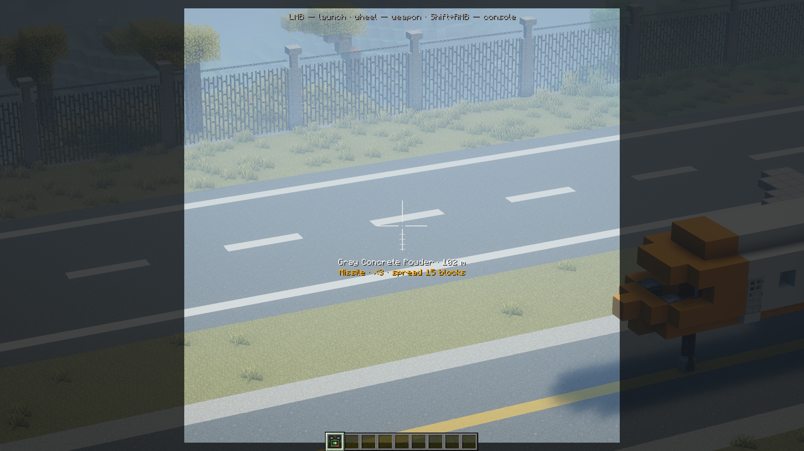
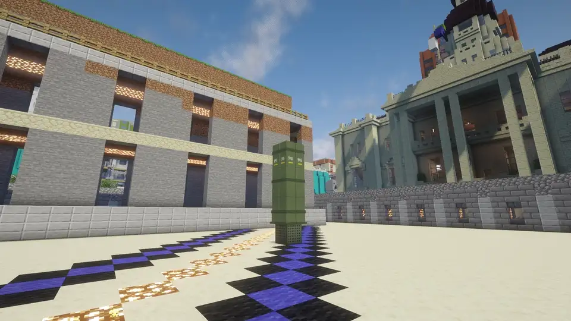

# Пульт наведения

[English](../designator.md) · Русский

Пульт наводит и пускает все удары: из бинокля, с экрана пульта или с [карты](map.md).
Shift+ПКМ с пультом в руке открывает экран пульта; когда впервые берёшь пульт в руку, об этом напоминает подсказка в
углу экрана.

## Как получить

Крафт: сверху красная пыль, в середине железный слиток, подзорная труба и железный слиток, снизу компас.

Состав: 1 красная пыль, 2 железных слитка, 1 подзорная труба и 1 компас. Получается 1 пульт. Рецепт появляется в книге
рецептов, как только у тебя есть любой из ингредиентов.

В творческом режиме пульт лежит во вкладке «Incoming». Если хозяин мира разрешил пульт только операторам, остальным
он не стреляет.

## Бинокль

- **ПКМ (держать)** — бинокль. Под прицелом видно, что это и как далеко. Захватил моба, игрока или аппарат — пульт
  пищит.
- **Колесо мыши** — оружие: Шахед, Ланцет, Ракета, Град, Бомба, Ядерная. Град бьёт пакетом; если прокрутить к другому
  оружию, снова будет один снаряд.
- **ЛКМ** — пуск. Если под прицелом ничего нет, об этом скажет строка над панелью предметов.

Если ты стоишь там, куда долетают осколки боевой части (опасная дистанция плюс разброс залпа: около 120 м у Шахеда и
Града, 210 м у ракеты, 55 м у Ланцета), прицел предупреждает «Опасно близко». Пуск он не запрещает.

Мобов, игроков, аппараты и блоки бинокль захватывает до 400 блоков. Дальше он отмечает землю, которую видно, насколько
позволяет воздух: 20 км в ясную погоду, 5 км в дождь, 1 км в грозу, и не дальше, чем достаёт карта. За прорисовкой для
этого нужна дальняя земля от Voxy, Distant Horizons или LOD Server Support, без них бей [по карте](map.md). Для ядерного пуска проверь цель и
удерживай последнюю кнопку пуска три секунды. Отпускание отменяет удержание. [Ядерный удар](nuke.md#как-запустить).

## Экран пульта

Shift+ПКМ с пультом в руке. Здесь выбирают, сколько снарядов пустить, как широко их раскидать и куда. Бинокль потом
стреляет с этими же настройками.

- **Оружие** — шесть кнопок, у каждой подсказка. У ракеты и бомбы рядом кнопка ядерной боевой части.
- **Количество и разброс** — до 30 снарядов на площади до 150 блоков от центра.
- **Цель**: «Куда смотрю», «Вокруг меня» (туда, где стоишь, так что отойди), «Игрок» (только
  [замеченные](rules.md#разведка)), «Аппарат» (летательные аппараты Create рядом), «На карте».
- **ОГОНЬ**, **Отбой** и **Настройки**. Пока заказ не готов, ОГОНЬ серый, а подсказка на нём говорит, чего не хватает
  (мощности, игрока, аппарата). В выживании красная строка над ним показывает, каких боеприпасов не хватает на заказ.

## Снаряды на экране

Пока твои снаряды летят, справа вверху виден их список с этапом полёта и временем до удара, а в мире вокруг каждого
снаряда и его цели — рамки-уголки размером с само тело на экране, между ними пунктир. Рамка держится на идущем
игроке или мобе и растёт вместе с ним, когда приближаешь вид зумом; дальняя не становится меньше нескольких пикселей.
Номер снаряда и время до удара — над его рамкой, подпись цели — под её рамкой: текст не закрывает то, что помечает, и
при любом зуме остаётся того же размера.

## Отбой

Кнопка «Отбой» на экране пульта отменяет **твои** удары: снаряды самоликвидируются в воздухе без взрыва, B-2
отворачивает, невыпущенные снаряды залпа возвращаются в инвентарь. Ядерный удар, летящий «Град» и сброшенная бомба
долетят.
