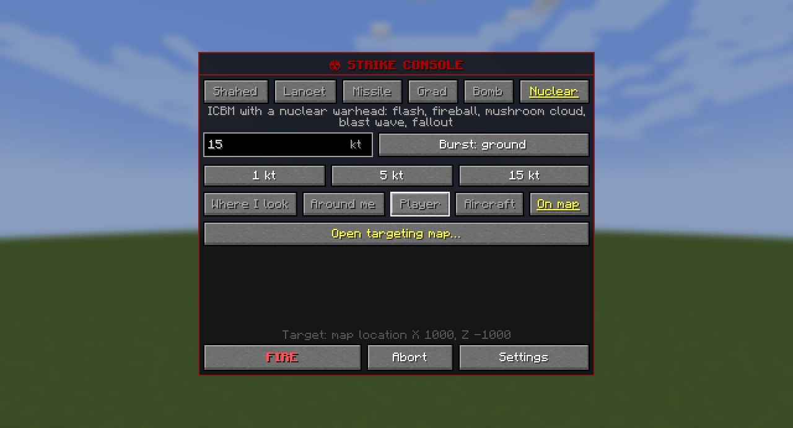
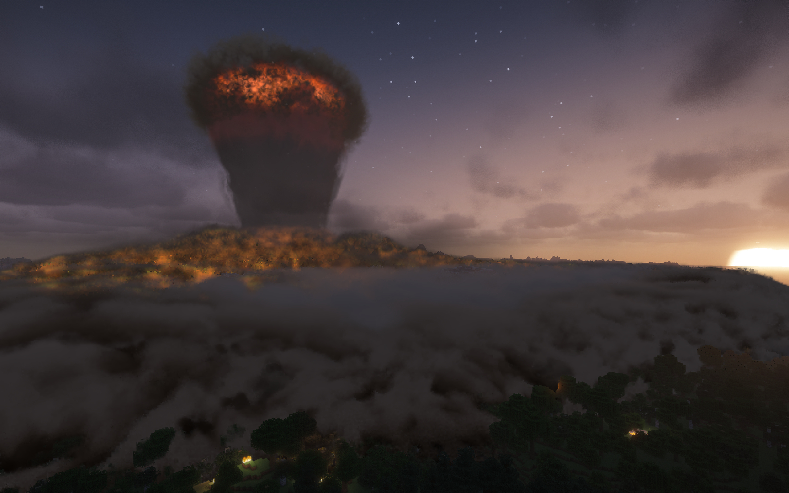

# Ядерный удар

[English](../nuke.md) · Русский

Ядерная боеголовка от 1 кт до 1 Мт на МБР, крылатой ракете или бомбе B-2: вспышка, гриб, ударная волна и пожары.
Наземный взрыв оставляет воронку и радиоактивный след по ветру. По умолчанию один блок равен метру, а дальняя волна
замедлена, чтобы было видно её приближение. Расстояния ниже указаны для полного масштаба.
Смотри [игровые условности](not-physical.md) и [настройки мира](settings.md#настройки-мира).

При тревоге укройся под толщей грунта, отойди от окон и не смотри на огненный шар. После наземного взрыва выйди
из следа осадков или оставайся в укрытии; вода смывает заражение. [Выживание и радиация](#как-выжить) идут перед
[описанием удара](#что-будет) ниже.

## Как пустить

По умолчанию — операторы и хозяин одиночного или открытого по сети мира, с читами или без.

1. Нужен предмет «МБР» или ракета либо бомба плюс «Ядерная боевая часть» ([рецепты](munitions.md#рецепты)).
2. На экране пульта: оружие «Ядерная» или выбор ядерной боевой части у ракеты и бомбы; числовое поле мощности и подсказки значений,
   от 1 кт до серверного предела (`nuclear.max_yield`, по умолчанию 100 кт, не выше 1 Мт); у МБР и ракеты подрыв наземный
   (по умолчанию, с воронкой и радиоактивным следом) или воздушный (шире разрушения), бомба рвётся под землёй.
3. ЛКМ в бинокле или «ОГОНЬ» открывает проверку цели и мощности, подтверждённых сервером. Удерживай кнопку
   пуска три секунды или выбери её клавишей Tab и удерживай Пробел либо Enter. Отпускание, уход указателя с кнопки,
   потеря фокуса окна или закрытие проверки отменяет удержание. На маленьком экране прокручивай текст мышью или Page Up/Down.

Карта цели показывает оценочные контуры для ровной земли: справочный силуэт огненного шара, давление 5 psi и 1 psi.
Шар показан на втором максимуме свечения; позже он расширяется дальше.
«Вместить эффекты» вмещает их в окно; «Ожоги / стекло» добавляет ориентир 0,5 psi для стекла и медианный радиус ожога
I степени открытой кожи при указанной погодной видимости. Это оценки, а не границы одинакового урона: рельеф,
укрытия, одежда и материалы меняют результат. Пунктирный силуэт шара над землёй не означает касание земли.
В проверке показаны расстояние от тебя и стрелка по ветру на схеме севером вверх. Неизвестная высота земли остаётся оценкой.
Обзор большей зоны не увеличивает дальность выбора цели и не раскрывает скрытых игроков.
После взрыва кольцо на карте в реальном времени идёт за ударной волной по земле, пока волна не ослабнет до безвредной.
От толстого красного при большом давлении оно бледнеет и тоньшает к концу, подпись — расстояние от эпицентра и давление;
полоса за ним — где сейчас дует ударный ветер. Под твоей меткой — секунды до прихода волны к тебе.

Проверка не резервирует боеприпас и не запускает подготовку или тревогу. Оплата и прежнее окно второго ключа
начинаются после подтверждения. Изменение цели, погоды, серверного лимита или настройки времени полёта требует новой
проверки. Неоплаченная проверка истекает через минуту и сбрасывается при выходе, смерти и перезапуске.
Время полёта и операторские команды немедленного подрыва прежние; проверка не гарантирует готовность разрушений
или LOD для наблюдателя, прибывшего в неподготовленное место во время полёта.

В существующих мирах конфиг менять не нужно: тип подрыва не хранится в `incoming-server.toml`. Старые версии обычно
не записывали AIR в настройки пульта, поскольку он был выбран по умолчанию. Поэтому после обновления такие пульты
перейдут на GROUND, даже если ты выбрал AIR кнопкой. Если поле `air_burst=true` записано в сохранении, AIR останется.
Перед пуском воздушный подрыв можно снова выбрать на экране пульта. Уже запланированные МБР сохранят свой тип подрыва.

МБР стартует с точки пуска, выбранной [на карте](map.md#точка-пуска), а без неё — позади тебя. Первая ступень работает минуту: пламя и белый след уходят в небо с наклоном к цели,
пока ступень не выгорит на высоте около 20 км. По умолчанию удар следует через 90 секунд после пуска;
при меньшем времени полёта короче и подъём, и падение.
Вниз возвращается только боеголовка. Последние 30 секунд она круто падает с неба со стороны пуска, яркая, как
большой метеор: воздух перед ней раскаляется в плазму. Ночью она освещает землю и оставляет длинный бело-оранжевый
след, днём видна как яркая точка с коротким хвостом. Её могут скрыть облака, дымка и рельеф. Она быстрее звука,
поэтому до взрыва ничего не слышно. Масштаб скорости полёта управляет и заходом.

Если хозяин мира разрешил ядерку всем, игроку без прав оператора нужен второй ключ, когда в игре есть кто-то ещё:
другой игрок не дальше 16 блоков нажимает `.` за 30 секунд. При `world.early_warning = true` о таком пуске сообщается всем.
При выключенной сети запрос второго ключа по-прежнему получают игроки рядом, которые могут разрешить пуск; автоматических сообщений о пуске и тревоги у цели нет. После приказа обычный запускающий не может
отозвать ядерный удар, даже пока тот ждёт второго ключа; оператор или хост может отменить его командой `/incoming clear`. МБР обычного игрока
по-прежнему летит не меньше 90 секунд, а ракета или B-2 с ядерной боевой частью ждут пуска 90 секунд даже при выключенной сети. Владелец сохраняет свой отсчёт и подтверждения пуска.

## Как выжить

- **Под землю.** Толща природного грунта укрывает закрытый бункер или пещеру от волны, земля держит свет и ослабляет
  радиацию. Открытый гребень, навес или стенка из природного материала до трёх блоков толщиной может сломаться,
  если воздух подходит с обеих сторон; узкий природный столб может опрокинуться. Тонкая природная крыша не заменяет глубину. Блок камня ослабляет радиацию подрыва примерно в сто раз, блок земли — раз в тридцать. Окоп или стена
  держат то, что идёт прямо от шара, но не ту часть, которую воздух рассеивает с неба.
- **Подальше от стен и окон.** Волна калечит прежде всего броском о твёрдое и стеклом окон между тобой и взрывом. Стена
  прямо за спиной отражает волну и поднимает давление на лёгкие самое меньшее вдвое. Рухнувший дом засыпает тех, кто
  внутри: выбирайся из-под завала, пока не задохнулся.
- **Волна оглушает.** У 15 кт она приглушает звук примерно до 4 км, а ближе всё слышно как сквозь вату. Слух возвращается за
  игровые часы: до 16 дальше 1,5 км, двое игровых суток в 1 км. С этим приходит тихий звон, слышный только в тишине:
  дальше 1,5 км — меньше игрового часа, громко и долго — только примерно ближе 1 км. С 5 psi (примерно 1,1 км) могут
  порваться перепонки, и всё звучит глухо 4–8 игровых недель. Смерть возвращает слух, а выход из игры и повторный вход —
  нет.
- **Не смотреть на шар.** Свет достаёт только тех, кто видит шар, под открытым небом или через окно, и обжигает
  сторону тела к шару.
- **Ожоги** зависят от мощности: у большого подрыва импульс длиннее, и коже его нужно больше. У 15 кт открытая кожа
  краснеет примерно до 3,4 км, покрывается пузырями до 2,6 км и сгорает вглубь до 2,1 км; хлопковая рубашка
  загорается до 1,6 км. Одежда защищает, только пока не загорелась: горящая одежда жжёт кожу под собой,
  поэтому там, где загорается рубашка, одетый игрок обожжён по всему боку к шару, как животное. Дальше обожжены только
  лицо и руки. Железная броня свет не пускает, кожаная загорается позже рубашки. Ожоги отнимают
  долю здоровья и держат её, пока заживают: пузыри — две игровые недели, глубокие — пять. Глубокие ожоги на четверти
  тела или пузыри на 30 % тела — ожоговый шок: смерть в пределах 12 игровых часов. Там, где загорается одежда, это шок;
  дальше одетого игрока вспышка жжёт намного меньше. Молоко и зелья ожоги не лечат.
- **Увидел вспышку вдали** — у тебя есть секунды до волны: за склон, в подвал, в яму.
- **Вспышка слепит.** Она засвечивает глаза всем, кто видит шар, и слабее — всем под открытым небом, которое она
  освещает. Поле зрения белеет. Когда белое уходит, там, где был шар, остаётся послеобраз: сначала яркий, потом
  оранжевый, потом фиолетовый, он ходит за взглядом. Днём картинка остаётся немного бледной и выцветшей и приходит в
  себя за секунды или минуты; сквозь неё всегда видно. Чем ближе, тем дольше, а ночью, когда глаза привыкли
  к темноте, — намного дольше: у 15 кт днём в 3 км — около 50 секунд, ночью в 10 км — несколько минут. Кто смотрел в
  сторону шара, у того его изображение выжигает в глазах слепое пятно навсегда — у 15 кт примерно до 30 км днём и
  50 км ночью. Пятно ходит со взглядом, сбоку оно бледнее; проходит только со смертью. В творческом режиме ослепление
  такое же, но слепых пятен нет; наблюдатель видит только белую вспышку и послеобраз. Настройка «Яркость вспышки»
  ослабляет или выключает всё это.
  Закрытое укрытие защищает от новой вспышки; через окна и входы в пещеры проходит часть рассеянного света.
  Факел не пропускает вспышку сквозь камень. Огненный шар, частично скрытый холмами или деревьями, светит только
  видимой частью. Уже полученный послеобраз в укрытии не исчезает.
- **Уйди из следа или пережди в доме.** Осадки лежат на всём, что открыто небу, и светят сквозь крышу и стены: блок
  камня или земли держит почти всё, блок дерева — около 95 %, стекло — почти ничего, а открытый проём пропускает. Пыль
  с одежды смывает вода (дождь не смывает); иначе она спадает так же медленно, как сами осадки. Осадки выпадают там,
  куда ветер несёт облако, и тогда, когда оно туда доходит: за десятки километров по ветру через час и больше после
  взрыва, даже когда облако уже не видно. На земле они слабеют, пока идут сутки мира, везде по одному закону: в семь раз
  старше — в десять раз слабее. В назначенный день они не исчезают: у эпицентра наземного взрыва земля остаётся
  заметно радиоактивной годы игрового времени (15 кт: около полутора лет игры в обычном мире), всё слабее, пока не
  выполнят `/incoming clear`.
- **Лучевая болезнь** начинается через часы и идёт по игровым часам: тошнота и рвота, потом дни или недели, когда
  кажешься здоровым, потом недели слабости, от 2 Гр — без естественного восстановления здоровья. Убьёт ли она,
  решает доза: до 2 Гр почти никто не умирает, при 4,5 Гр — половина, от 10 Гр — все, и чем больше доза, тем скорее
  (от 50 Гр — за игровые сутки-двое). От 50 Гр она бьёт по мозгу: через минуты еле плетёшься, на четверти скорости, до
  самой смерти. Молоко её не лечит. Животные и жители получают ту же дозу и болезнь, нежить — нет.

Счётчик Гейгера в руке щёлкает и показывает мощность дозы и твою дозу. Его крафтят из медных и железных слитков,
красной пыли, нотного блока и электронной лампы ([рецепт](munitions.md#рецепты)). В творческом режиме доза не копится.

Защитный костюм из другого мода защищает, если в нём задана защита от радиации: у защитного костюма Mekanism она
есть, а датапак может задать долю любой броне ([для сборщиков](packs.md#защита-от-радиации-incomingradiation_shielding)).
Каждая надетая вещь задерживает свою долю излучения взрыва, осадков и пыли чёрного дождя; полный защитный костюм
Mekanism задерживает всё. Уже полученную дозу он не снижает и пыль, уже осевшую на тебе, не убирает: её смывает вода.
Счётчик Гейгера по-прежнему показывает мощность дозы вокруг тебя; в костюме твоя доза растёт медленнее. Своего костюма в
Incoming нет.

## Что будет

Сирена заранее предупреждает игроков возле цели. Сначала вспышка. Днём секунду-две огненный шар ярче солнца: всё, что
смотрит на него, залито белым светом, обычный дневной свет отступает, воздух вокруг шара светится. Крупный взрыв
светит много секунд: глаза привыкают к нему, поэтому освещённые им земля и пыль сохраняют цвет и детали, а дневное
небо за ними темнеет. Потом день возвращается, а шар поднимается и становится грибом. Ночью шар заливает землю оранжевым светом.
Волна проходит по земле, ломает здания и поднимает пыль. Звук приходит к тебе вместе с волной.
Пожары и густая пыль мешают видеть ещё долго после удара. Факелы, фонари и другие источники света
подсвечивают пыль вокруг себя и освещают землю под её тенью; с LambDynamicLights — и факел в руке.

Вспышка выжигает открытую землю по всей зоне: трава выгорает до земли и обугленной подстилки, растения сгорают,
биомы темнеют. Свет идёт от всего огненного шара, а он даже при наземном взрыве в 1 Мт выше километра, поэтому
земля за невысоким пригорком тоже горит. Стена, дом или холм рядом (до 40 блоков в сторону взрыва) затеняет землю
за собой; рельеф дальше не затеняет, поэтому за далёкими холмами след сильнее, чем в жизни.

Зелёная трава, листва и цветы во вспышке обугливаются, парят и дымят, но не продолжают гореть, как и на настоящих
испытаниях. Огонь остаётся только на сухом топливе, до которого дошёл свет: сено, блоки сушёной ламинарии, сухие кусты,
строительные леса, книжные полки и кафедры, шерсть, ковры, кровати и флаги, под открытым небом или в доме за стеклом. Дерево от вспышки не загорается. Где климат сухой (пустыня,
саванна, бесплодные земли), трава сухая и горит сплошным полем. Ударная волна задувает часть этих пожаров: ниже 2 psi
ни одного, выше 5 psi половину. Город горит от пожаров, зажжённых через окна; открытая зелёная местность вокруг не горит.
Волна сносит остатки лёгкого дыма от нагретых вспышкой поверхностей, когда до них доходит.

При наземном взрыве, выбранном по умолчанию, пылевой столб соединяется с шапкой гриба. При явно выбранном
воздушном подрыве на стандартной высоте он начинает подниматься позже, с клубящимся верхним краем, и остаётся
ниже шапки, которая растёт быстрее. Разрыв между ними предусмотрен моделью; в первые секунды короткий столб
может целиком скрываться в пыли у земли.

Шапка стоит на километры выше дымки, поэтому солнце освещает её дольше, чем землю. На закате свет на облаке становится
золотым, потом красным, а граница тени Земли поднимается по столбу и шапке; большая шапка ещё какое-то время светится
после того, как солнце на земле село.

Наземный взрыв оставляет воронку и радиоактивный след по ветру. Над водой та же волна срывает вместо пыли белые брызги:
ниже, и через несколько минут они оседают. Подрыв на воде выбрасывает ещё и базисную волну — кольцо тумана из капель,
которое катится от падающего столба воды.
Волна срывает пыль с земли ровно там, где касается её: каждое место поднимает свою пыль, чуть больше или меньше, чуть
раньше или позже соседних, и эта пыль взлетает и остаётся там, где сорвана, пока волна бежит дальше. Пыль каждого места
поднимается примерно в полтора раза выше слоя и оседает до него примерно за секунду, поэтому сразу за волной бежит
небольшой неровный гребень. Голая земля, поля и лес дают густую пыль;
скалы, дороги, крыши и снег дают только пыль разрушенных зданий, поэтому там стена ниже и прозрачнее, а мгла после
неё светлее. Пыль лежит на самой земле: поднимается на холмы и спускается в низины и доходит до той земли, которую видно.
В первые секунды над волной стоит тонкая белая оболочка конденсации: воздух за волной расширяется и остывает ниже точки
росы (воздух в Minecraft для этого достаточно влажный и в ясную погоду, и в дождь).
Пыль цвета той земли, с которой поднята: серо-коричневая над травой, полями и лесом, светло-бежевая над песком, серая
над дорогами, крышами и скалами. Крупная земля держится внизу и выглядит темнее и землистее, мелкая пыль на верхушках
клубов светлее, а соседние участки сорванной земли немного различаются оттенком. Сразу
за волной это чистая пыль; дым темнит её лишь по мере того, как разгораются пожары под ней, за минуты, и только
горящие пожары подсвечивают её снизу оранжевым. Пыль клубится комьями и вихрями: ветер волны отбрасывает её наружу,
обратный ветер останавливает её и возвращает часть назад, затем воздух, втягиваемый под поднимающийся огненный шар, медленно
тянет нижнюю пыль к эпицентру. Десятки секунд слой остаётся беспокойным: вздуваются и опадают валы, поднимаются языки пыли,
порывы сдвигают её клочья; потом он успокаивается до медленных клубов пыльной бури, слегка кружится и сносится ветром.
За следующие часы та же пыль редеет в дымку, которую сносит ветром; где сходится пыль нескольких взрывов, она
складывается.
При настройке **«Гриб и пылевая волна»** в OFF пылевая волна не рисуется: ни эта пыль, ни водяная мгла, ни базисная волна. Остаются брызги рядом с вами и пыль от рушащихся зданий.
После вспышки всё ещё опасны ожоги, радиация и падающие обломки: оставайся в укрытии и следи за дозой.

Distant Horizons и Voxy показывают разрушения, даже если ты не подходил к ним. Для МБР самая разрушенная область
готовится ещё во время полёта; после других ядерных носителей дальний вид может обновиться позже. Выбитые окна и
поваленные деревья дальше от центра появляются при приближении. В Voxy игроку, который пропустил удар, тоже нужно
подойти, чтобы увидеть дальние руины.
Incoming хранит ограниченный список недавних дальних обновлений и запрашивает свежий рельеф с сервера, если LOD Server Support перезаписал его. Это восстановление не гарантировано; постоянным источником руин остаются изменения мира на диске.

Подробное описание эффектов, их времени и ограничений модели перенесено в [техническую справку на английском](../../dev/nuclear-effects-reference.md).

### Время после удара

Всё, что движется у тебя на глазах, идёт в настоящем времени: полёт, вспышка, волна, гриб, дым и первые 20 минут
пожаров. Дальше медленные последствия идут по суткам твоего мира: город горит и тлеет около 12 часов, радиация осадков
спадает, а ожоги, лучевая болезнь, слух и электросеть заживают и чинятся. Игровой час — час суток мира:

- в обычном мире сутки длятся 20 минут, поэтому игровой час проходит за 50 секунд, а пожары догорают примерно через
  10 минут после этих первых 20;
- с модом, удлиняющим сутки, те же часы идут дольше, вплоть до настоящих;
- с остановленной сменой дня (`doDaylightCycle false` или мод, который держит время) останавливается солнце, но не
  последствия: они идут в том темпе, в каком сутки шли в последний раз, а если не шли никогда — в темпе обычных суток;
- ночь, которую проспали все в Верхнем мире (в одиночной игре — твой сон), сразу заканчивает эти 20 минут и двигает удар вперёд
  на проспанные часы: ты просыпаешься, когда город уже в своём возрасте, пожары догорают, а осадки ослабли. То, что удар
  поднял в воздух, становится старше на эту ночь: после обычной ночи пыль и гриб уже унесло ветром, как и облака, пыль
  и следы всех других ударов, а их воронки уже догорели;
- ночь, проспанная в первую минуту после ядерного удара, пока его ударная волна ещё идёт по земле, считается ночью, в
  которую ты не спал: ты просыпаешься, и удар такой, каким ты его оставил;
- ночь, пропущенная, пока кто-то не спит (в том числе стоящий без дела игрок или наблюдатель), ничего не меняет у него на
  глазах: пожары и дождь идут своим временем, а вперёд уходит только то, чьих изменений никто не видит: осадки на
  земле, раны, лучевая болезнь, слух и ремонт электросети;
- ожоги, лучевая болезнь, слух и свет в квартале заживают и чинятся в настоящем времени, пока хоть один удар, который
  их вызвал, идёт в свои первые минуты: у ядерного взрыва это 20 минут, у обычного удара — пока облако не перестало
  подниматься и не догорело топливо в воронке, если оно есть (примерно от 2 до 16 минут). Тело, которое ранили два взрыва подряд,
  заживает в настоящем времени, пока не кончатся оба;
- раны и слух меняются только, пока ты в мире: вне игры лучевая болезнь не идёт дальше, ожоги не заживают, слух не
  возвращается, и ты застаёшь их такими, какими оставил;
- `/time add` считается как сон; `/time set day` ночью считается как прошедшая ночь, пока сутки идут, а при
  остановленной смене дня только выставляет свет. Время, выставленное назад, никогда ничего не возвращает;
- `/tick freeze` останавливает момент удара, как и весь мир: вспышка, волна и облака замирают, пока ты осматриваешься,
  а `/tick step` двигает их дальше.

Дым города уходит с ветром в настоящем времени: в каждый момент ветер уносит столько дыма, сколько пожары дают в этот
момент, и дым часами сносится и расползается по ветру, в том числе после того, как пожары погасли. Чёрный дождь идёт из
этого дыма там, куда его снесло: место по ветру получает около полутора часов дождя при 24-часовых сутках и не больше
примерно 10 минут в обычном мире, где пожары догорают быстрее.

Следствие никогда не приходит раньше причины: осадки выпадают, когда над тобой проходит облако, а чёрный дождь
начинается, только когда разгорелся огненный шторм, не раньше чем через 20 настоящих минут после взрыва, и идёт только
под сносимым дымом, никогда впереди него.

### Как убрать последствия

Хост или оператор может разом убрать всё ядерное командой `/incoming clear`. Кроме отбоя ударов в полёте, она
заставляет мир забыть прошедшие ядерные взрывы: у всех игроков пропадают гриб, пылевая волна и дым, огненный шторм и
чёрный дождь, а осадки перестают облучать. Что взрыв уже сделал, остаётся: руины и выжженная земля, горящие блоки
(обычный огонь, догорает как обычно) и полученная игроками доза (её снимает `/incoming radiation clear`). Зона руин
больше не растёт, так что чанки, до которых она не дошла, остаются как были. У обычного игрока `/incoming clear`
только отзывает его собственные обычные удары.

### Сохранённые руины за дальностью прорисовки

Когда волна пройдёт всю зону разрушений, сервер постепенно применит руины и след на земле к существующим чанкам
во всей зоне — даже без игроков поблизости и без мода дальней прорисовки. Карты, читающие сохранённый мир,
получат изменения при обычном обновлении. Проход расширяется от эпицентра наружу; большая зона обрабатывается не сразу.
Число одновременных загрузок зависит от свободного времени сервера и памяти. Одновременные удары делят память
подготовки между измерениями; при высокой нагрузке дальние обновления могут остаться для этого фонового прохода.
Руины в поле зрения игроков имеют приоритет. Проход продолжается после перезапуска сервера и обрабатывает сохранённые ядерные удары старых версий.
