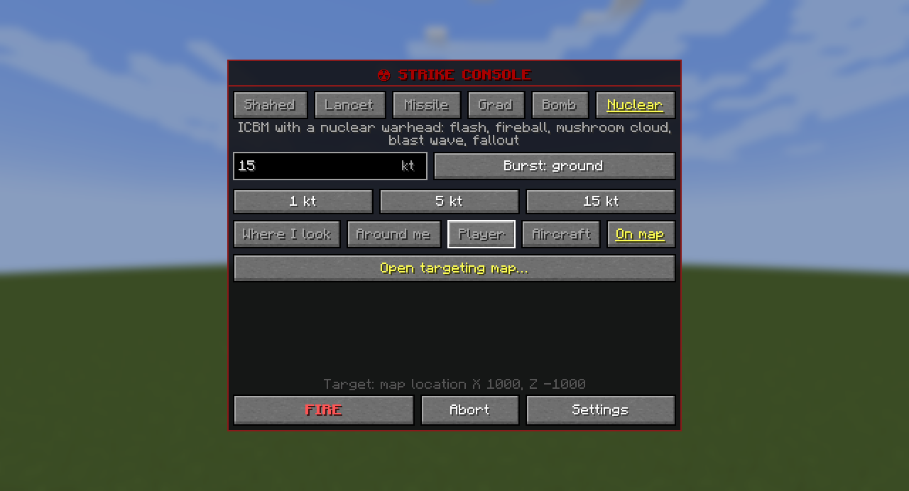
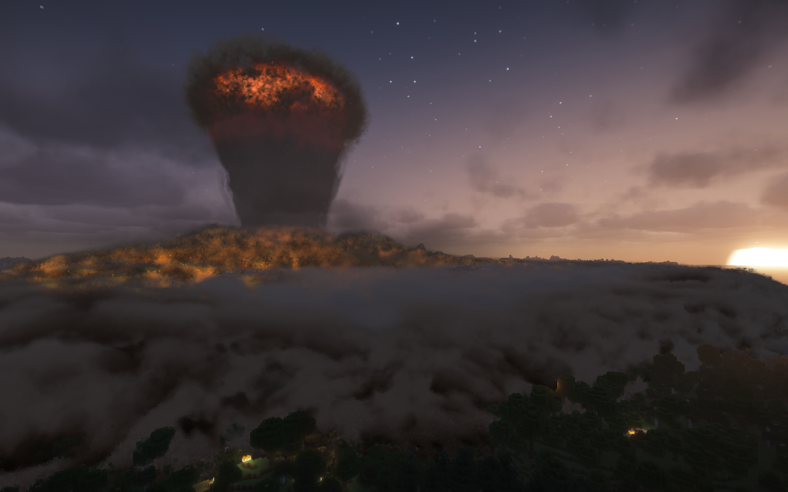

# Ядерный удар

[English](../nuke.md) · Русский

Ядерная боеголовка от 1 кт до 1 Мт на МБР, крылатой ракете или бомбе B-2: вспышка, гриб, ударная волна и пожары.
Наземный взрыв оставляет воронку и радиоактивный след по ветру. По умолчанию один блок равен метру, а дальняя волна
замедлена, чтобы было видно её приближение. Расстояния ниже указаны для полного масштаба.
Смотри [игровые условности](not-physical.md) и [настройки мира](settings.md#настройки-мира).

При тревоге укройся под толщей грунта, отойди от окон и не смотри на огненный шар. После наземного взрыва выйди
из следа осадков или оставайся в укрытии; вода смывает заражение. [Выживание и радиация](#как-выжить) идут перед
[описанием удара](#что-будет) ниже.

## Как пустить

По умолчанию — только оператор.

1. Нужен предмет «МБР» или ракета либо бомба плюс «Ядерная боевая часть» ([рецепты](munitions.md#рецепты)).
2. На экране пульта: оружие «Ядерная» или выбор ядерной боевой части у ракеты и бомбы; числовое поле мощности и подсказки значений,
   от 1 кт до серверного предела (`nuclear.max_yield`, по умолчанию 100 кт, не выше 1 Мт); у МБР и ракеты подрыв наземный
   (по умолчанию, с воронкой и радиоактивным следом) или воздушный (шире разрушения), бомба рвётся под землёй.
3. ЛКМ в бинокле или «ОГОНЬ» открывает проверку цели и мощности, подтверждённых сервером. Удерживай кнопку
   пуска три секунды или выбери её клавишей Tab и удерживай Пробел либо Enter. Отпускание, уход указателя с кнопки,
   потеря фокуса окна или закрытие проверки отменяет удержание. На маленьком экране прокручивай текст мышью или Page Up/Down.

Карта цели показывает оценочные контуры для ровной земли: справочный силуэт огненного шара, давление 5 psi и 1 psi.
Шар показан на втором максимуме свечения; позже он расширяется дальше.
«Вместить эффекты» вмещает их в окно; «Ожоги / стекло» добавляет ориентир 0,5 psi для стекла и медианный радиус ожога
I степени открытой кожи при указанной погодной видимости. Это оценки, а не границы одинакового урона: рельеф,
укрытия, одежда и материалы меняют результат. Пунктирный силуэт шара над землёй не означает касание земли.
В проверке показаны расстояние от тебя и стрелка по ветру на схеме севером вверх. Неизвестная высота земли остаётся оценкой.
Обзор большей зоны не увеличивает дальность выбора цели и не раскрывает скрытых игроков.

Проверка не резервирует боеприпас и не запускает подготовку или тревогу. Оплата и прежнее окно второго ключа
начинаются после подтверждения. Изменение цели, погоды, серверного лимита или настройки времени полёта требует новой
проверки. Неоплаченная проверка истекает через минуту и сбрасывается при выходе, смерти и перезапуске.
Время полёта и операторские команды немедленного подрыва прежние; проверка не гарантирует готовность разрушений
или LOD для наблюдателя, прибывшего в неподготовленное место во время полёта.

В существующих мирах конфиг менять не нужно: тип подрыва не хранится в `incoming-server.toml`. Старые версии обычно
не записывали AIR в настройки пульта, поскольку он был выбран по умолчанию. Поэтому после обновления такие пульты
перейдут на GROUND, даже если ты выбрал AIR кнопкой. Если поле `air_burst=true` записано в сохранении, AIR останется.
Перед пуском воздушный подрыв можно снова выбрать на экране пульта. Уже запланированные МБР сохранят свой тип подрыва.

МБР стартует позади тебя. Первая ступень работает минуту: пламя и белый след уходят в небо с наклоном к цели,
пока ступень не выгорит на высоте около 20 км. По умолчанию удар следует через 90 секунд после пуска.
Вниз возвращается только боеголовка. Последние 30 секунд она круто падает с неба со стороны пуска, яркая, как
большой метеор: воздух перед ней раскаляется в плазму. Ночью она освещает землю и оставляет длинный бело-оранжевый
след, днём видна как яркая точка с коротким хвостом. Её могут скрыть облака, дымка и рельеф. Она быстрее звука,
поэтому до взрыва ничего не слышно. Масштаб скорости полёта управляет и заходом.

Если хозяин мира разрешил ядерку всем, игроку без прав оператора нужен второй ключ, когда в игре есть кто-то ещё:
другой игрок не дальше 16 блоков нажимает `.` за 30 секунд. Такой пуск видят все. После приказа обычный запускающий не может
отозвать ядерный удар, даже пока тот ждёт второго ключа; оператор или хост может отменить его командой `/incoming clear`. Тревога у цели
идёт не меньше 90 секунд: ракета или B-2 с ядерной боевой частью стартуют через 90 секунд после её начала.

## Как выжить

- **Под землю.** Толща природного грунта укрывает закрытый бункер или пещеру от волны, земля держит свет и ослабляет
  радиацию. Открытый гребень, навес или стенка из природного материала до трёх блоков толщиной может сломаться,
  если воздух подходит с обеих сторон; узкий природный столб может опрокинуться. Тонкая природная крыша не заменяет глубину. Блок камня ослабляет радиацию подрыва примерно в сто раз, блок земли — раз в тридцать. Окоп или стена
  держат то, что идёт прямо от шара, но не ту часть, которую воздух рассеивает с неба.
- **Подальше от стен и окон.** Волна калечит прежде всего броском о твёрдое и стеклом окон между тобой и взрывом. Стена
  прямо за спиной отражает волну и поднимает давление на лёгкие самое меньшее вдвое. Рухнувший дом засыпает тех, кто
  внутри: выбирайся из-под завала, пока не задохнулся.
- **Не смотреть на шар.** Свет достаёт только тех, кто видит шар, под открытым небом или через окно, и обжигает
  сторону тела к шару.
- **Ожоги** зависят от мощности: у большого подрыва импульс длиннее, и коже его нужно больше. У 15 кт открытая кожа
  краснеет примерно до 3,4 км, покрывается пузырями до 2,6 км и сгорает вглубь до 2,1 км; хлопковая рубашка
  загорается до 1,6 км (тушит вода). Одежда защищает, пока не загорелась, поэтому одетый игрок обожжён на лице и
  руках, а животное — по всему боку. Железная броня свет не пускает, кожаная загорается позже рубашки. Ожоги отнимают
  долю здоровья и держат её, пока заживают: пузыри — две игровые недели, глубокие — пять. Глубокие ожоги на четверти
  тела или пузыри на 30 % тела — ожоговый шок: смерть в пределах 12 игровых часов. Одетого игрока одна вспышка жжёт
  намного меньше, но загоревшаяся одежда горит, как любой огонь, — в воду. Молоко и зелья ожоги не лечат.
- **Увидел вспышку вдали** — у тебя есть секунды до волны: за склон, в подвал, в яму.
- **Вспышка слепит.** Она засвечивает глаза всем, кто видит шар, и слабее — всем под открытым небом, которое она
  освещает: всё поле зрения светлеет, потом становится серым днём или чёрным ночью и проясняется за секунды или
  минуты. Чем ближе, тем дольше, а ночью, когда глаза привыкли к темноте, — намного дольше: у 15 кт днём в 3 км —
  около 50 секунд, ночью в 10 км — несколько минут. Кто смотрел в сторону шара, у того его изображение выжигает в
  глазах слепое пятно навсегда — у 15 кт примерно до 30 км днём и 50 км ночью. Пятно ходит со взглядом, сбоку оно
  бледнее; проходит только со смертью. В творческом режиме и наблюдателем белая вспышка и послеобраз
  видны, но зрение не меркнет и пятен не видно.
- **Уйди из следа или пережди в доме.** Осадки лежат на всём, что открыто небу, и светят сквозь крышу и стены: блок
  камня или земли держит почти всё, блок дерева — около 95 %, стекло — почти ничего, а открытый проём пропускает. Пыль
  с одежды смывает вода (дождь не смывает); иначе она спадает так же медленно, как сами осадки.
- **Лучевая болезнь** начинается через часы и идёт по игровым часам: тошнота и рвота, потом дни или недели, когда
  кажешься здоровым, потом недели слабости, от 2 Гр — без естественного восстановления здоровья. Убьёт ли она,
  решает доза: до 2 Гр почти никто не умирает, при 4,5 Гр — половина, от 10 Гр — все, и чем больше доза, тем скорее
  (от 50 Гр — за игровые сутки-двое). Молоко её не лечит. Животные и жители получают ту же дозу и болезнь, нежить — нет.

Счётчик Гейгера в руке щёлкает и показывает мощность дозы и твою дозу. Его выдаёт оператор. В творческом режиме
доза не копится.

## Что будет

Сирена заранее предупреждает игроков возле цели. Сначала вспышка, затем огненный шар поднимается и становится грибом.
Волна проходит по земле, ломает здания и поднимает пыль. Звук приходит к тебе вместе с волной.
Пожары и густая пыль мешают видеть ещё долго после удара.

При наземном взрыве, выбранном по умолчанию, пылевой столб соединяется с шапкой гриба. При явно выбранном
воздушном подрыве на стандартной высоте он начинает подниматься позже, с клубящимся верхним краем, и остаётся
ниже шапки, которая растёт быстрее. Разрыв между ними предусмотрен моделью; в первые секунды короткий столб
может целиком скрываться в пыли у земли.

Наземный взрыв оставляет воронку и радиоактивный след по ветру. Над водой вместо стены пыли поднимаются брызги.
После вспышки всё ещё опасны ожоги, радиация и падающие обломки: оставайся в укрытии и следи за дозой.

Distant Horizons и Voxy показывают разрушения, даже если ты не подходил к ним. Для МБР самая разрушенная область
готовится ещё во время полёта; после других ядерных носителей дальний вид может обновиться позже. Выбитые окна и
поваленные деревья дальше от центра появляются при приближении. В Voxy игроку, который пропустил удар, тоже нужно
подойти, чтобы увидеть дальние руины.
Incoming хранит ограниченный список недавних дальних обновлений и запрашивает свежий рельеф с сервера, если LOD Server Support перезаписал его. Это восстановление не гарантировано; постоянным источником руин остаются изменения мира на диске.

Подробное описание эффектов, их времени и ограничений модели перенесено в [техническую справку на английском](../../dev/nuclear-effects-reference.md).

### Сохранённые руины за дальностью прорисовки

Когда волна пройдёт всю зону разрушений, сервер постепенно применит руины и след на земле к существующим чанкам
во всей зоне — даже без игроков поблизости и без мода дальней прорисовки. Карты, читающие сохранённый мир,
получат изменения при обычном обновлении. Проход расширяется от эпицентра наружу; большая зона обрабатывается не сразу.
Число одновременных загрузок зависит от свободного времени сервера и памяти. Одновременные удары делят память
подготовки между измерениями; при высокой нагрузке дальние обновления могут остаться для этого фонового прохода.
Руины в поле зрения игроков имеют приоритет. Проход продолжается после перезапуска сервера и обрабатывает сохранённые ядерные удары старых версий.
