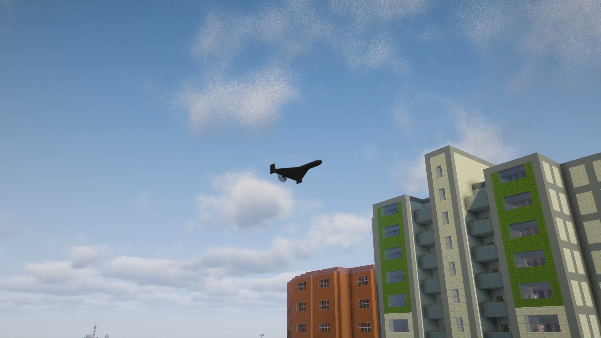
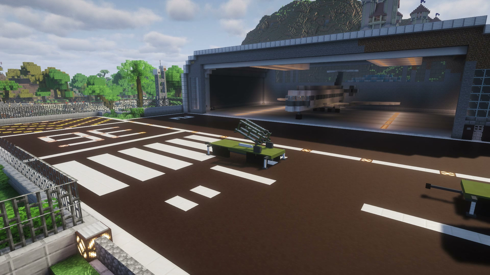
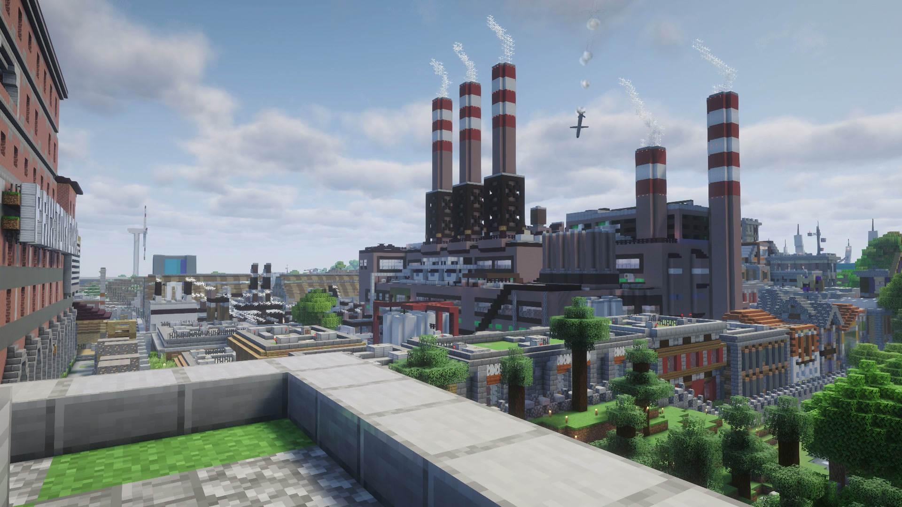
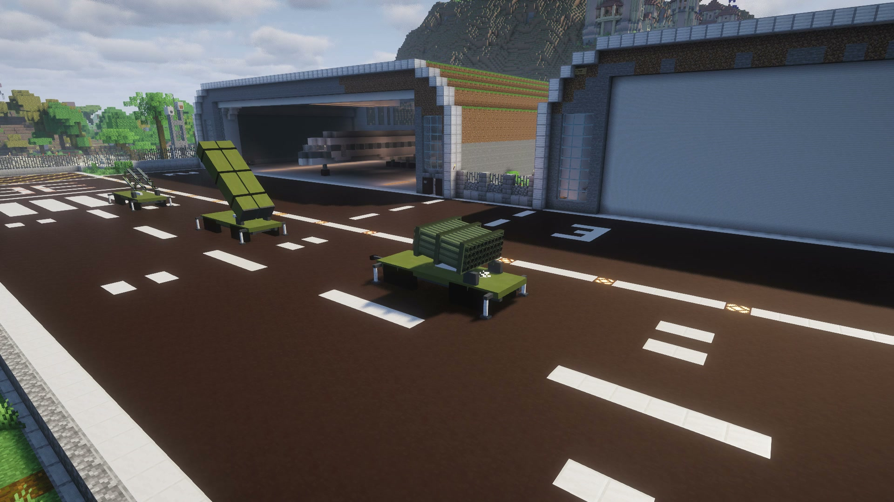
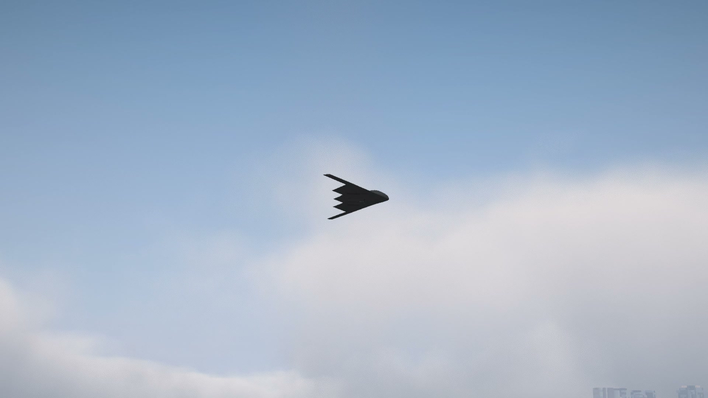
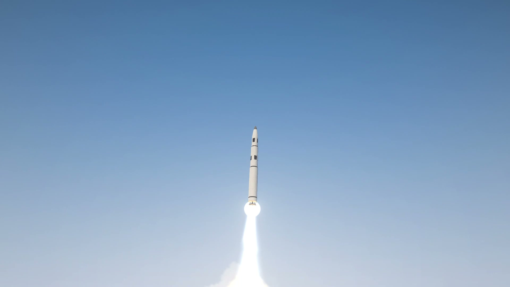

# Оружие

[English](../weapons.md) · Русский

Шесть видов, в пульте они идут в таком порядке. Каждый пуск тратит [боеприпас](munitions.md) из инвентаря.

| | Шахед | Ланцет | Ракета | Град | Бомба (B-2) | Ядерная (МБР) |
|---|---|---|---|---|---|---|
| До удара | ≈50 с | подлёт и ≈25 с круга | ≈30 с | 7–10 с | ≈40 с | 90 с |
| Боевая часть, ТНТ | 50 кг | 3 кг | ≈150 кг | 6,4 кг на снаряд | 2,4 т, под землёй | от 1 до 15 кт |
| За движущейся целью | да, через камеру | да, через камеру | нет | нет | нет | нет |
| Маршрут по карте | да | да | да | нет | нет | нет |
| Сбивает ЗРК | да | да | да | нет | да | нет |

Время дано для близкой цели. Хозяин мира может поменять время полёта.

Горящее топливо в воронке непрерывно гудит и трещит. Звук стихает по мере выгорания топлива; запись не затихает и не
запускается заново каждые несколько секунд. Громкость и момент прихода зависят от тепловыделения и пути до вас.

## Настоящее оружие

Каждое оружие — настоящее изделие. Размеры, масса, боевая часть и двигатели взяты из открытых данных; где числа не
опубликованы (часть двигателей, доля взрывчатки в боевой части), они выведены по законам физики из опубликованных. От
боевой части зависит всё, что делает взрыв: что и докуда он ломает, воронка, раны, а в том, что видно и слышно, —
величина, время и ход событий.

| | Shahed-136 | «Ланцет-3» | «Томагавк» | «Град», 9М22У | GBU-57 (с B-2) | «Минитмен III» |
|---|---|---|---|---|---|---|
| Длина | 3,5 м | 1,65 м | 5,56 м | 2,87 м | 6,2 м | 18,2 м |
| Масса | 200 кг | 12 кг | 1,3 т (1,6 т с ускорителем) | 66,6 кг | 13,6 т | 36 т |
| Боевая часть, ТНТ | 50 кг | 3 кг | ≈150 кг | 6,4 кг | 2,4 т ВВ, под землёй | ядерная |
| Выбивает стёкла до | ≈70 м | ≈29 м | ≈105 м | ≈37 м | — | — |
| Ломает кирпич и камень до | ≈3,4 м | ≈0,5 м | ≈7 м | ≈0,9 м | — | — |
| Ломает доски, двери, заборы до | ≈6 м | ≈0,9 м | ≈12 м | ≈1,5 м | — | — |
| Воронка в грунте, поперёк | ≈2,4 м | ≈0,9 м | ≈3,5 м | ≈1,2 м | — | — |
| Топлива к удару | ≈30 кг | нет | ≈275 кг | нет | нет | — |
| Настоящая скорость | 185 км/ч | 110 км/ч, в пике ≈300 | ≈900 км/ч | ≈690 м/с к выгоранию | ≈510 м/с при ударе (расчёт) | — |
| Пробивает камень | — | — | — | — | ≈4 м в игре, ≈8–9 м в жизни | — |
| Настоящая высота полёта | 1,5–2,8 км | 600–800 м на круге | 30–50 м над землёй | вершина дуги ≈7 км | сброс с ≈12 км | — |
| Скорость в игре | ≈150 км/ч | ≈115 км/ч | ≈290 км/ч | по своей дуге | B-2 ≈860 км/ч, 170 блоков над целью | — |

## Что делает взрыв

Взрыв — это заряд боевой части в тротиле, а не игровая «сила взрыва». Из него следует всё:

- **Ударная волна** — с давлением и импульсом настоящего заряда такого размера на земле (Кинни и Грэхем). Блок
  ломается, когда и того и другого хватает для его материала: сначала стекло и факелы, потом листва, доски и двери,
  брёвна, кирпич и камень. Радиусы сходятся с британскими данными о разрушениях от бомб (Джаррет): шахед валит
  кирпичные стены в пределах ~3 м, деревянные — ~6 м. Малый заряд ломает намного меньше, чем обещает одно его давление:
  его волна слишком короткая, стена не успевает поддаться. Уцелевшая стена закрывает то, что за ней; волна дома не
  огибает (приближение).
- **В помещении** горячие газы взрыва давят на все стены, пока не выйдут через окна и двери. Шахед, влетевший в
  закрытую комнату, выбивает её целиком — как выбитый этаж на настоящих кадрах.
- **Воронка** — по закону заряда на земле: около 0,65·∛W метра поперёк и в четверть этого глубиной, в скале чуть
  меньше, в грунте под водой чуть больше; сухой песок и гравий насыпи путей роются как земля. Воронка роется, только
  если взрыв у земли. Воронка ракеты — яма в два-три блока поперёк и около блока глубиной: воронки намного меньше, чем
  в прежних версиях, и это настоящий размер.
- **Покрытие на сплошной опоре** не изгибается как свободная стена. Оно роется вместе с опорой по закону воронки
  своей среды. В связном камне и бетоне доля блока сохраняется как повреждение поверхности и видна раскрытым заполнителем и сколами материала, дополнительно — ближними трещинами;
  это приближение вида разбитой поверхности, остаток блока сохраняет коллизию;
  оставшийся блок держит тело и волну. Мелкая воронка не открывает плиту толщиной в метр.
- **Плиту над пустотой** (настил моста, крышу над помещением, свод пещеры) заряд пробивает, если лежит на ней, а плита
  тоньше радиуса пробоя из наставления армии США по подрывным работам (FM 5-250): всё между зарядом и пустотой в этом
  радиусе выбито, и взрыв идёт дальше в пустоту. Правило одно для всех блоков, природных и построенных: решают материал
  и толщина до пустоты. Ракета пробивает около 2,7 м камня или кладки и 4,2 м земли: в настиле моста из метра камня —
  дыра блоков в пять поперёк, три метра камня держат. Шахед пробивает около 1,75 м камня, ракета «Града» — меньше
  метра. Бомба, которая рвётся глубоко в земле, пробивает в бункер или пещеру до ~8 м скалы. Правило наставления
  рассчитано на верный пробой, поэтому настоящий заряд может выбить и чуть больше. Пролёт вокруг дыры стоит:
  обрушения ослабленного пролёта нет.
- **Огонь** — только от топлива и горящих обломков. В шахеде и ракете к удару остаётся топливо; три четверти его
  сгорают огненным шаром (≈16 м у шахеда, ≈34 м у ракеты) за одну-три секунды. Эта вспышка поджигает тонкое сухое
  горючее, которого коснулась: листву, сухую траву, сено, книги, а у ракеты изредка и ткань, шерсть. Доски, брёвна и другое
  толстое дерево от такой короткой вспышки только обугливаются; загораются они лишь у самой воронки, куда падает горящее
  топливо. Огонь стоит на том, что горит: песок, камень, земля, металл и рельсы не горят, и пламени на них не остаётся.
  Поэтому шахед в городе оставляет несколько очагов у места удара и на сухих растениях рядом, а не горящий круг. У «Града»
  и «Ланцета» топлива нет. Горящий обломок поджигает только то горючее, на которое упал. Дальше огонь растёт по правилам
  игры. Подстроенных вторичных подрывов нет.
- **Люди и мобы** страдают от той же волны, что и при ядерном ударе: давление на лёгкие, бросок о стену, стёкла окна.
  Рядом с шахедом волна убивает, в 30 м на открытом месте — ничего, но осколки достают и там (ниже). За уцелевшей
  стеной волна не достаёт; в комнате, где рванул заряд, газы бьют всех. Фронт проходит блоки и тела от заряда наружу: стена или плита, сломанная до прихода
  фронта к телу за ней, больше его не закрывает. Уцелевшая стена по-прежнему защищает.
- **Осколки.** Стальной корпус боевой части рвётся на тысячи кусков. Их массы — по закону Мотта для толщины и диаметра
  корпуса, начальная скорость — по закону Гарни для масс заряда и корпуса, воздух тормозит каждый по его размеру.
  Летят они поясом поперёк оси боевой части. Детонация бежит от носа к хвосту и наклоняет пояс назад (угол Тейлора),
  своя скорость боевой части — вперёд: у шахеда и «Ланцета» пояс клонится назад на ~9°, у «Града» вперёд на ~6°. У
  пикирующей под 60° половина пояса уходит в землю с одной стороны и в небо с другой. Осколок останавливается в первом теле или твёрдом блоке на пути.
  Ранит он энергией удара: от ~79 Дж (порог опасного осколка у совета по безопасности боеприпасов США) — тяжело,
  тяжёлый и быстрый может убить. Стекло осколки пробивают и бьют, в каменных кирпичах, кирпичах и плитке глубинного сланца, кирпичах
  полированного чернокамня и адских кирпичах оставляют выбоины (блок становится треснувшим; у других блоков треснувшего
  вида нет, и они остаются как были), в земле, дереве, листве и воде застревают. Щит, повёрнутый к взрыву, их держит. За стеной не достают никого. Сами осколки не светятся: сталь выходит
  при ~500–700 K, ниже 798 K, с которых металл начинает светиться, поэтому видно, куда осколки попали (искры о камень
  и металл, облачка пыли из земли и дерева, стекло), а не сами осколки.

  | | Shahed-136 | «Ланцет-3» | «Томагавк» | «Град» 9М22У |
  |---|---|---|---|---|
  | Осколков | ≈7200 | ≈6500 | ≈4900 | ≈5100 |
  | Начальная скорость | ≈3,0 км/с | ≈3,0 км/с | ≈1,8 км/с | ≈1,6 км/с |
  | Средний осколок | ≈1,4 г | ≈0,1 г | ≈39 г | ≈2,4 г |
  | Опасны до | ≈125 м | ≈55 м | ≈205 м | ≈115 м |

  «Опасны до» — где посреди пояса на каждые 56 м² падает один опасный осколок: это расстояние берёт совет по
  безопасности боеприпасов США. Отдельные тяжёлые осколки летят намного дальше. Форма корпуса и доля ВВ у большинства
  этих боевых частей — оценка; у настоящих есть ещё носовая и донная плиты, а бывают и готовые осколки.
- **Аппараты** Create Aeronautics теряют блоки, которые тот же закон ломает на их расстоянии.

Известные пределы: пороги ранений взяты для длинных ядерных волн, поэтому у малого заряда они немного завышают вред.
Осколки летят по прямой (тяжесть сгибает путь опасного осколка меньше чем на метр), не рикошетят и проходят сквозь
аппараты Create Aeronautics. Блок с выбоиной трескается целиком, а настоящий осколок оставляет ямку в несколько
сантиметров (не по физике).

## Как они летают

Полёт — своя игровая модель мода, а не копия настоящего оружия: правила одни для всех, числа у каждого свои, игровые
(не по физике: подобраны под блоки и под то, как полёт читается на экране). Всё у цели (заряд, взрыв, урон) —
настоящее.

По умолчанию скорости и высоты полёта игровые, меньше настоящих (не по физике): блок — метр, но видно только несколько
сотен блоков, и на настоящей скорости быстрое оружие проходит их за секунду-две. Настройка мира
[`scale.flight_speed`](settings.md#настройки-мира) (или пресет REAL) поднимает их до настоящих: 0 — игровые, 1 — как в
жизни, между ними каждое оружие проходит одну и ту же долю пути, поэтому их порядок не меняется.

| | Игровые (0) | Настоящие (1) |
|---|---|---|
| Шахед | 42 м/с, в пике 60 м/с, 45 блоков над землёй | 51 м/с, в пике 105 м/с, 2 км |
| «Ланцет» | 32 м/с, в пике 80 м/с, круг в 45 блоках над целью | 31 м/с, в пике 83 м/с, круг в 700 м |
| Крылатая ракета | 80 м/с, в пике 100 м/с, 12 блоков над рельефом | 250 м/с, 40 м над рельефом |
| «Град», сход с трубы | 80 м/с с пусковой в 600 блоках | 683 м/с с ~19 км |
| B-2 | 240 м/с, 170 блоков над точкой сброса | 250 м/с, 12 км |
| Ракета ЗРК | 280 м/с | 1000 м/с |

Темп разворота и набора остаётся игровым, поэтому быстрое оружие разворачивается шире. Время полёта остаётся, поэтому
быстрое оружие стартует дальше. Пусковая «Града» рядом с вами стреляет с того места, где стоит: дальше встаёт только
пусковая, поставленная без вас. При 1 бомба B-2 после сброса падает ещё ~50 секунд, и удар на столько же позже.

- **Развороты** набираются и гасятся плавно, на месте ничто не разворачивается. Шахед и ракета кренятся в вираже —
  чем круче разворот, тем больше крен.
- **Горка и пике** меняют высоту на скорость: шахед в наборе под 15° теряет около 15 % скорости, в пике
  разгоняется быстрее, чем одним мотором, а потом возвращается к крейсерской.
- **Залп летит волной**, а не ниткой. Шахеды, ракеты и «Ланцеты» сходят с пусковой по очереди, и у каждого своя
  полоса сбоку от пути: у шахеда и «Ланцета» — до 32 блоков в обе стороны, у ракеты — до 48 (не по физике: порядка
  расстояния между снарядами, чтобы залп выглядел волной). В свою полосу снаряд выходит за первые 100 блоков маршрута
  (ракета — за 300, «Ланцет» — за 80) и возвращается к своей точке прицеливания за последние 300 (ракета — за 500,
  «Ланцет» — за 150), поэтому точность та же. Маршрут на карте — один на весь залп, и каждый снаряд идёт по нему в
  своей полосе. Прилетают снаряды по-прежнему с разницей в секунду-две.
- **Снаряды «Града»** летят под действием тяжести и сопротивления воздуха: спуск круче подъёма. Расчёт огня знает только
  ветер у земли, а наверху он сильнее, поэтому залп ложится немного по ветру. Каждый снаряд сходит с трубы с небольшим
  разбросом по углу и скорости, поэтому разрывы рассеяны примерно на 1 % дальности. «Град» стреляет и ближе своей
  настоящей наименьшей дальности ~5 км (не по физике: снаряды сходят медленнее настоящих).
- **Бомба** падает под действием тяжести и сопротивления, рули ведут её в точку. Сходит она с B-2 с его скоростью,
  поэтому B-2 сбрасывает её примерно за 145 блоков до цели (с 12 км — примерно за 10 км), и в землю она входит почти
  отвесно. Ветер её почти не сносит. С ростом шкалы к настоящей и сопротивление снаряда «Града» и бомбы идёт от
  игрового к настоящему, с ростом у скорости звука.

## Шахед

Дрон-камикадзе: стартует с прицепа рядом с тобой, тарахтит мотором и в конце пикирует. Брать по постройкам
и по движущимся целям. Двухтакт у него без глушителя: тихой ночью его слышно за ~12 км, днём за ~6 км, задолго до
прихода. Его сбивает ЗРК, поэтому против обороны — залпом или по маршруту в обход.
Пикирует, только когда видит цель: если её закрывает холм или дом, шахед летит дальше на своей высоте и пикирует
круче. Упреждения по идущей цели у него нет. Высокий дом вплотную к цели или крыша над ней всё равно могут
помешать: тогда он бьёт в дом или в крышу.

## Ланцет

Маленький дрон с катапульты. Электромотор у него тихий: слышно его лишь за несколько сотен блоков. Кружит над целью,
пока ты выбираешь её в [камере](camera.md#ланцет), и бьёт без промаха. Взрыв небольшой: по технике, игроку, отдельному дому.

## Крылатая ракета

Идёт низко над рельефом и перед целью пикирует. Мощный удар по неподвижной цели. Может нести ядерную боевую часть.
Рельеф она видит на всём пути, и там, где рядом никого нет и мир не загружен: берёт сохранённую высоту каждого места,
а для земли, где ещё никто не был, — генератор мира, который знает землю, но не деревья и постройки. Чанки, сохранённые ещё
в формате до Minecraft 1.18, ей неизвестны, пока не загрузятся. Карта высот, уже переведённая в нынешний формат,
годится и тогда, когда чанку ещё нужна догенерация под нулём. Холм на пути она
перелетает и пикирует за ним. Обхода по долинам она не ищет: маршрут задаёшь ты. Если цель закрывает холм, край
карьера или дом, ракета набирает высоту, пока не увидит цель, и тогда пикирует.
Дом вплотную к цели, который закрывает её под крутым углом (например, на 40 блоков выше цели и в 20 блоках от неё),
она не обходит, а цель под крышей не достаёт: туда — бомбой.

## Град

Прицеп с 40 трубами выпускает очередь неуправляемых ракет. Накрывает площадь, ЗРК его не сбивает, а сирена у цели
воет всего за 8 секунд.

## Бомба (B-2)

B-2 прилетает издалека и сбрасывает бетонобойную бомбу GBU-57. Брать по бункерам и подземным базам. Радар ЗРК видит
B-2 очень поздно. Может нести ядерную боевую часть.

**Насколько глубоко.** Бомба входит в землю с той скоростью и под тем углом, что дало ей падение, и идёт дальше по
прямой. Насколько далеко — по скорости, по самой бомбе (13,6 т, 0,8 м в поперечнике, острый нос) и по тому, через что
она идёт: уравнения пробития Янга (Sandia, 1997), слой за слоем. С игровыми скоростями полёта B-2 летит в 170 блоках
над целью, а не на ~12 км (не по физике — чтобы его было видно). Бомба сходит с него на его 240 м/с и падает под
тяжестью и сопротивлением воздуха, поэтому бьёт на ~235 м/с вместо ~510 м/с. С `scale.flight_speed` 1 B-2 летит на
12 км, и бомба бьёт на ~510 м/с. Поэтому она проходит:

| | Игровые скорости полёта (≈235 м/с) | Настоящий сброс, `flight_speed` 1 (≈510 м/с) |
|---|---|---|
| Камень, бетон | ≈4 блока | ≈8–9 м |
| Глубинный сланец | ≈3 блока | ≈7 м |
| Гравий | ≈23 блока | ≈40–65 м |
| Земля и дёрн | ≈55 блоков | ≈100–200 м |

Земля сразу под бетонной плитой первые 5 блоков вдвое твёрже. Вода тормозит бомбу немного. Коренная порода и укреплённый
глубинный сланец её останавливают. В скале уравнения точны только до двух раз. Какой блок из чего — в карте данных
`incoming:penetration` (`data/incoming/data_maps/block/penetration.json`): набор данных или мод может добавить свои блоки;
блок без записи считается кирпичом. Тонкий блок (ковёр, плита, ступени) считается такой толщины, какой он есть.

**Взрыватель.** Если бомба пробилась в пещеру или комнату бункера, пройдя хотя бы 4 блока твёрдого, она взрывается,
когда вошла туда целиком. Листва, шерсть и рыхлый снег её почти не тормозят и не считаются. Иначе — там, где встала.

**Подземный взрыв.** 2,4 т ТНТ. Что он делает, зависит от того, насколько глубоко он для своего заряда: глубина,
делённая на кубический корень заряда (все радиусы здесь — оценки с широким разбросом, наставление армии США
TM 5-855-1):

- Глубже ~13 блоков взрыв остаётся под землёй: полость радиусом ~3 блока, раздробленная в булыжник или щебень порода до ~10 блоков (сундуки и другие блоки без записи о материале
  остаются),
  обрушенные куски сводов ходов и пещер до ~27 блоков. Из хода бомбы бьют газы и пыль, земля трясётся. Если заряд
  мельче ~17 блоков, через секунду свод полости рушится до самого верха и оставляет провал на поверхности.
- Мельче ~13 блоков он выбрасывает воронку: у поверхности — как у наземного взрыва, шире всего (примерно в полтора раза)
  около половины этой глубины и сходит на нет к 13 блокам. Чем ближе к поверхности, тем больше заряда уходит в воздух: ударная волна,
  выбитые стёкла и облако наверху — как у наземного взрыва этой доли заряда.
- Всё, что в пустоте рядом с зарядом, — комната бункера, пещера — получает ударную волну и давление газов, как комната
  при любом взрыве. В зоне дробления никто не выживает.

## Ядерная (МБР)

Межконтинентальная ракета стартует позади тебя, и через 90 секунд её боевая часть рвётся у цели. Взлетает она как
настоящая МБР: медленно отрывается, разгоняется по мере выгорания топлива и видна в небе около девяти секунд. Всё про
неё — в разделе [Ядерный удар](nuke.md).

## Как выглядит взрыв

Размер, подъём, цвет и свет каждого взрыва — от заряда и топлива, оставшегося в баках; дым и огненный шар нарисованы
по симуляциям настоящего газа, запечённым в Blender, вблизи и вдали одинаково. Солнце освещает дым со своей стороны и
просвечивает его тонкие края, огненный шар освещает дым вокруг себя. Когда топливо сгорело, шар не гаснет разом: он
остывает, смешиваясь с воздухом, — от жёлтого через оранжевый и тёмно-красный в дым. Огнём он виден, пока его
свечение ярче света на его дыме, поэтому днём он становится дымом раньше, чем ночью: шар бомбы через 3 с после взрыва
днём — уже дым, ночью — ещё светится. Растущее облако всё время сохраняет клубы, вблизи и вдали. Воздух перемешивает
облако с первой секунды, поэтому, поднимаясь, оно расширяется и редеет. Ветер выше сильнее: верх облака уходит вперёд
низа, и облако наклоняется и вытягивается по ветру, а не плывёт одним шаром.

- **Шахед**: короткая вспышка, затем шар горящего бензина около 16 блоков в поперечнике: горит около 1,3 секунды и
  ещё около секунды светится, остывая. Около четверти бензина остаётся в воронке, пропитав грунт, и горит около
  2,5 минуты пламенем около 3 блоков высотой. Днём пламя оранжевое, ночью светится жёлто-белым и освещает землю
  вокруг. Вдали, где языки пламени частицами уже не рисуются, пожар — светящееся пятно того же цвета и яркости, ночью
  с ореолом. Всё это время из воронки идёт чёрный дым и клонится по ветру: при сильном
  ветре стелется низко, в тихую погоду встаёт выше. Дым шара вместе с пылью, сорванной под ним, поднимается на
  несколько сотен блоков тёмным облаком.
- **Крылатая ракета**: вспышка больше и шар топлива около 34 блоков, горит около 2,7 секунды; топливо в воронке догорает
  около четверти часа. Её заряд даёт мало сажи, дым — в основном от горящего топлива, пыли много.
- **Град**: вспышка и небольшой серо-чёрный клуб с пылью, без шара топлива. Залп оставляет поле клубов, которые
  сливаются и уходят по ветру, над ковром пыли от всех попаданий.
- **Ланцет**: небольшая вспышка и облако в несколько десятков блоков высотой.

Ветер за фронтом волны срывает пыль со всякой поверхности, до которой доходит, — с земли, крыши или склона одинаково,
так же, как волна ядерного удара. Голая земля, песок, гравий и снег отдают её легко: низкое кольцо светлой пыли убегает
с волной — у шахеда на несколько десятков блоков, — потом вырастает до нескольких блоков, висит минуты и уходит с ветром
у земли. Трава держит грунт, и на лугу пыль встаёт только у воронки; на камне, кирпиче и досках есть
только тонкий слой осевшей пыли; под проницаемой листвой источником остаётся поверхность внизу; вода пыли не даёт: у берега пыль лежит в основном над сушей. Воздух с пылью тяжелее чистого, поэтому пыль
растекается по поверхности, с которой поднялась, и идёт по пологим склонам вверх и вниз, а где её сносит за край (крыши,
обрыва), опускается на поверхность ниже: густая — за секунды, редкая — дольше. По пологому склону она поднимается, а на стены —
нет: на улице между домами она остаётся на улице, в ветер и в штиль. Пока облако поднимается, под ним тянется тонкий столб пыли. Разрыв
зенитной ракеты в воздухе не оставляет ни воронки, ни пыли, если только он не низко над землёй. Удар в крышу или стену —
тот же взрыв, что удар в землю: часть крошки поднимается с горячим газом, а холодный выброс и обратное выпадение
питают низкий тяжёлый слой. Поэтому низкая пыль есть и на мостовой, без выдуманного слоя почвы поверх камня. Разделение
горячего и холодного потоков — оценка: по половине прежнего запаса пыли раздробленного материала. Под проницаемой кроной
источник и опора пыли — поверхность внизу. Волна также поднимает пыль с улицы там, где она ещё достаточно сильна.

Взрыв на воде вместо пыли выбрасывает белый столб брызг. При ударе о гладь — около 78 блоков у шахеда, 113 у ракеты и
39 у «Града»: оценка по таблице султанов обычных зарядов Swisdak с уменьшенным запасом безопасности. Глубина заряда
меняет высоту и ширину. Столб шахеда достигает вершины примерно за четыре секунды и падает обратно к восьмой; медленные
струи падают раньше, оставляя пену и низкое кольцо водяной пыли, которое сносит ветром. По воде расходится кольцо волн,
его скорость зависит от глубины воды. Комья воды летят частицами. Топливо, упавшее на воду, растекается слишком тонко, чтобы гореть,
и после шара огня не остаётся.

Огненный шар и горящее топливо освещают землю и стены вокруг, как шар ядерного удара: ночью по блокам вокруг воронки
расходится оранжевый свет и гаснет, пока шар остывает. Блоки бросают от него тени: дом или холм между огнём и землёй
оставляет её тёмной, даже если сам дом за краем кадра. Тени считаются примерно в 90 блоках вокруг вас и в 40 вверх и вниз, дальше их нет. Горячий газ над огнём,
над шаром и в струе ракеты преломляет свет, и то, что за ним, дрожит. Дрожание показано таким, каким его видит глаз:
над огнём и шаром на обычном экране — около пикселя, поэтому оно заметно на краях за ними, а в струе ракеты меньше —
её быстрый газ смазывается; в бинокль — настоящий угол.

Во влажном воздухе вокруг взрыва на миг вспыхивает белое облако конденсации. Днём облако поднимается выше, чем
ночью, когда холодный воздух у земли его держит. Облако видно минуты, пока оно не расплывётся до невидимого. Искры,
комья земли, пыль и искры от ударов осколков, языки пламени, а где в баке оставалось топливо — горящие куски — частицы.
Горящий кусок в полёте оставляет клубы серо-чёрного дыма дерева, они поднимаются своим теплом и уходят по ветру, а его
пламя освещает дым вокруг. Взрыв бомбы рисуется так же: прорыв наружу — облако той доли
заряда, что вышла в воздух, взрыв глубже — облако поменьше из устья хода; пыль удара о землю и рухнувшего провала
стелется низко и уходит с ветром.

То, что взрыв поджёг, продолжает дымить. Над каждым пожаром встаёт столб чёрного дыма, клонится по ветру и тянется с
ним; чем больше огонь, тем выше столб. Горящие блоки рядом, топливо в воронке и горящее масло возле них — один пожар:
горящий дом даёт один высокий столб, а не несколько слабых. Днём он поднимается выше, чем тихой ночью, когда держится
низко и стелется. Вблизи и за километры столб рисуется так же, как дымный след: одна сплошная клубящаяся труба, а
не цепочка отдельных клубов; где он уже примерно двух пикселей — тонкая линия. Ночью пламя освещает дым снизу. Столб растёт от огня со скоростью ветра, а когда огонь гаснет,
остаток дыма уходит по ветру. Откуда огонь — решает сервер: дым идёт над любым огнём, который показывает игра, а не
только от ударов.

Дальше прорисовки снаряды, взрывы и дым рисует сам мод — до дальности видимости из настроек сервера (по умолчанию
8 км), и пуски тоже: пламя ускорителя, облако старта и дымный след пуска за километры. С **Distant Horizons** или **Voxy** дальний рельеф закрывает их, как настоящий холм: взрыв за дальним гребнем
спрятан за ним, взрыв перед гребнем виден целиком. Так и с шейдерпаком, и без него. Без этих модов дальнего рельефа
нет, и прятаться не за чем.

## Огонь и дымные следы

Факел каждого двигателя и его дымный след рассчитываются из данных двигателя, для всех видов оружия одинаково, и
выглядят одинаково вблизи и издалека.

- **Ракетные двигатели** (ускорители шахеда и крылатой ракеты, снаряд «Града», ступень МБР): у сопла короткое горячее
  ядро, за ним — оранжевое пламя ярче него: выхлоп догорает в воздухе. Длина, цвет и яркость — от двигателя: пламя
  ускорителя во много раз ярче дневного неба, поэтому и днём, и ночью оно у сопла белое, а остывая, желтеет и
  оранжевеет. «Алмазы» скачков уплотнения встают в ядре, но пламя догорания вокруг него ярче в 10–1000 раз, и их не
  видно. Ночью дальше светится остывающий хвост, а пламя освещает дым вокруг. Пламя
  освещает и землю, пусковую и стены рядом по всей своей длине над землёй, от сопла до конца светящегося хвоста, и
  блоки бросают от него тени. Ускоритель не выключается разом: в последние мгновения догорают остатки топлива и давление
  в двигателе падает — пламя укорачивается и тускнеет, а рёв стихает за полсекунды у крылатой ракеты (за десятую долю
  секунды у маленького ускорителя шахеда), и только потом пустой ускоритель отделяется.
- **Двигатели без огня**: поршневой мотор шахеда, реактивный двигатель крылатой ракеты и электромотор «Ланцета» огня
  не дают и видимого дыма не оставляют.
- **Дымные следы**: ускорители с алюминием в топливе и МБР оставляют густой белый дым, «Град» — след серее. Чем
  медленнее летит ракета, тем гуще её след. Горячий след немного поднимается. Днём он быстрее расплывается и тает, в
  тихую ночь остаётся узким и висит гораздо дольше. Турбулентность гнёт его ось, а сам дым расплывается медленнее:
  след ЗРК виден десятки секунд днём и минуты в тихую ночь, сносясь ветром на своей высоте. Маршевый участок следа
  продолжается и за дальностью отслеживания сущности ракеты. След — круглая клубящаяся
  труба дыма, её освещают солнце и пламя,
  вблизи и за километры одинаково, без разрывов по длине; только там, где он уже двух пикселей, — тонкая линия. В сумерках и ночью его
  освещает открытое небо, как облака: на закате он серый, под луной — бледно-сиреневый. Дым начинается там, где
  кончается видимое пламя: ближе к соплу выхлоп — ещё само пламя.
  След «Града» — настоящий участок выгорания при любой `scale.flight_speed`: настоящий 9М22У за 1,9 с работы
  разгоняется до ~690 м/с и оставляет ~650 м дыма, дым всего топлива — на эту длину. На игровой скорости пламя гаснет
  через 2 с, примерно в 160 блоках от труб, а дым идёт и без пламени, пока снаряд не пролетит все 650 блоков (не по
  физике: на игровой скорости двигатель выгорел бы раньше). При `scale.flight_speed` 1 снаряд сходит с трубы сразу на
  полной скорости (не по физике), и след кончается на 650 блоках, когда пламя ещё горит.
- **Облако пуска**: пока струя ракеты ещё бьёт в землю, её дым остаётся у пусковой вместе с поднятой пылью и
  поднимается и уходит по ветру одним тёплым облаком. Шахед оставляет у рельса короткое белое облачко, ускоритель
  крылатой ракеты — побольше. Каждый снаряд «Града» добавляет своё облако, и полный залп хоронит пусковую в дыму и пыли,
  которые висят и сносятся ветром. Камень и бетон пыли не дают. МБР оставляет у старта большое облако. Струя гонит пыль
  по земле туда, куда смотрит: с наклонной направляющей или трубы (шахед, «Град», крылатая ракета) пыль уходит вперёд
  по струе длинным языком, от струи отвесно вниз — расходится во все стороны.
- **Сзади**: если смотреть вдоль следа или прямо в сопло, видно круглое сечение дыма и пламени, а не плоскую полосу.
- **Глаза привыкают к огню**: рядом со стартом ночью или с огненным шаром глаза привыкают к свету огня. Пламя яркое, но
  не заливает весь экран; далёкое пламя ночное зрение не меняет.
- **Ветер**: дым сносит ветер мира — тот же, что несёт радиоактивные осадки ядерного удара. У каждых игровых суток свой
  ветер, от суток к суткам он медленно поворачивает. У земли он слабее, особенно ночью.
- **Инверсионный след**: B-2 оставляет его только там, где воздух достаточно холоден, чтобы след возник. На высоте,
  где он летает сейчас, воздух слишком тёплый, поэтому следа нет. Падающая бомба следа не оставляет. Белый «воротник»
  пара вокруг тела бывает только около скорости звука во влажном воздухе; бомба в игре падает медленнее, у неё его нет.

## Если пусковой негде встать

Пусковая встаёт рядом с тобой. Если вокруг тесно, пульт пишет «Пусковую негде поставить…», и снаряд прилетает
издалека. Хочешь видеть пуск — отойди на открытое место.
