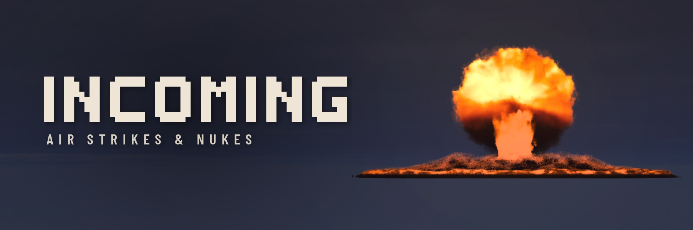
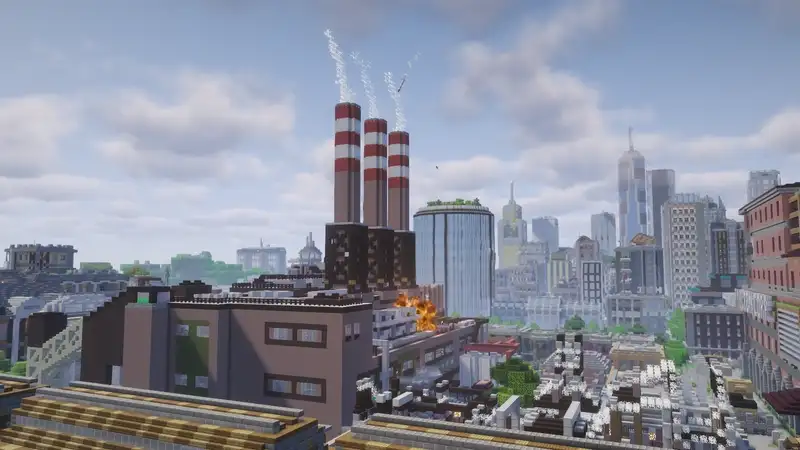
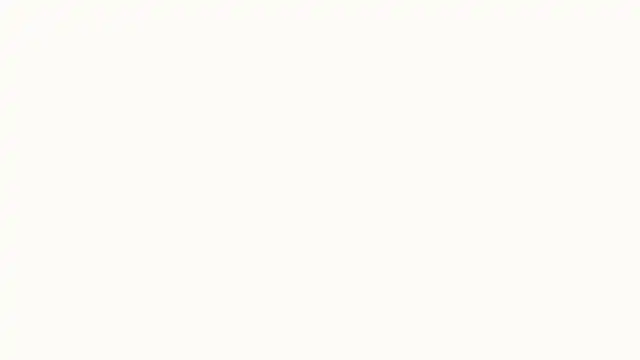

# Incoming: Air Strikes & Nukes

Air strikes and air defense for Minecraft 1.21.1.

Incoming adds air strikes with explosions, smoke, fires and block destruction, from drone attacks to nuclear strikes.
It includes six weapons, air defense and sirens, with a designator for choosing targets and planning salvos.

## Features

- **Explosions and aftermath:** fireballs light up nearby terrain, blasts break blocks and shatter windows, and dust and smoke rise and drift with the wind. Strikes can start fires; leftover fuel burns in the crater.
- **Blackout:** strike a transformer substation to cut electric lights in its district.

### Nuclear strikes

Flash, blast wave, mushroom cloud, fires and ruins. Ground bursts leave a crater and fallout downwind.
Launch an ICBM or fit a nuclear warhead to a cruise missile or B-2 bomb. By default for operators and the host of a single-player or LAN world.

### Weapons

- **Shahed-136:** send a drone toward a target, alone or in a salvo.
- **Lancet:** circle above the target, look through its camera and choose where to dive.
- **Cruise missile:** fly low over the terrain, then climb and dive into the target.
- **Grad:** fire unguided rockets across an area.
- **B-2:** call in a bomber with a bunker buster that penetrates the ground before exploding.
- **ICBM:** carries a nuclear warhead to the target after a warning period.

### Air defense and sirens

- **SAM:** shoots down hostile drones, cruise missiles and B-2s; it cannot intercept Grad rockets or ICBMs.
- **Sirens:** warn players near a target.

### Launching

- **Strike Designator:** aim through binoculars, or press Shift+RMB with it in hand to open the console: weapon, salvo, spread, target and map. Set routes, or watch through a projectile's camera.
- **Fixed launchers:** load ammunition, assign a target with the designator and fire with redstone, also from a Create Aeronautics aircraft in flight.

### For servers and modpacks

- **Events and commands:** scripts and other mods (KubeJS included) see every strike order, round, nuclear burst and power outage and can refuse an order, so a pack can set its own price, cooldown or scoring. Strikes take tags, `/incoming status` lists them, and `/incoming rule` changes world rules while the world runs.
- **Rules:** a permission mod such as LuckPerms decides who may launch; claims from Open Parties and Claims, FTB Chunks and others keep their blocks against every strike; FTB Teams and Open Parties and Claims parties are sides, and the SAM spares their rounds.
- **Signals:** advancements and statistics; redstone from the SAM during an air raid and from a working substation; Create Display Links, Jade and CC:Tweaked computers read the SAM and the fixed launcher.
- **Data:** recipes take common ingredients from other mods, and packs can give any worn item radiation shielding (Mekanism's hazmat suit works out of the box). See [For server owners and pack makers](https://github.com/zentixua/incoming/blob/main/docs/guide/packs.md).

## Requirements and dependencies

**Minecraft 1.21.1 · NeoForge 21.1.264+ · Java 21.** Incoming is required on the server and every client.
No other mods are required.

Create, Create Aeronautics with Sable, Distant Horizons, Voxy through Roxy, Iris, Vista, Jade, CC:Tweaked, Mekanism, FTB Teams and Open Parties and Claims are optional.
See [compatibility and supported versions](https://github.com/zentixua/incoming/blob/main/docs/guide/compatibility.md).

## FAQ

**Fabric or Forge?** This version is for NeoForge only.

**Other Minecraft versions?** Incoming currently supports 1.21.1.

**Can I use it in a modpack?** Yes, under the GPL-3.0 license.

**Client or server?** Both. It works in single-player, LAN worlds and dedicated servers. Use the same Incoming version on both sides.

**How demanding is it?** Large salvos, nuclear strikes and shaders can be demanding. See [performance help](https://github.com/zentixua/incoming/blob/main/docs/guide/faq.md#troubleshooting).

**Why do blasts break so little?** Each weapon carries the charge of the real one, and a block is a metre. A Shahed (50 kg of TNT) leaves a crater in soil about 2.4 m across and breaks brick walls within about 3 m; a cruise missile (about 150 kg) within about 7 m; a Grad rocket (6.4 kg) within about 1 m, so trees next to it can stay standing. What the blast leaves without support then falls: a missile in a ground-floor flat can bring down the storeys above it. Smoke and dust reach much farther than the damage, as in real footage. The default 15 kt nuke brings down brick buildings out to about 700 m and wooden ones out to about 1.3 km. See [what a blast does](https://github.com/zentixua/incoming/blob/main/docs/guide/weapons.md#what-a-blast-does).

**Nuke too big or too small for my world?** Choose the yield on the console, from 1 kt up to the world's limit (100 kt by default). The world owner can raise the limit up to 1 Mt with `nuclear.max_yield`, or shrink every nuclear distance: set `scale.scale_preset` to `CUSTOM` and lower `nuclear.effects_scale` (1.0 is true to life; at 0.1 a 15 kt blast brings down brick out to about 70 m). Open settings with the Settings button on the console (Shift+RMB with the Strike Designator) or under Mods → Incoming → Config; world settings can be changed there in a single-player world not opened to LAN, otherwise in `incoming-server.toml`. See [world settings](https://github.com/zentixua/incoming/blob/main/docs/guide/settings.md#world-settings).

**Can I protect builds?** The owner can restrict launches and disable destruction and fires in [world settings](https://github.com/zentixua/incoming/blob/main/docs/guide/settings.md#world-settings). Destruction is on by default.

## Links

[Player guide](https://github.com/zentixua/incoming/blob/main/docs/guide/README.md) · [Issues](https://github.com/zentixua/incoming/issues) · [Source](https://github.com/zentixua/incoming)

## License and credits

Made by ZentixUA. [GPL-3.0-only](https://github.com/zentixua/incoming/blob/main/LICENSE). [Sound credits](https://github.com/zentixua/incoming/blob/main/SOUND-CREDITS.md) · [Asset credits](https://github.com/zentixua/incoming/blob/main/tools/bake_fx/SOURCES.md).
Includes sable-companion and FastNoiseLite by Jordan Peck (MIT); fireball and smoke textures use JangaFX CC0 simulations.
