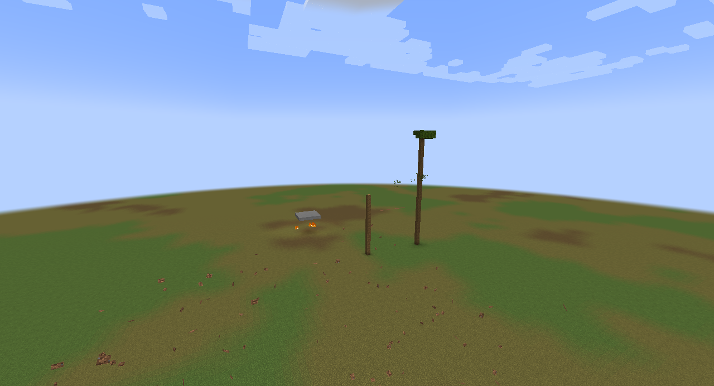
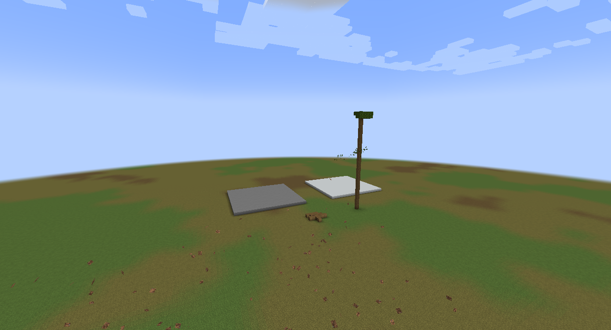
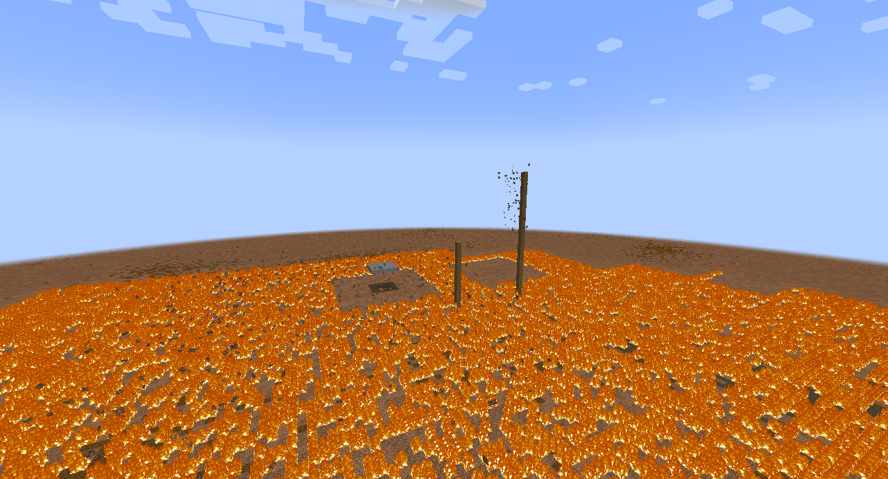
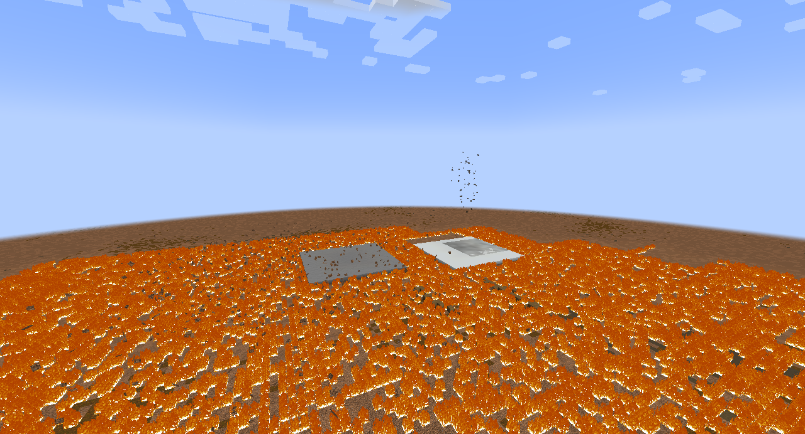
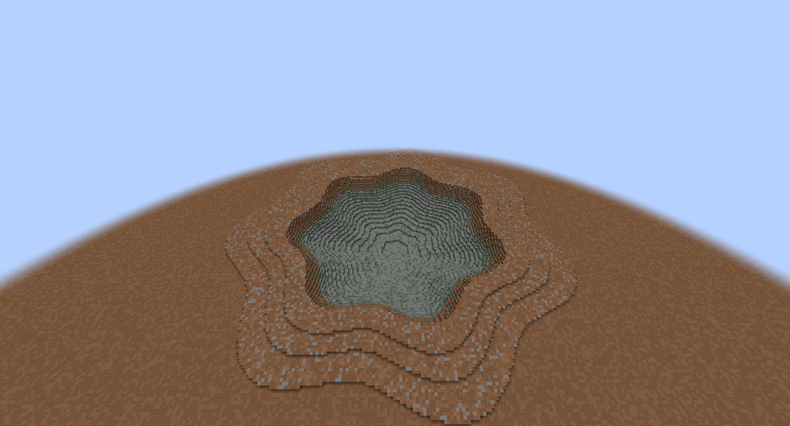
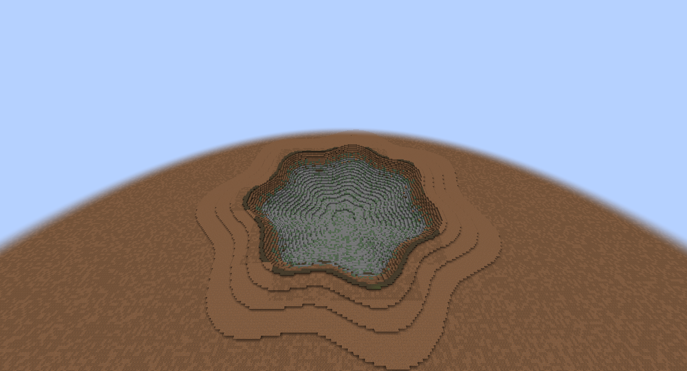

# MT-B2 final-head follow-up

PR #560, 4 November 2026. Final production head `f92dabaaac30bb04b3e9b07296be44a2602114c8`; paired main `8e3e2dc2848268dc1cb6953bf8900ece3a06598e`. No production code changed in this follow-up. Main already belongs to the PR ancestry through merge commit `3c6f54e87`; the final fetch found no newer main. [Итог](https://github.com/zentixua/incoming/actions/runs/41754368308/job/126329506319) remains green; `pr-ci.log` records the final check.

[Per-chunk cost including actual support continuation, all samples and B5 memory scope](cost-and-budget.md). The old **7.68 ms/chunk apply-only** is now explicitly beside **10.10 ms/chunk median apply + support**, cumulative across ticks (warm range 7.93–39.82 ms). The full material lifecycle is reported separately. Full ledger admission/compaction is deferred to B5 under the allowed large-change exception; no complete 512 MiB bound is claimed.

## Paired capture method

Waited for the GPU lease with `INCOMING_GPU_OWNER=MT-B2 tools/sandbox.sh start --wait`; no busy-queue cancellation. Final-head and main clients ran sequentially in separate fresh sandbox worlds, through virtual KWin with no host audio. Both clients stopped; the lease was released. No player instance, server, release or deployment was touched.

Both sides use the same archived evidence-only `Sandbox.capture.java.txt` fixture and patch. The head used the root worktree temporarily; its original Sandbox was restored byte for byte afterward. Main used the disposable `followup-main` worktree. Production source hashes were checked after capture: all 1348 head and 1342 main entries matched `source-identity.json`. Timing instrumentation belongs only to the separate CPU bench checkout, never the visual client.

The fixture has two 25×25 roofs on glass walls (stone and white concrete), a bare 16-block oak column and a 30-block oak trunk with a crown. The ground surface is Y=64 with deep stone beneath it. Each new scene uses a new site; the corresponding sites, cameras and effect commands match exactly across head/main. It is a local effects sandbox without a shaderpack or LOD mod, not a full-pack Iris/LOD acceptance claim.

Commands, in this order (use `final-main-*` or `final-head-*` names):

```sh
tools/sandbox.sh shot <prefix>-roof 'nuke 15 air near 2835' --at '-0.25,0.5,1,3,10' --wav 6 --cam '85 28 25 10'
tools/sandbox.sh shot <prefix>-tree 'nuke 15 air near 1000' --at '-0.25,0.5,1,3,10' --wav 6 --cam '85 28 25 10'
tools/sandbox.sh shot <prefix>-crater 'nuke 15 ground near 100' --at '0.1,0.5,1,3,10,30' --wav 6 --cam '200 100 180 -80'
```

**At +8 seconds the diagnostic fixture clears client FX. The +10/+30 images show geometry, not natural disappearance of the flash/pall.** Earlier frames and six-second WAVs retain normal effects. Frame age is relative to the sandbox front marker. The first requested crater +0.10 frame actually arrived at +0.178 s on main and +0.183 s on head; it is not pre-front evidence. Remaining frame ages differ from requests by at most 14 ms. All actual ages, source PNG hashes and audio metadata are in [capture-metadata.json](capture-metadata.json); `summarize_captures.py` reproduces the metadata without playback.

There are 32 PNG frames at 1280×692 and six 6-second stereo 48 kHz PCM WAVs. Paired RMS differences are about 0.07 dB (roof), 0.01 dB (tree), and under 0.01 dB (crater). These are numerical checks, not a new subjective listening verdict or a claim of identical waveforms. Production sound code/assets did not change.

## Geometry observations

Counters inspect original roof planes and original trunk columns at +10 s, not the entire material ledger. The bare column and crowned trunk are deliberately separate geometry cases. Exact log lines are in [geometry-counters.txt](geometry-counters.txt).

| Scene / original cells still occupied | Main | Final head |
|---|---:|---:|
| Weak zone: stone roof blocks at original roof plane | 49 | 0 |
| Weak zone: concrete roof blocks at original roof plane | 0 | 0 |
| Weak zone: bare oak column | 16 | 1 |
| Weak zone: tall crowned oak trunk | 30 | 30 |
| Strong zone: stone roof blocks at original roof plane | 47 | 0 |
| Strong zone: concrete roof blocks at original roof plane | 0 | 0 |
| Strong zone: bare oak column | 14 | 0 |
| Strong zone: tall crowned oak trunk | 29 | 0 |
| Ground burst: crater-center top non-air Y at +30 s | 46 | 46 |

Final-head roof material lies at the base; main leaves a floating stone patch and loses most roof material. The weak-zone crowned tree stays; the strong-zone trunks fall on the head. The crater center has the same sampled depth while its rim uses excavated material instead of the main decorative palette. The single-column crater value is not a full surface-volume measurement. Material balances and review regressions remain covered by the existing registered GameTests, not inferred from pixels.

| Main 8e3e2dc28 | Final head f92dabaaa |
|---|---|
|  |  |
|  |  |
|  |  |

Complete sequences and WAVs are in the six linked capture folders; `head-client.log`/`main-client.log` retain the full logs. Earlier evidence in the archive remains historical and is superseded by these final-head pairs.
