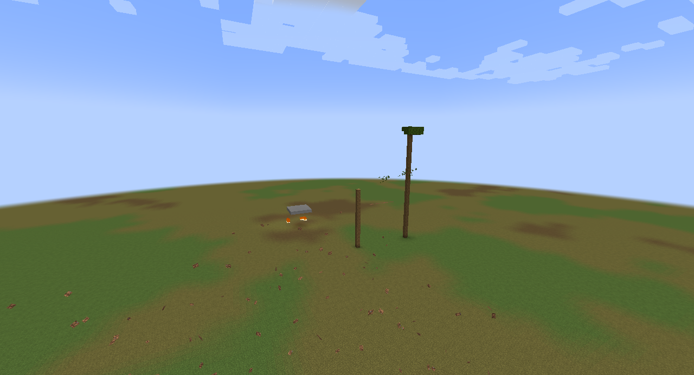
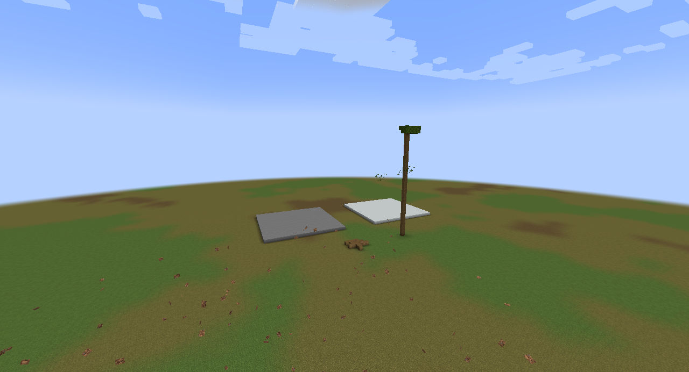
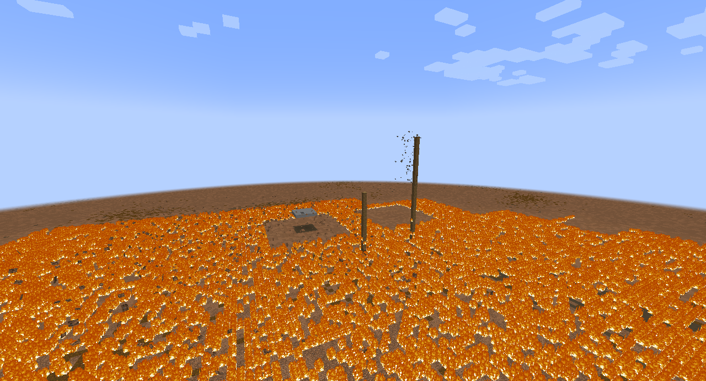
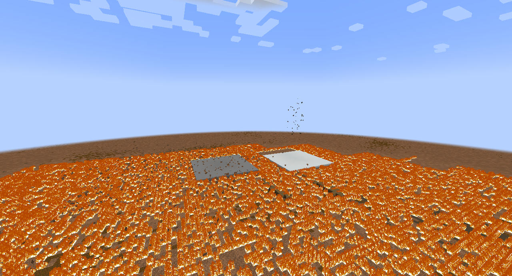
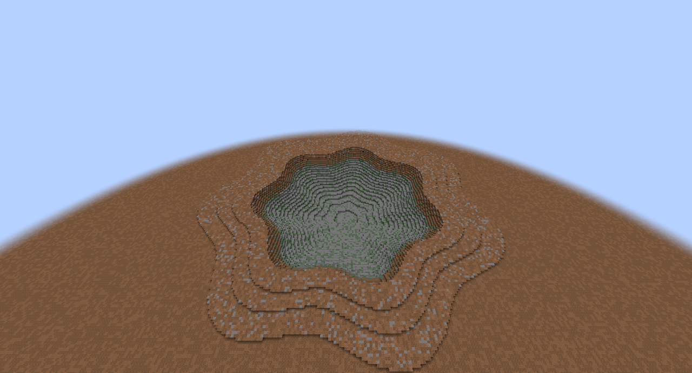
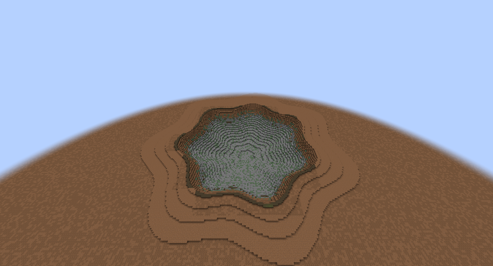

# Paired sandbox frames

Baseline is `292f3153636952a8168da493e717952ec680c396`; PR source is recorded in `source-identity.json`. Both copies use the same disposable structural fixture. Actual frame ages and framebuffer dimensions belong to each `capture.json` and PNG; file names contain requested ages.

**At +8 s, the disposable fixture clears client effects. Frames at +10 s and +30 s expose authoritative geometry; they do not establish normal dust visibility. Earlier frames and WAV retain ordinary effects.**

| Scene | Baseline | PR |
|---|---|---|
| Weak-zone roofs and timber |  |  |
| Strong-zone tall tree |  |  |
| Ground-burst crater |  |  |

The airburst cases use 15 kt, near ranges 2835 m and 1000 m, camera `85 28 25 10`. The ground-burst case uses 15 kt, near range 100 m, camera `200 100 180 -80`. All use the virtual muted sandbox, day, test wave speed 1.0. The ordinary client renderer/audio are unchanged. The crater camera views the burst 100 m north of the fixture point; its capture clock is wave arrival at that fixture point.

Full sequences:
- [main-material-roof frames, capture manifest and WAV](material-sandbox/main-material-roof)
- [final-source-roof frames, capture manifest and WAV](material-sandbox/final-source-roof)
- [main-material-tree frames, capture manifest and WAV](material-sandbox/main-material-tree)
- [final-source-tree frames, capture manifest and WAV](material-sandbox/final-source-tree)
- [main-material-crater frames, capture manifest and WAV](material-sandbox/main-material-crater)
- [final-source-crater frames, capture manifest and WAV](material-sandbox/final-source-crater)

During failure and fall, existing representative block-textured fragments show the motion. They are not a one-to-one full-block rendering of every authoritative material record. Numeric GameTests separately verify no deposition before travel, source/destination identity, save/reload and stable settlement.

At 100 m the ground-burst front is already at the fixture when the client observes the event. Its requested −0.25 s image was captured after arrival; `age` is authoritative, and that image is not pre-front evidence. The final crater pair uses clean worlds and the same absolute fixture site and camera. Small stochastic glazing/wobble details are not a pixel-equality assertion; profile and source balances are checked separately.
