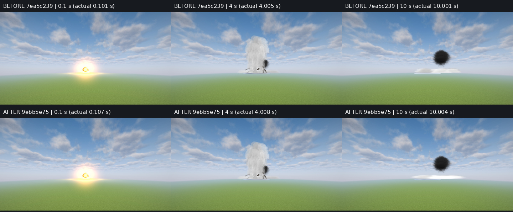
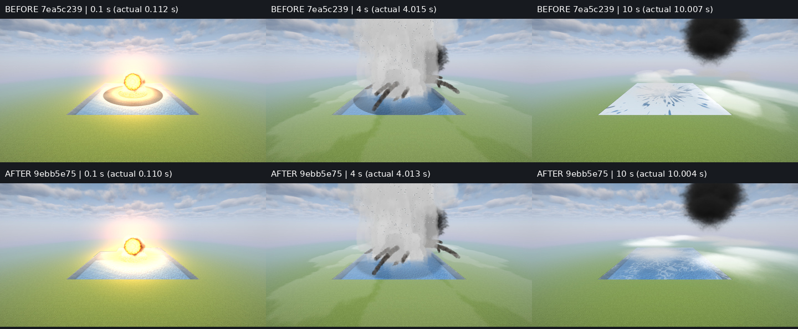
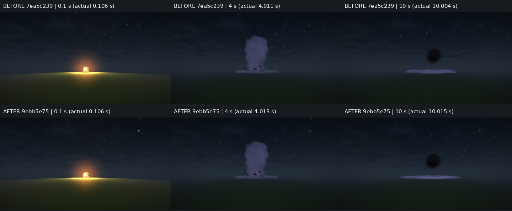

# WT — final visual polish, 24 October 2026

## Existing rendering reused

| Available | Use in this pass |
| --- | --- |
| WaterDecal noise and per-ring profile | World-space patch/lace coverage without a new texture, renderer or dependency. |
| Sorted SmokePuffs and baked puff6 atlas | Diffuse fine-droplet mist after the ballistic jets have landed. |

## Scope and review

Artem relayed Claude's approval of the core model, class test and main/3.4.1 visual comparison. This pass addresses the three requested presentation details. It changes neither WaterBlast nor its charge/depth law, trajectories, dimensions, mass or timing. The extra jet-detail and nearest-first ring-slot suggestions were optional and are left out of this small pass. Audio is unchanged; the original reviewed WAVs remain in [the core report](README.md#audio).

- Ordinary foam now has world-space warped patches and irregular lace, with a maximum composited foam opacity of 0.6. Water remains visible, and the polar dark spokes are gone. The underlying foam coverage/lifetime is unchanged. Ordinary rings carry a B-channel flag; the nuclear compositor path retains its original foam rendering.
- The ring profile now ends at waveRadius(t), without max(columnRadius, waveRadius). Wave shading fades smoothly at the leading edge and is limited to 0.35. The front radius and foam values still come from the unchanged model. A regression test checks the actual front and soft bounded edge at 0.1, 1, 4 and 10 seconds.
- Once the final jet lands, the fine mist switches from the falling spray6 atlas to diffuse puff6. This removes the stretched falling-spray streaks. The low thin mist ring remains, as required by its existing geometry; no extra height, water removal or smaller physical extent hides it. The 4-second spray column retains spray6.

## Before / after

Top row is reviewed core 7ea5c239; bottom row is final 9ebb5e75. Both are based on main 4498ecfc. Same effect (`blast drone 1 0 water`), payload seed, pond, cameras, Iris and Complementary Unbound r5.9.3. Quiet power mode; these frames are not a benchmark. Day cameras: `170 12 0 40` and `70 25 0 0`; night uses the first camera. The close view intentionally crops the column top. The pond is 65×65 blocks, four water blocks deep. Wind depends on world gameTime and was not frozen; smoke drift differs between takes.

The requested moments are 0.1, 4 and 10 seconds; exact ages appear on each tile and in capture JSON. Final day ages: 0.107 / 4.008 / 10.004 s; close: 0.110 / 4.013 / 10.004 s; night: 0.106 / 4.013 / 10.015 s. Warm-up and the first day take (late 0.271 s opening) are excluded. JPEG copies use quality 96 without colour/contrast changes; JSON keeps the original PNG names. Original PNGs remain in the WT sandbox output on the laptop.

Full final frames and JSON: [day](polish_day_final), [surface](polish_near), [night](polish_night). Full before frames/JSON: [day](wt_day), [surface](wt_near), [night](wt_night). The accepted main/3.4.1 and community references remain in [the core report](README.md).

Author's frame check: the 10-second surface reads as translucent foam with water visible through lace; the early hard dark ring is gone; late mist is diffuse without the directional falling-spray lines. The physical low layer is still visible above the shore. The 4-second column has the same substance and scale. Final acceptance belongs to Claude's requested follow-up review.

## Validation

- Local `./gradlew --daemon build`: 1221 JUnit tests, zero failures/errors/skips.
- Local `./gradlew runGameTestServer -PgametestOnly=blast_ground_under`: 1/1 passed.
- Current head 9ebb5e75: full CI, including Итог and Записка, green on its first attempt. Previous heads' diagnostics remain in the core report and were not erased or reclassified.
- Local log: `/mnt/data/projects/incoming/mod/run/wt-WT-dl/polish-check.log`.
- Own sandbox stopped and GPU lease released after captures. No personal game, instance, world, settings, server, modpack or release changes.
