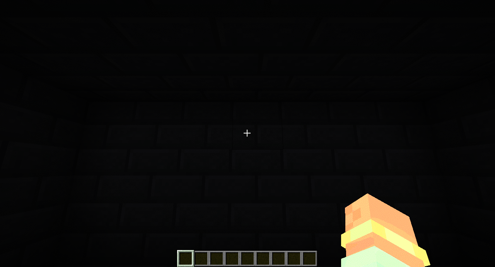
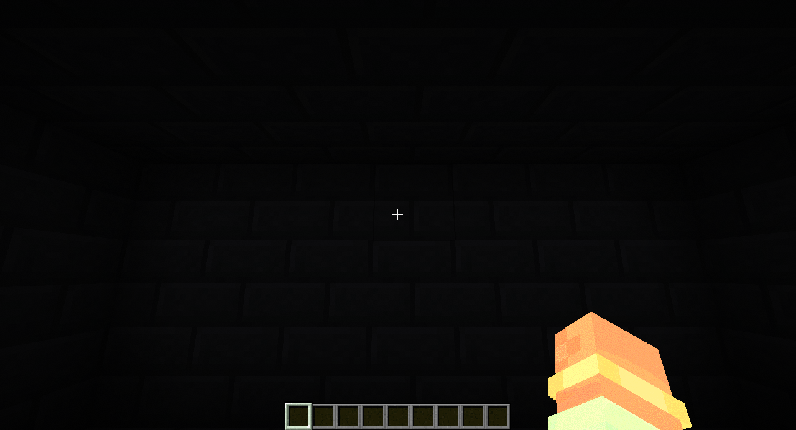
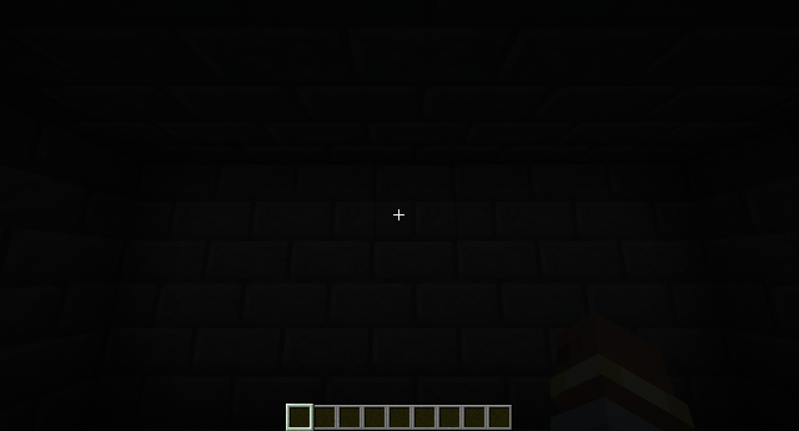
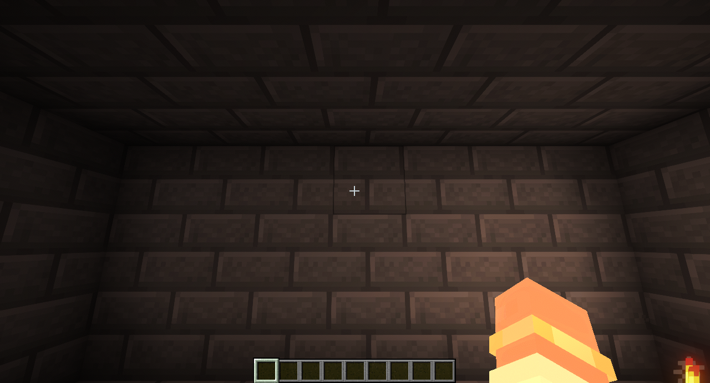
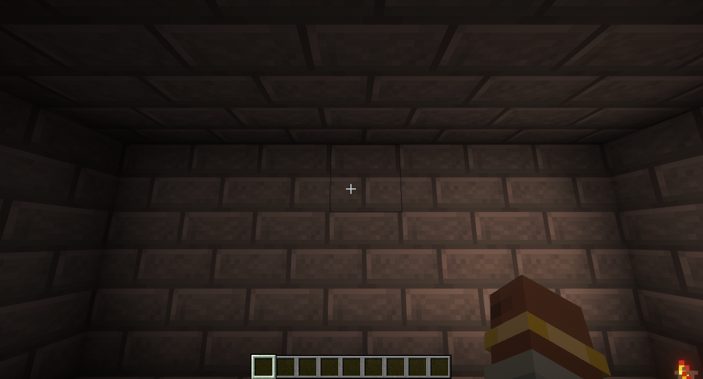
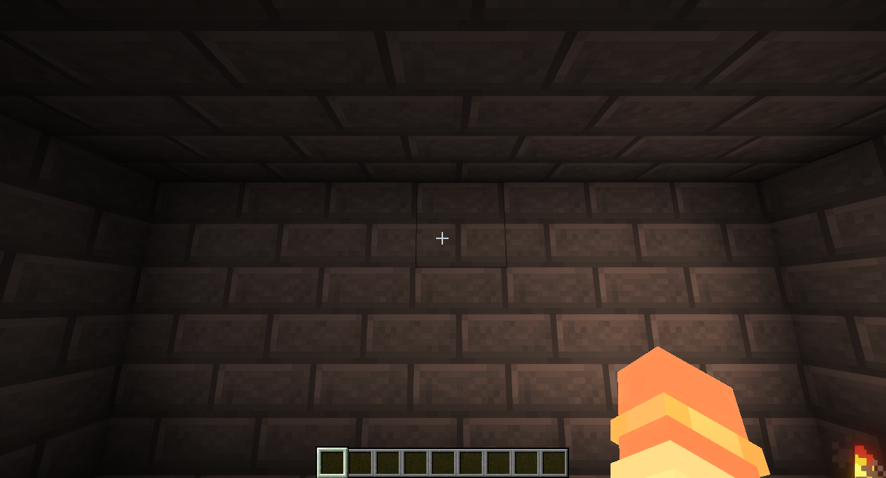
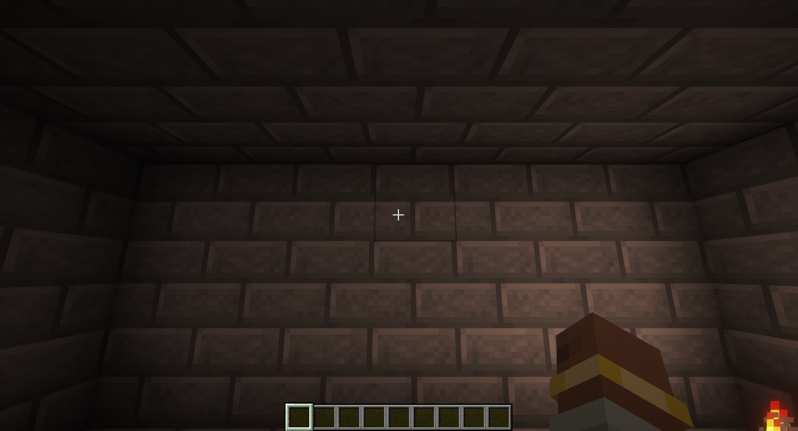
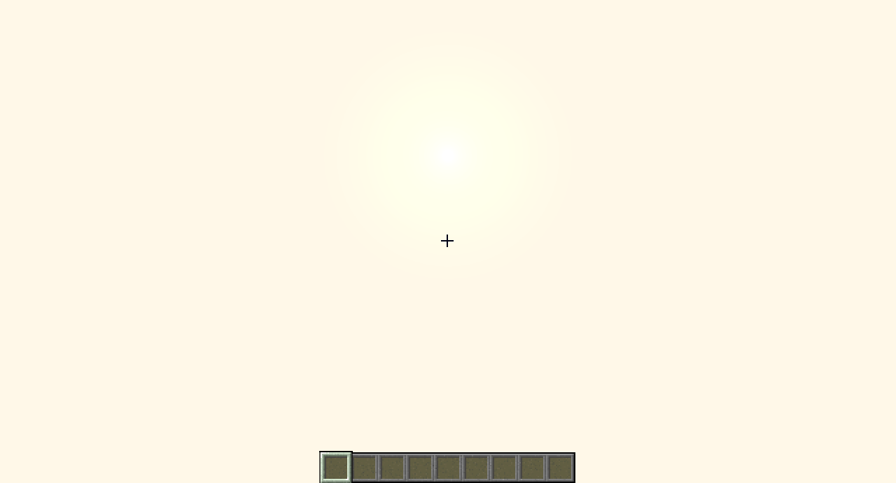
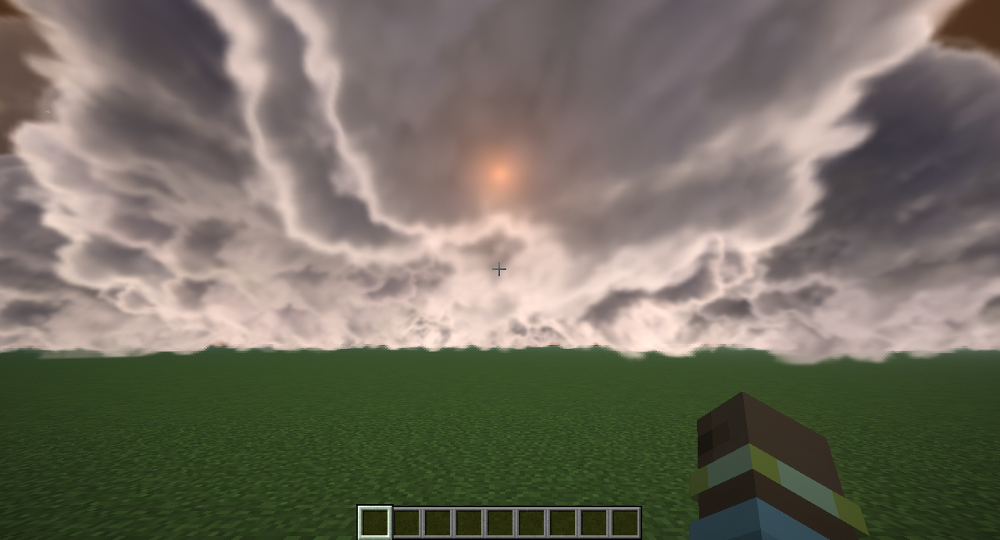

# First-person hand admission — PR #643 integration

Before: merge commit c55c3dc4c (main including LIGHT and FLASHCAM in the release candidate), without the hand opening gate. After: f215898e7. Both use the same temporary devtest-only creative-mode substitution in flashCameraSetup to show the hand; the fixture was restored before commit. No production changes beyond the gate separate these captures.

Complementary Unbound, 1280x720 virtual display, original 1280x692 PNGs, 1 Mt night, 4550 m ground range, 2400 m HOB, client-only source. Each pair has matching local geometry, source seed and detonation-relative ages; translated sandbox sites keep earlier rooms out of the shot. Raw sky/block light: sealed 0/0, torch 0/9, open 15/0. Capture metadata is retained alongside the images. No image editing.

| Scene / time | Before | After |
|---|---|---|
| sealed / 1 s |  |  |
| sealed / 3 s |  |  |
| torch / 1 s |  |  |
| torch / 3 s |  |  |
| open / 1 s |  |  |
| open / 3 s |  |  |
